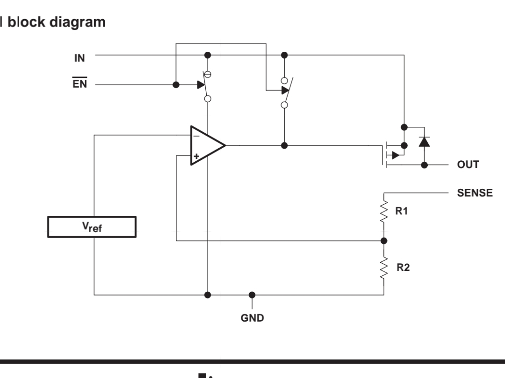

# 第一章 开关电源设计

> 本章涵盖 Buck 电路方案选择、测试常见问题、开关损耗与降频策略，以及 LDO 线性稳压电源。

## 1.1 Buck 电路方案选择

### 1.1.1 场景判断

当输入输出压差较大（V<sub>in</sub> - V<sub>out</sub> ≥ 10 V）、且负载电流超过 3 A 时，优先选择**全桥（同步）驱动 Buck**。

选择高侧驱动方案时，应尽量避免**带电流保护**的高侧驱动——负载跳变时电流保护可能误触发，导致高侧 MOS 关断，出现掉电现象。

### 1.1.2 同步 Buck 的优点

- MOS 导通电阻低，热损耗小。常用同步 MOS 的导通内阻约 7 mΩ。
- 以 12 V / 5 A 的 Buck 为例，导通损耗：

$$
P_{cond} = I^2 R_{ds(on)} = 5^2 \times 7\text{ m}\Omega \approx 175\text{ mW} \qquad (1.1)
$$

- Buck 由两颗 MOS 构成，**热量由两颗 MOS 分担**，热效应进一步降低。

### 1.1.3 同步 Buck 的缺点

- 需要两颗低内阻 MOS，**成本更高**。
- 外围电路器件较多。
- 低端 MOS 需要**回流到芯片的地平面**形成回路，容易受到地平面干扰。部分场合需将模拟地与数字地通过 0 Ω 电阻**单点连接**，避免串扰。

### 1.1.4 并联 MOS 方案

重载 Buck 中，仅靠两颗 MOS 作为开关器件可能热效应不达标。此时可采用**多 MOS 并联**，降低总导通内阻、分摊热量。并联时注意：

- 选择同批次、同封装的 MOS；
- 布局对称，保证均流；
- 栅极单独串联电阻，避免相互振荡。

## 1.2 Buck 电路测试常见问题

### 1.2.1 谐振现象

测试中常看到 SW 波形上叠加**正弦振荡**，本质是**寄生参数 LC 回路的衰减谐振**。

- LC 谐振波形会耦合到 SW 节点；
- 根源是开关回路的寄生电感与 MOS 结电容、PCB 寄生电容构成的谐振；
- **Layout 要求**：开关回路尽可能短；地平面保持完整；避免分割地平面导致回流路径过长，加重寄生电感。

### 1.2.2 纹波测试要点

- 使用**对地弹簧（地环）**，缩短示波器探头的地回路；
- 减少探头回路寄生参数对输出波形的影响；
- 探头尽量靠近输出电容、被测点。

## 1.3 开关损耗与降频策略

### 1.3.1 开关损耗公式

开关管导通/关断不是瞬间完成的，存在交叠区（米勒平台）。开关损耗近似为：

$$
P_{sw} \approx \frac{1}{2} V_{in} I_{out} (t_{on} + t_{off}) f_{sw} \qquad (1.2)
$$

- V<sub>in</sub>：输入电压；
- f<sub>sw</sub>：开关频率；
- I<sub>out</sub>：输出电流。

### 1.3.2 为什么高输入电压要降频

由式 (1.2) 可见，P<sub>sw</sub> ∝ V<sub>in</sub> f<sub>sw</sub>。当输入电压升高时，若保持 f<sub>sw</sub> 不变，开关损耗会**线性上升**。

在高压（数百伏）、大电流工况下，不降频会使开关管迅速过热甚至烧毁。因此**降频**本质上是把开关损耗拉回到与低压输入时相当的水平，保证热设计可靠性。

## 1.4 LDO 线性稳压电源

### 1.4.1 组成与原理

LDO（Low Dropout Regulator）由**一个 MOS（通常为 PMOS）**和一个**运算放大器**构成：

- 运放作为**误差放大器**；
- 输出电压经电阻分压后送入运放正极，与**基准源**比较；
- 误差信号控制 PMOS 栅极，调整 V<sub>ds</sub> 压降，形成闭环稳压。



### 1.4.2 效率与损耗

LDO 是线性稳压器，输入电流约等于输出电流，多余电压全部降在 PMOS 上：

$$
\eta \approx \frac{V_{out}}{V_{in}} \qquad (1.3)
$$

$$
P_{loss} = (V_{in} - V_{out}) I_{out} \qquad (1.4)
$$

- PMOS 的导通损耗 + 运放自身损耗，决定了 LDO 效率上限；
- 压差越大、效率越低，只适合**小压差、小电流、低噪声**场合。

## 1.5 Ćuk 变换器

### 1.5.1 拓扑与特点

Ćuk 变换器是一种**非隔离 DC-DC 拓扑**，用**两个电感 + 一个耦合电容**实现升降压，输出为**负极性**：

```
      L1              C1
Vin ─/\/\/──●────────||────────●──/\/\/── Vout(负)
             │                  │    L2
            SW                 D
             │                  │
            GND                GND
```

- **L<sub>1</sub>**：输入电感
- **C<sub>1</sub>**：耦合电容（能量传输核心）
- **L<sub>2</sub>**：输出电感
- **SW / D**：开关管、二极管

能量传递方式：**电感充能 → 耦合电容搬运 → 电感放能**，而不是像 Buck / Boost 那样由电感直接传能。

### 1.5.2 变换比

$$
V_{out} = -\frac{D}{1-D} V_{in} \qquad (1.5)
$$

### 1.5.3 核心优点：输入输出电流都连续

- L<sub>1</sub> 让**输入电流连续**
- L<sub>2</sub> 让**输出电流连续**
- 结果：**输入 / 输出纹波都小**，EMI 好、对电容应力小——这是它相对 Buck-Boost 的最大优势

### 1.5.4 缺点

- **耦合电容 C<sub>1</sub> 体积大**：承担全部功率，纹波电流大，需要大容量、高耐压、高纹波电流的电容
- **输出反极性**
- **CCM 下有右半平面零点（RHP zero）**，限制控制环路带宽
- 元件多（2 个电感 + 大电容）

### 1.5.5 与其他非隔离拓扑对比

| 拓扑 | 输出极性 | 输入电流 | 输出电流 |
| --- | --- | --- | --- |
| Buck-Boost | 反 | 断续 | 断续 |
| **Ćuk** | **反** | **连续** | **连续** |
| SEPIC | 同 | 断续 | 连续 |
| Zeta | 同 | 连续 | 断续 |

> 想要"低纹波"选 Ćuk（双连续）；想要"正输出"选 SEPIC / Zeta。

### 1.5.6 典型应用

| 场景 | 为什么用 Ćuk |
| --- | --- |
| PFC（功率因数校正） | 输入电流连续，EMI 低 |
| 电池供电、低纹波电源 | 双连续电流，纹波小 |
| 负电压生成 | 反极性输出 |
| 隔离电源 | 隔离 Ćuk |

## 1.6 PFC（功率因数校正）

### 1.6.1 什么是 PFC

PFC 的目标不是"升压"，而是**让输入电流和输入电压同相、成正比**，使负载"看起来像纯电阻"，功率因数接近 1：

$$
\text{PF} = \frac{P}{V_{rms} \cdot I_{rms}} \qquad (1.6)
$$

- 普通整流桥 + 电容：输入电流是**尖峰脉冲**，PF 只有 0.5~0.6，谐波大
- PFC 电路通过控制开关，把输入电流"修"成正弦

### 1.6.2 最常用：Boost PFC

```
市电 AC → 整流 → 0~Vpeak 的脉动直流 → Boost 变换器 → 稳定 DC（如 400 V）
```

Boost PFC 干两件事：

1. **升压**：把脉动直流升到稳定直流（输出必须 > 输入峰值）
2. **整形电流**：让输入电流跟随整流后的正弦波形（这才是"PFC"的核心）

### 1.6.3 为什么 Boost 是 PFC 主流

1. **输入电流连续**（电感在输入端）→ 电流平滑、EMI 低、容易整形
2. **输出天然高于输入峰值**（PFC 输出通常 400 V，正好 > 220 V 的峰值 311 V）
3. **拓扑简单、效率高、驱动容易**

### 1.6.4 PFC 拓扑不止 Boost

| 拓扑 | 输入电流 | 输出 | 用途 |
| --- | --- | --- | --- |
| **Boost PFC** | **连续** | > 输入峰值 | **最主流**（400 V 母线） |
| Buck PFC | 断续 | < 输入峰值 | 低压输出 |
| Buck-Boost PFC | 断续 | 任意 | 通用 |
| SEPIC PFC | 断续 | 非反相 | 中等功率 |
| **Ćuk PFC** | **连续** | **反极性（负）** | 低功率、LED |
| 无桥 / Totem-pole PFC | — | — | 高效（SiC / GaN） |

### 1.6.5 Ćuk 能做 PFC 吗

**能，但不是主流。**

- 优点：输入电流连续（L<sub>1</sub> 在输入端）→ EMI 低，电流容易整形
- 缺点：输出是负极性，和常规正 DC 母线不匹配，用起来不方便
- 所以 Ćuk PFC 主要用于**低功率、LED 驱动、需要负电压**等特殊场合
