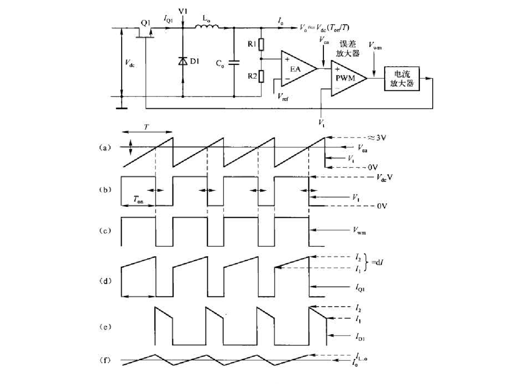
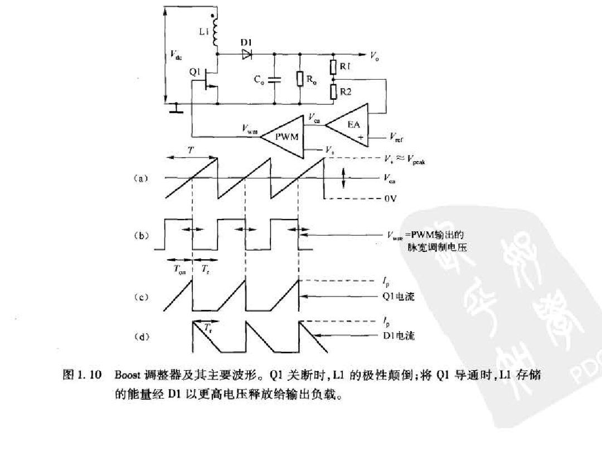
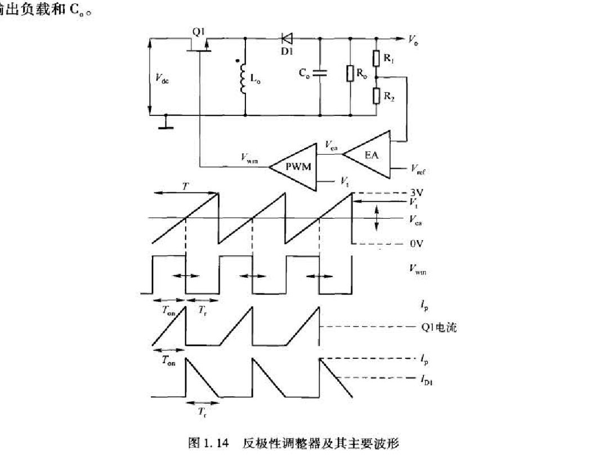
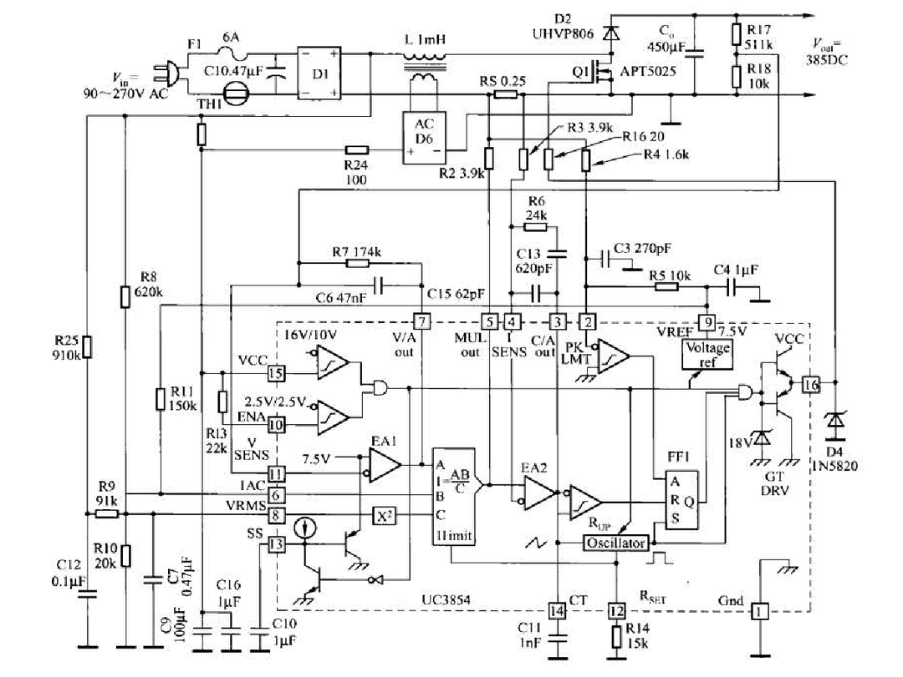
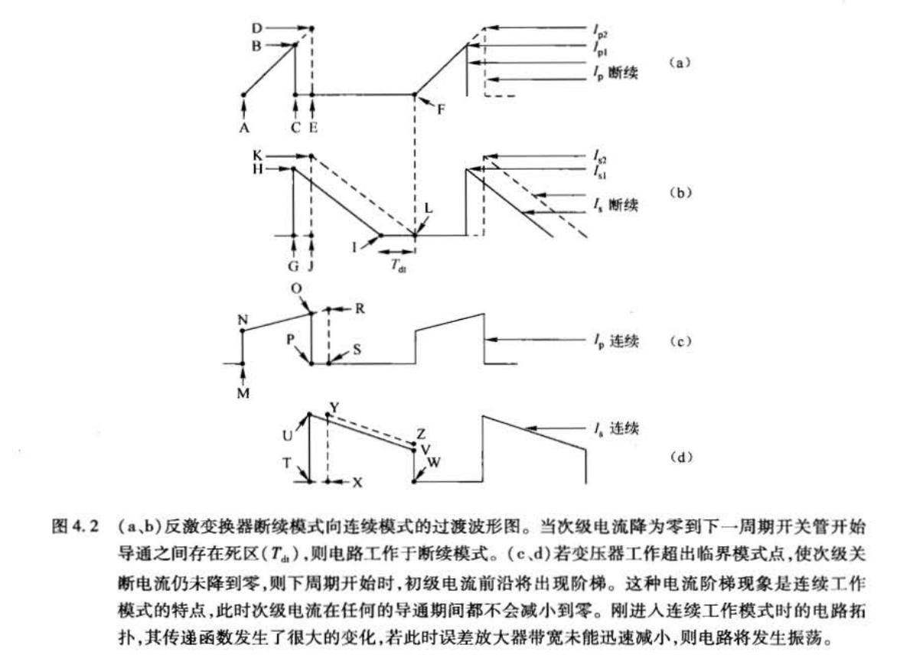
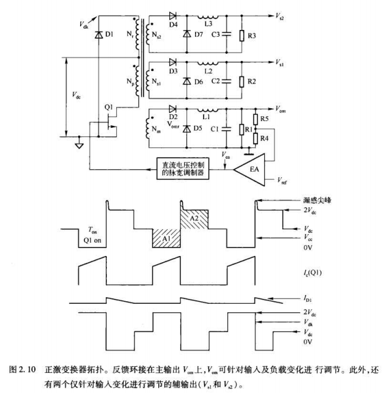
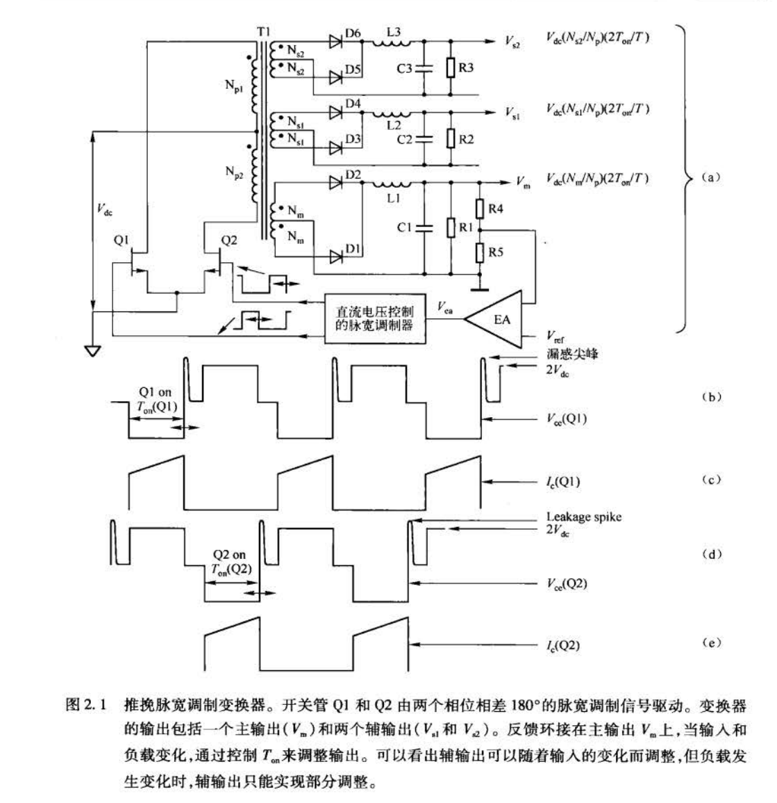
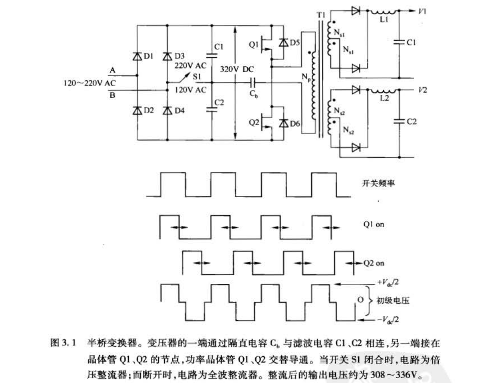

# 第一章 开关电源设计

> 本章从"开关电源的核心思想"出发，讲清 Buck / Boost / Buck-Boost 的**工作原理、数学本质与物理本质**，再展开方案选择、测试问题、开关损耗、LDO，以及 Ćuk 与 PFC。文中公式一律"**由物理过程引出，再逐项解读**"，并与后续章节（MOSFET、元件）**融会贯通**。

## 1.1 开关电源的核心思想

### 1.1.1 为什么用"开关"

线性稳压器（LDO）用"可变电阻"分压，多余电压全部转化为热，效率上限为 Vout/Vin。

开关电源用**开关管（全开/全关）+ 储能元件（电感/电容）**：

- 开关管只工作在两种状态：**大电流小压降**（导通）或 **大压降零电流**（关断）
- 这两种状态下"电压 × 电流"都很小，因此**理论效率接近 100%**

### 1.1.2 工作原理

```
Vin ──[开关管]──[储能元件 L/C]──▶ Vout
         │
        PWM（占空比 D）
```

- 开关管以频率 fsw 通断，占空比 D = ton / Ts
- 电感/电容把斩波后的方波"平均"成平滑直流
- 负反馈调节 D，使 Vout 稳定

### 1.1.3 数学本质

输出电压由**占空比**决定：

$$
V_{out} = f(D) \cdot V_{in} \qquad (1.1)
$$

不同拓扑对应不同 f(D)：Buck 为 D、Boost 为 1/(1−D)、Buck-Boost 为 D/(1−D)。

### 1.1.4 物理本质

开关电源**并不耗散多余能量**，而是通过"**改变能量传递的时间比例**"控制输出：

- 电感存储磁能 ½Li²，电容存储电能 ½Cv²（元件详细特性见[第三章 3.2 / 3.3](第三章-电源原理图常识.md)）
- 开关将能量分段地从输入传递到输出，储能元件负责"平滑电压与电流的波动"
- 开关频率越高 → 能量传递越频繁 → 储能元件可以越小

> **融会贯通**：本章讲的"开关管承担 V-I 交叠损耗"会在[第五章 5.8](第五章-MOSFET特性与选型.md) 里用 MOSFET 的 RDS(on)、Qgd、Coss 精确展开；这里先建立"能量传递"的物理图像。

## 1.2 三种基本拓扑：工作原理、数学与物理

### 1.2.1 Buck（降压）

**工作原理**（两个状态）：

- **S 导通、D 截止**：Vin → L → 负载，电感储能，iL 上升
- **S 关断、D 导通**：L 经 D 续流，iL 下降，能量释放给负载

**物理过程**：电感在导通时"存能量"、在关断时"放能量"，输出电容把断续的电流"填平"。



**图中讲解**：

- **电路部分**（上方）：V_dc 为输入，Q1 为开关管，D1 为续流二极管，L_o 为电感，C_o 为输出电容，R1/R2 为反馈分压，EA 为误差放大器，PWM 为比较器——这是一个完整的"电压模式" Buck 闭环。
- **波形 (a) V_ca**：误差放大器输出，与锯齿波比较后决定占空比。
- **波形 (b) V_wm**：PWM 输出，即开关管 Q1 的驱动信号（高电平导通、低电平关断）。
- **波形 (c) V_i**：开关节点（Q1 与 D1 的连接点）电压，在 V_dc 与 0 之间跳变。
- **波形 (d) I_Q1**：流过开关管的电流，导通期间上升，关断期间为零。
- **波形 (e) I_D1**：流过二极管的电流，关断期间续流，导通期间为零。
- **波形 (f) I_L**：电感电流，连续的三角波——这正是"电感储能/放能"的直观体现。

**读图要点**：Q1 导通时 I_Q1 = I_L、D1 截止；Q1 关断时 I_D1 = I_L、Q1 截止。电感电流"连续"，正是 Buck 输出平滑的根本原因。

**由物理引出公式（伏秒平衡）**：稳态下电感电压一周期积分必须为零（否则电流会一直涨/跌）：

$$
(V_{in} - V_{out})\, D T_s + (-V_{out})\, (1-D) T_s = 0 \qquad (1.2)
$$

**逐项解读**：

- 第一项 `(V_in − V_out)·D·T_s`：**导通期间**电感两端的正伏秒（能量充入）
- 第二项 `(−V_out)·(1−D)·T_s`：**关断期间**电感两端的负伏秒（能量放出）
- 两项相加为 0：**充入 = 放出**，本质是能量守恒

整理得：

$$
V_{out} = D \cdot V_{in} \qquad (1.3)
$$

**电感电流纹波**（导通期间电感电压驱动电流上升）：

$$
\Delta I_L = \frac{(V_{in} - V_{out})\, D T_s}{L} \qquad (1.4)
$$

- **逐项解读**：ΔI ∝ (Vin−Vout)·D·Ts / L——压差越大、占空比越大、频率越低、电感越小，纹波越大

**输出纹波电压**（电容"安秒平衡"：一周期内电容电流积分为零）：

$$
\Delta V_{out} \approx \frac{\Delta I_L}{8 f_{sw} C} \qquad (1.5)
$$

- **逐项解读**：纹波与电感电流纹波成正比，与频率、电容成反比；所以"加大电容/提高频率"能减小纹波

**物理本质**：

- **电感是"能量搬运工"**：导通时把能量从输入存进磁场（½Li²），关断时把磁能释放给负载。能量没有"耗散"，只是"暂存—释放"。
- **伏秒平衡的本质是能量守恒**：每周期电感"充入"的伏秒必须等于"放出"的伏秒，否则电感电流会无限增长（饱和）或衰减到零（停振）。
- **为什么需要输出电容**：电感电流是"三角波"（脉动），电容把它"平滑"成近似直流。电容与电感是"一对搭档"——电感稳电流，电容稳电压。
- **为什么电感不能太大也不能太小**：太大 → 响应慢、体积大；太小 → 纹波大、易进入 DCM。
- **设计巧思**：Buck 只用"开关 + 二极管 + 电感 + 电容"四件套，就把"斩波"变成了"平滑直流"，结构最简单、效率最高，因此是应用最广的拓扑。

### 1.2.1.1 Buck 的 DCM 分析

前面讨论的是 CCM（连续导通模式）。当负载较轻时，电感电流会在关断结束前降到零，进入 **DCM（断续导通模式）**。

**DCM 的三个阶段**：

1. **导通阶段**：S 导通，电感电流从 0 线性上升，储能
2. **放电阶段**：S 关断，电感经 D 续流，电流线性下降
3. **空闲阶段**：电感电流降到零，D 截止，负载由电容供电

**DCM 变换比**：

$$
\frac{V_{out}}{V_{in}} = \frac{2D}{2D + D_{2}} \qquad (1.32)
$$

其中 D2 为放电时间占比。

**物理本质**：DCM 下，变换比不仅取决于 D，还取决于 D2（与负载有关）。轻载时 D2 减小，输出电压升高——这是 DCM 下"负载调整率变差"的原因。

**CCM 与 DCM 的对比**：

| | CCM | DCM |
| --- | --- | --- |
| 电感电流 | 始终 >0 | 每周期到零 |
| 变换比 | 仅与 D 有关 | 与 D、负载有关 |
| 电流应力 | 小 | 大（峰值高） |
| 环路 | 二阶（LC） | 一阶 |
| 效率（轻载） | 低（开关损耗占比高） | 高（可降频） |

**工程意义**：DCM 下没有 RHP 零点（对 Boost/Buck-Boost），环路容易补偿；但峰值电流大、EMI 大。轻载时进入 DCM，可采用"跳频"降低开关损耗。

### 1.2.2 Boost（升压）

**工作原理**：

- **S 导通**：Vin → L 储能，iL 上升；D 反偏，负载由电容供电
- **S 关断**：Vin + 电感反电动势 → D → 负载，给电容和负载充电



**图中讲解**：

- **电路部分**：L1 为电感（串联在输入），D1 为二极管（接输出），Q1 为开关管（对地），C_o 为输出电容，R1/R2、EA、PWM 构成闭环。
- **波形 (a) V_ca**：误差放大器输出与锯齿波比较，决定占空比。
- **波形 (b) V_wm**：PWM 输出，即 Q1 的驱动信号。
- **波形 (c) I_Q1**：开关管电流，导通期间上升（L1 储能）。
- **波形 (d) I_D1**：二极管电流，关断期间上升（L1 把能量释放到输出）。

**读图要点**：Q1 导通时，L1 接输入、储能，D1 反偏；Q1 关断时，L1 的反电动势**叠加**在输入电压上，经 D1 把能量"顶"到更高的输出。这正是 Boost"升压"的物理图像。

**由物理引出公式**：

$$
V_{in}\, D T_s + (V_{in} - V_{out})\, (1-D) T_s = 0 \qquad (1.6)
$$

**逐项解读**：导通时电感电压 = Vin（正伏秒）；关断时 = Vin−Vout（负伏秒）；两者相等 → 解出：

$$
V_{out} = \frac{V_{in}}{1-D} \qquad (1.7)
$$

**物理本质**：

- **升压的根源是电感的"反电动势"**：关断瞬间，电感电流不能突变，电感产生一个"反抗"电动势。这个电动势与输入电压**串联叠加**，把能量"顶"到更高的输出。
- **为什么输出电压一定高于输入**：因为关断时电感电压 = V<sub>out</sub> − V<sub>in</sub> > 0，即 V<sub>out</sub> > V<sub>in</sub>。占空比越大，电感储能越多，"顶"得越高。
- **为什么 D→1 时 V<sub>out</sub>→∞**：占空比越大，关断时间越短，同样的能量要在更短时间内释放，电压必然更高。实际中受器件耐压限制，D 不能太大。
- **为什么需要二极管 D**：关断时它让电感电流"只能往输出走"，不能倒流回输入；否则能量会倒灌。
- **为什么 Boost 的输入电流连续**：电感串在输入端，电流不能突变，所以输入电流连续——这是 Boost 做 PFC 的天然优势。

### 1.2.2.1 Boost 的 DCM 分析

Boost 在轻载时也会进入 DCM。三个阶段：

1. **导通阶段**：电感储能，iL 从 0 上升
2. **放电阶段**：电感向输出放能，iL 下降
3. **空闲阶段**：iL 降到零，输出由电容供电

**DCM 变换比**：

$$
\frac{V_{out}}{V_{in}} = \frac{1 + \sqrt{1 + \frac{4D^{2}}{K}}}{2}, \qquad K = \frac{2L}{R T_{s}} \qquad (1.39)
$$

**逐项解读**：

- DCM 下，升压比不仅取决于 D，还取决于 K（与负载、电感有关）
- 负载越轻（R 越大），K 越小，升压比越大
- 因此 DCM 下轻载时输出电压会"偏高"

**物理本质**：DCM 下，电感在每个周期都把能量"放完"，输出电压由"每次放多少"决定，而"放多少"与负载有关。这与 CCM 下"由占空比决定"不同。

**工程意义**：DCM 下没有 RHP 零点，环路容易补偿；但峰值电流大，适合小功率场合。

### 1.2.3 Buck-Boost（升降压）

**工作原理**（两个状态）：

- **S 导通**：Vin → L 储能，D 反偏，负载由电容供电
- **S 关断**：L 的反电动势使 D 导通，能量释放到输出，输出为**反极性**



**图中讲解**：

- **电路部分**：Q1 为开关管（对地），L_o 为电感（接在 Q1 与输出之间），D1 为二极管（方向与 Buck/Boost 相反），C_o 为输出电容。
- **波形 (a) V_ca**：锯齿波与误差放大器输出，决定占空比。
- **波形 (b) V_wm**：PWM 驱动信号。
- **波形 (c) I_Q1**：开关管电流，导通时上升（L_o 储能）。
- **波形 (d) I_D1**：二极管电流，关断时上升（L_o 放能）。

**读图要点**：与 Boost 相比，**开关管和二极管的位置"互换"**——Q1 在输入侧对地，D1 在输出侧。导通时 L_o 从输入储能，关断时 L_o 的极性反转、经 D1 把能量释放到输出，因此输出是**反极性**。

**由物理引出公式**：

$$
d\,V_{in} + (1-d)\,(-V_{out}) = 0 \qquad (1.8)
$$

**逐项解读**：导通时电感从输入储能（正伏秒 d·Vin）；关断时向输出放能（负伏秒 (1−d)·Vout）；两者相等 → 解出：

$$
|V_{out}| = \frac{D}{1-D} V_{in} \qquad (1.9)
$$

**三种工作模式**：

| 条件         | 占空比     | 工作模式 |
| ---------- | ------- | ---- |
| Vout < Vin | D < 0.5 | 降压   |
| Vout = Vin | D = 0.5 | 等压   |
| Vout > Vin | D > 0.5 | 升压   |

**物理本质**：Buck-Boost 是 Buck 与 Boost 的"组合"——导通时像 Buck 一样从输入储能，关断时像 Boost 一样向输出放能。输出极性由二极管方向决定，因此是反极性。

**DCM 分析**：

在 DCM 下，电感电流在关断后降到零。设放电时间为 D2Ts，由伏秒平衡：

$$
V_{in} D T_s = |V_{out}| D_{2} T_s \qquad (1.11)
$$

得 DCM 变换比：

$$
|V_{out}| = V_{in} \frac{D}{D_{2}} \qquad (1.12)
$$

**物理本质**：DCM 下变换比还取决于 D2（与负载有关）。轻载时 D2 减小，输出电压升高——这是 DCM 下"负载调整率差"的原因。

**开关应力**：

- 开关管承受电压：Vin + |Vout|
- 开关管峰值电流：电感峰值电流
- 二极管承受电压：Vin + |Vout|

**传递函数**（CCM，详见[第四章 4.2.6](第四章-系统环路.md)）：

$$
G_{vd}(s) = \frac{V_{in}}{(1-D)^{2}} \cdot \frac{1 - \frac{s}{\omega_{RHP}}}{1 + \frac{s}{Q\omega_{0}} + \left(\frac{s}{\omega_{0}}\right)^{2}} \qquad (1.13)
$$

**物理本质**：Buck-Boost 含**右半平面零点**，因为能量"先存电感、再放输出"，占空比增大瞬间输出反而先降——控制作用方向与预期相反。

**优缺点**：

| 优点       | 缺点                |
| -------- | ----------------- |
| 升降压均可    | 输出反极性             |
| 结构简单、成本低 | 输入、输出电流都断续        |
| 一个开关管    | 含 RHP 零点、环路难补偿    |
| 适合宽输入范围  | 开关应力大（Vin+|Vout|） |

### 1.2.4 三种拓扑对比

| 拓扑 | 变换比 | 输出极性 | 输入电流 | 输出电流 |
| --- | --- | --- | --- | --- |
| Buck | D | 同 | 断续 | 连续 |
| Boost | 1/(1−D) | 同 | 连续 | 断续 |
| Buck-Boost | D/(1−D) | 反 | 断续 | 断续 |

> **融会贯通**：这里的"连续/断续"会决定电感纹波与 EMI；开关管承受的电压/电流应力则是[第五章 5.2.1](第五章-MOSFET特性与选型.md) 选型（VDS、ID）的依据。

### 1.2.4.1 三种拓扑的电流波形对比

| 拓扑 | 输入电流 | 输出电流 | 原因 |
| --- | --- | --- | --- |
| Buck | 断续（脉动） | 连续（电感） | 电感在输出侧 |
| Boost | 连续（电感） | 断续（脉动） | 电感在输入侧 |
| Buck-Boost | 断续（脉动） | 断续（脉动） | 电感在中间 |

**物理本质**：

- **电感的"位置"决定哪一侧电流连续**：电感是"电流惯性"元件，串在哪一侧，哪一侧的电流就不能突变。
- **Buck**：电感在输出侧 → 输出电流连续，输入电流断续（脉动）。
- **Boost**：电感在输入侧 → 输入电流连续，输出电流断续。
- **Buck-Boost**：电感在中间 → 输入、输出都断续。
- **工程意义**：连续的一侧 EMI 小、纹波小；断续的一侧需要更大的滤波电容。这也是为什么 Boost 适合做 PFC（输入电流连续）。

**工程意义**：电流连续的一侧，EMI 小、纹波小；电流断续的一侧，需要更大的滤波电容。

## 1.3 Buck 电路方案选择

### 1.3.1 场景判断

当输入输出压差较大（Vin − Vout ≥ 10 V）、且负载电流超过 3 A 时，优先选择**全桥（同步）驱动 Buck**。

选择高侧驱动方案时，应尽量避免**带电流保护**的高侧驱动——负载跳变时电流保护可能误触发，导致高侧 MOS 关断、出现掉电。

### 1.3.2 同步 vs 非同步：数学与物理

- **非同步 Buck**：低端用**二极管**续流，导通压降 Vf（约 0.5~1 V），损耗：

$$
P_{D} = V_{f} \cdot I_{out} \qquad (1.10)
$$

- **同步 Buck**：低端用 **MOS** 替代二极管，压降 I·Rds(on)，损耗：

$$
P_{MOS} = I_{out}^{2} \cdot R_{ds(on)} \qquad (1.11)
$$

**逐项解读**：二极管损耗与电流**线性**相关（Vf·I）；MOS 损耗与电流**平方**相关（I²R）。小电流时可能二极管更省，大电流时 MOS 明显更优。

**物理本质**：

- **二极管 vs MOS 的本质区别**：二极管是"PN 结"，导通压降 V<sub>f</sub> 基本固定（0.5~1 V），损耗 = V<sub>f</sub>·I（与电流**线性**）；MOS 导通时是"电阻"，损耗 = I²R（与电流**平方**）。
- **为什么小电流时二极管可能更省**：小电流下 MOS 的 I²R 很小，而二极管有固定的 V<sub>f</sub> 门槛，两者差距缩小。
- **为什么大电流时 MOS 明显更优**：MOS 的压降 I·R<sub>ds(on)</sub> 远小于 V<sub>f</sub>（5 A × 7 mΩ = 35 mV，远小于 0.7 V），因此损耗小得多。
- **设计巧思**：同步 Buck 用 MOS 替代二极管，本质是"把固定压降换成可变电阻"，让大电流下的损耗大幅下降——这是现代高效电源的标配。

**举例**（12 V / 5 A）：二极管 0.7 V × 5 A ≈ **3.5 W**；MOS 25 × 7 mΩ ≈ **175 mW**。

### 1.3.3 同步 Buck 的优点

- 导通损耗低、热损耗小
- 两颗 MOS 分担热量，热效应更低
- 效率更高

### 1.3.4 同步 Buck 的缺点

- 需要两颗低内阻 MOS，**成本更高**
- 外围器件多
- 低端 MOS 需要**回流到芯片地平面**形成回路，容易受到地平面干扰；部分场合需把模拟地与数字地通过 0 Ω 电阻**单点连接**

### 1.3.5 并联 MOS 方案

重载 Buck 中，仅靠两颗 MOS 可能热效应不达标，此时采用**多 MOS 并联**：

- 数学：并联后等效 Rds(on) 减半，导通损耗减半
- 物理：电流分摊到多颗管子，热量分散
- 注意：同批次、同封装、对称布局均流；栅极单独串联电阻，避免相互振荡（详见[第六章 6.2.1.2](第六章-电机驱动硬件环路设计.md) 的 Miller 振荡）

### 1.3.6 Buck 的电感与电容选择

**电感选择**：

$$
L = \frac{(V_{in} - V_{out})\, D T_s}{\Delta I_L} \qquad (1.36)
$$

**逐项解读**：由纹波要求 ΔIL（通常取输出电流的 20~40%）反推电感量。电感越大，纹波越小，但体积越大、瞬态响应越慢。

- 饱和电流要大于峰值电流（Iout + ΔIL/2）
- DCR 要小，减小导通损耗

**输出电容选择**：

$$
C = \frac{\Delta I_L}{8 f_{sw} \Delta V_{out}} \qquad (1.37)
$$

**逐项解读**：由纹波要求 ΔVout 反推电容。电容越大、频率越高，纹波越小。

- 考虑 ESR 贡献：ΔVESR = ΔIL·ESR
- 实际取"容性纹波"与"ESR 纹波"的较大者
- 电容的耐压要留裕量

**物理本质**：

- **电感决定电流纹波**：电感是"电流惯性"，L 越大，电流越"稳"，纹波越小；但 L 太大，响应变慢、体积变大。
- **电容决定电压纹波**：电容是"电压惯性"，C 越大，电压越"稳"，纹波越小。
- **两者配合**：电感把"方波电流"变成"三角波电流"，电容再把"三角波电压"滤成"平滑直流"。
- **设计权衡**：L、C 越大，纹波越小，但体积、成本、响应速度都变差——需要折中。

### 1.3.7 Buck 的输入电容

输入电容的作用，是"吸收"开关导通瞬间的脉冲电流，避免输入电压跌落与 EMI：

$$
C_{in} \geq \frac{I_{out} D (1-D)}{f_{sw} \Delta V_{in}} \qquad (1.38)
$$

**逐项解读**：输入电容与输出电流、占空比、频率、允许的输入纹波有关。D=0.5 时最大。

**物理本质**：

- **输入电容是"本地电荷仓库"**：开关导通瞬间，电流需求骤增，如果从远处电源取电，线路电感会产生压降和 EMI。输入电容就近供电，把"脉冲电流"限制在本地。
- **为什么需要它**：减小输入电压波动、降低 EMI、保护前级电源。
- **设计要点**：电容要靠近开关管，回路要短，否则寄生电感会抵消效果。

## 1.4 Buck 电路测试常见问题

### 1.4.1 谐振现象

测试中常看到 SW 波形上叠加**正弦振荡**，本质是**寄生参数 LC 回路的衰减谐振**：

- 物理：开关回路的寄生电感 Lloop 与 MOS 结电容、PCB 寄生电容构成谐振腔
- 数学：谐振频率 f ≈ 1 / (2π√(LloopCpar))
- **Layout 要求**：开关回路尽可能短；地平面保持完整；避免分割地平面导致回流路径过长

### 1.4.2 纹波测试要点

- 使用**对地弹簧（地环）**，缩短示波器探头的地回路
- 减少探头回路寄生参数对输出波形的影响
- 探头尽量靠近输出电容、被测点

### 1.4.4 测试安全与注意事项

开关电源测试涉及高压、大电流，必须注意安全：

1. **高压隔离**：市电输入侧必须用隔离变压器，避免触电
2. **放电**：断电后电容仍存电，测试前要放电
3. **探头接地**：示波器探头地要与被测地一致，避免短路
4. **上电检查**：先检查极性、短路、焊点，再上电
5. **逐步加载**：从轻载逐步加到满载，观察温升与波形

**物理本质**：开关电源的储能元件（电感、电容）在断电后仍可能存有能量，必须确认放电后再操作。

## 1.5 开关损耗与降频策略

### 1.5.1 物理过程

开关管导通/关断不是瞬间完成的，存在**交叠区**（米勒平台期间）：

- 交叠区里，开关管**同时承受大电压和大电流**
- 瞬时功率 P = V·I 很大 → 一个开关周期损失一块能量

### 1.5.2 由物理引出公式

假设 V、I 在交叠区线性变化，平均功率 ≈ ½·V·I，乘以交叠时间、再乘以频率：

$$
P_{sw} \approx \frac{1}{2} V_{in} I_{out} (t_{on} + t_{off}) f_{sw} \qquad (1.12)
$$

### 1.5.3 逐项解读

- **½**：交叠区功率近似三角形，平均取一半
- **Vin**：开关管承受的电压
- **Iout**：导通电流
- **ton、toff**：开关时间（由**栅极电荷、驱动电流**决定，详见[第五章 5.3 / 5.4](第五章-MOSFET特性与选型.md)）
- **fsw**：开关频率——频率越高，开关损耗越大

### 1.5.4 为什么高输入电压要降频

由式 (1.12) 可见 Psw ∝ Vin·fsw：

- Vin 升高时，若保持 fsw 不变，开关损耗**线性上升**
- 高压大电流下不降频 → 开关管过热甚至烧毁
- **降频**本质是把开关损耗降低至与低压输入相当的水平，保证热设计可靠性

> **融会贯通**：t<sub>on</sub>+t<sub>off</sub> 不是常数，它由 MOSFET 的 Qgd（米勒电荷）和驱动电流决定——**换管子、改栅极电阻都会改变开关损耗**。这正是[第五章 5.8.3](第五章-MOSFET特性与选型.md) 要展开的内容。

### 1.5.5 开关损耗的定量估算

设某 Buck：Vin = 12 V，Iout = 5 A，fsw = 500 kHz，ton+toff = 50 ns。

$$
P_{sw} = \frac{1}{2} \times 12 \times 5 \times 50\,\text{ns} \times 500\,\text{kHz} = 0.75\,\text{W} \qquad (1.33)
$$

**逐项解读**：开关损耗与 Vin、Iout、开关时间、频率都成正比。高频化虽然能减小电感电容，但开关损耗会线性增加。

**物理本质**：

- **交叠区的物理图像**：开关不是"瞬间"完成的。在 t<sub>on</sub>、t<sub>off</sub> 期间，V<sub>DS</sub> 和 I<sub>D</sub> **同时不为零**，瞬时功率 P=V·I 很大，这段时间消耗的能量就是开关损耗。
- **为什么频率越高损耗越大**：每次开关都损失一块能量，频率越高，单位时间内的开关次数越多，损耗越大（P<sub>sw</sub> ∝ f<sub>sw</sub>）。
- **为什么高压更严重**：交叠损耗与 V<sub>DS</sub> 成正比，输入电压越高，同样的交叠时间损耗越大。
- **为什么需要软开关**：硬开关的 V、I 交叠无法避免，只能"缩短交叠时间"（快开关）或"让 V、I 错开"（软开关）。

### 1.5.6 软开关（ZVS/ZCS）

**硬开关**：V、I 交叠，损耗大。
**软开关**：通过谐振，让开关管在"电压为零"（ZVS）或"电流为零"（ZCS）时切换，消除交叠损耗。

- **ZVS（零电压开关）**：开通前让 VDS 降到零
- **ZCS（零电流开关）**：关断前让 ID 降到零

**物理本质**：

- **硬开关的问题**：开关管在"有电压、有电流"时切换，V、I 交叠产生损耗。
- **软开关的原理**：利用**谐振**，让开关管在"电压为零"（ZVS）或"电流为零"（ZCS）时切换，从而消除交叠。
- **ZVS（零电压开关）**：开通前，让谐振回路把 V<sub>DS</sub> 降到零，再开通 → 开通损耗为零。
- **ZCS（零电流开关）**：关断前，让谐振回路把 I<sub>D</sub> 降到零，再关断 → 关断损耗为零。
- **代价**：软开关需要额外的谐振电感/电容，增加成本与复杂度；且谐振元件会带来额外的环流损耗。

### 1.5.7 驱动损耗

驱动损耗是"给栅极电容充放电"的损耗，主要在驱动器里：

$$
P_{gate} = Q_{g} V_{GS} f_{sw} \qquad (1.34)
$$

**逐项解读**：Qg 是总栅极电荷，VGS 是驱动电压。驱动损耗与频率成正比，高频场合要选低 Qg 的 MOS（见[第五章 5.8.4](第五章-MOSFET特性与选型.md)）。

## 1.6 LDO 线性稳压电源

### 1.6.1 工作原理

LDO 由**一个 MOS（通常为 PMOS）和一个运算放大器**构成：

- 运放作为**误差放大器**
- 输出电压经电阻分压后送入运放正极，与**基准源**比较
- 误差信号控制 PMOS 栅极，调整 Vds 压降，形成闭环稳压


### 1.6.2 数学本质

LDO 是线性稳压器，输入电流约等于输出电流：

$$
\eta \approx \frac{V_{out}}{V_{in}} \qquad (1.13)
$$

$$
P_{loss} = (V_{in} - V_{out}) I_{out} \qquad (1.14)
$$

**逐项解读**：损耗与"压差 × 电流"成正比；压差越大、电流越大，发热越严重，效率越低。

### 1.6.3 物理本质

LDO 用**受控可变电阻（PMOS）** 把多余电压"线性地"耗散成热：

- 压差越大 → 耗散越多 → 效率越低
- 所以只适合**小压差、小电流、低噪声**场合

> **融会贯通**：LDO 的 PMOS 工作在**线性区（可变电阻）**，正是[第五章 5.1.3](第五章-MOSFET特性与选型.md) 讲的"线性区"；而 Buck 的 MOS 工作在**开关区**。**同一个 MOS，工作区不同，用法完全不同**。

### 1.6.4 LDO 与 Buck 的对比

|          | LDO          | Buck             |
| -------- | ------------ | ---------------- |
| 器件工作区    | 线性区          | 开关区              |
| 损耗       | (Vin−Vout)·I | I²Rds(on) + 开关损耗 |
| 效率       | Vout/Vin     | 90%+             |
| 纹波       | 极小           | 有开关纹波            |
| 成本 / 复杂度 | 低            | 高                |

### 1.6.5 LDO 的关键参数

| 参数 | 含义 | 影响 |
| --- | --- | --- |
| **压差（Dropout）** | 维持稳压所需的最小输入输出压差 | 压差越小，可用输入范围越大 |
| **PSRR** | 电源抑制比 | 抑制输入纹波的能力 |
| **输出噪声** | 输出端的噪声电压 | 影响模拟、射频电路 |
| **静态电流** | 无负载时的自身电流 | 影响待机功耗 |
| **负载调整率** | 负载变化时的输出变化 | 稳压精度 |
| **线性调整率** | 输入变化时的输出变化 | 稳压精度 |

### 1.6.6 PSRR 与噪声

LDO 的 PSRR 随频率升高而下降，高频段抑制能力弱。原因是误差放大器的带宽有限，高频时无法及时响应输入扰动。

对模拟电路（ADC、射频、音频），要选**高 PSRR、低噪声**的 LDO；对数字负载，普通 LDO 即可。

**物理本质**：

- **PSRR 的来源**：LDO 用负反馈抑制输入纹波——输入电压扰动经误差放大器、调整管、反馈网络形成闭环，把扰动"压"下去。
- **为什么 PSRR 随频率下降**：误差放大器的增益随频率下降；高频时环路增益不足，无法及时"纠正"输入扰动，因此抑制能力变弱。
- **为什么带宽决定高频 PSRR**：环路带宽越高，能在越高频段保持增益，PSRR 的"有效频段"越宽。
- **设计巧思**：对高 PSRR 要求，要选"高增益、宽带宽"的误差放大器，并优化补偿。

### 1.6.7 LDO 选型与应用

| 应用 | 选型重点 |
| --- | --- |
| 音频、ADC、射频 | 低噪声、高 PSRR |
| 电池供电 | 低压差、低静态电流 |
| 大电流负载 | 散热、封装 |
| 普通数字负载 | 成本、体积 |

### 1.6.8 LDO 与 DC-DC 的组合

实际系统中，常用"**DC-DC + LDO**"的组合：

- DC-DC 先降压（高效率），把电压降到略高于目标值
- LDO 再稳压（低噪声），滤除 DC-DC 的开关纹波

这样兼顾了效率与噪声。

## 1.7 Ćuk 变换器

### 1.7.1 电路结构

Ćuk 变换器用**两个电感 + 一个耦合电容**实现升降压，输出为**负极性**：

```
      L1              C1
Vin ─/\/\/──●────────||────────●──/\/\/── Vout(负)
             │                  │    L2
            SW                 D
             │                  │
            GND                GND
```

| 元件 | 作用 | 设计目的 |
| --- | --- | --- |
| **L1** | 输入电感 | 让输入电流连续、储能 |
| **C1** | 耦合电容 | 把能量从输入侧"搬"到输出侧 |
| **L2** | 输出电感 | 让输出电流连续、储能 |
| **SW** | 开关管 | 控制能量搬运的节拍 |
| **D** | 二极管 | 关断时提供能量通路 |

### 1.7.2 工作原理（两个状态）

Ćuk 的工作分两个状态，核心是"**能量分两步搬运**"：

**状态 1：SW 导通**

- SW 导通，D 反偏截止
- 输入电压 V<sub>in</sub> 加在 L1 上 → L1 电流线性上升，**L1 储能**
- 电容 C1 经 SW 向 L2 放电 → L2 电流上升，**L2 储能**
- 此时 C1 的电压为 V<sub>C1</sub> = V<sub>in</sub> + |V<sub>out</sub>|

**状态 2：SW 关断**

- SW 关断，D 导通
- L1 的电流经 C1、D 流到输出 → **C1 充电**，L1 放能
- L2 经 D 续流 → **L2 放能**，向负载供电
- 输入与输出通过 C1 "交接"能量

**关键理解**：在 Buck / Boost 中，电感直接串在输入到输出的路径上，能量"一次搬运"；而 Ćuk 的能量路径是 **L1 → C1 → L2**，分两次搬运。

### 1.7.3 数学本质：伏秒平衡推导

**L1 的伏秒平衡**。状态 1 时 L1 电压为 V<sub>in</sub>，状态 2 时 L1 电压为 V<sub>in</sub> − V<sub>C1</sub>（因为 C1 的电压顶着），因此：

$$
V_{in} D T_s + (V_{in} - V_{C1})(1-D) T_s = 0 \qquad (1.15)
$$

**逐项解读**：

- 第一项 `V_in·D·T_s`：导通期间 L1 的正伏秒（储能）
- 第二项 `(V_in − V_C1)(1−D)·T_s`：关断期间 L1 的负伏秒（放能）
- 两项为零 → 解出 **V<sub>C1</sub> = V<sub>in</sub>/(1−D)**

**L2 的伏秒平衡**。状态 1 时 L2 电压为 V<sub>C1</sub> − |V<sub>out</sub>|，状态 2 时 L2 电压为 −|V<sub>out</sub>|：

$$
(V_{C1} - |V_{out}|) D T_s + (-|V_{out}|)(1-D) T_s = 0 \qquad (1.16)
$$

解出 **|V<sub>out</sub>| = D·V<sub>C1</sub> = D·V<sub>in</sub>/(1−D)**，即：

$$
V_{out} = -\frac{D}{1-D} V_{in} \qquad (1.17)
$$

**物理本质**：Ćuk 的变换比与 Buck-Boost 相同（−D/(1−D)），但能量路径不同——Buck-Boost 用电感"直接"传能，Ćuk 用"电容"中转。

### 1.7.4 物理本质：为什么这样设计

**（1）为什么能量要"经过电容"搬运？**

这是 Ćuk 最核心的设计巧思。若像 Buck-Boost 那样用电感直接传能，输入电流和输出电流都会"断续"（因为电感在开关断开时没有通路）。Ćuk 把能量先存到 L1，再经 C1 搬到 L2，让**两个电感分别"稳住"输入和输出电流**。

**（2）为什么输入、输出电流都连续？**

- **L1 串在输入端**：开关的通断不会让输入电流断流，因为 L1 的电流不能突变
- **L2 串在输出端**：同理，输出电流也不会断流

因此 Ćuk 的**输入、输出电流都连续**，纹波小、EMI 低——这是它相比 Buck-Boost 的最大优势。

**（3）为什么耦合电容 C1 体积大？**

C1 是能量传递的"中转站"：每个周期，全部功率都要经过 C1 搬运一次。因此 C1 要承受全部的**纹波电流**和**功率**，体积大、成本高。这是 Ćuk 的主要缺点。

**（4）为什么 CCM 下有 RHP 零点？**

与 Buck-Boost 一样，Ćuk 的能量"先存后放"：占空比增大瞬间，L1 储能时间变长、放电时间变短，输出反而先降。控制作用"先反后正"，形成右半平面零点，限制环路带宽。

**（5）为什么输出是负极性？**

能量经 C1 中转后，由二极管的方向决定输出极性。Ćuk 的二极管接法使输出相对地为负。

**（6）设计巧思小结**：Ćuk 用"电容中转"换来了"双低纹波"，用"两个电感"换来了"输入输出都连续"，代价是"电容大、有 RHP 零点、输出反极性"——这是典型的"用成本换性能"的拓扑设计。

### 1.7.4 与其他非隔离拓扑对比

| 拓扑 | 输出极性 | 输入电流 | 输出电流 |
| --- | --- | --- | --- |
| Buck-Boost | 反 | 断续 | 断续 |
| **Ćuk** | **反** | **连续** | **连续** |
| SEPIC | 同 | 断续 | 连续 |
| Zeta | 同 | 连续 | 断续 |

### 1.7.5 典型应用

- PFC（输入电流连续，EMI 低）
- 电池供电、低纹波电源
- 负电压生成
- 隔离电源（隔离 Ćuk）

### 1.7.6 Ćuk 的设计方程

**变换比**：见 1.7.3 式 (1.17)。

**耦合电容电压**：

$$
V_{C1} = V_{in} - V_{out} = V_{in} + |V_{out}| \qquad (1.25)
$$

**电感电流**：

$$
I_{L1} = I_{in}, \qquad I_{L2} = I_{out} \qquad (1.26)
$$

**逐项解读**：Ćuk 的两个电感分别承担输入电流与输出电流，因此**输入、输出电流都连续**——这是它相比 Buck-Boost 的最大优势。

**耦合电容的选型**：C1 要承受全部功率的传递，因此体积大、纹波电流大。一般选低 ESR 的薄膜电容或电解电容。

### 1.7.7 Ćuk 的优缺点

**优点**：

- **输入、输出电流都连续** → 纹波小、EMI 低
- 可升降压
- 输出反极性
- 耦合电容可兼作隔离（隔离 Ćuk）

**缺点**：

- **耦合电容承受全部功率** → 体积大、成本高
- 输出反极性
- 含 RHP 零点（CCM 下）
- 拓扑较复杂

### 1.7.8 Ćuk 与其他拓扑对比

| 拓扑 | 输出极性 | 输入电流 | 输出电流 | 特点 |
| --- | --- | --- | --- | --- |
| Buck-Boost | 反 | 断续 | 断续 | 简单、纹波大 |
| **Ćuk** | **反** | **连续** | **连续** | **双低纹波、电容大** |
| SEPIC | 同 | 断续 | 连续 | 非反相 |
| Zeta | 同 | 连续 | 断续 | 非反相 |

**物理本质**：Ćuk 用"两个电感 + 一个耦合电容"把 Buck-Boost 的"断续"变成了"连续"——输入侧电感让输入电流连续，输出侧电感让输出电流连续，耦合电容负责把能量"搬"过去。

## 1.8 PFC（功率因数校正）

### 1.8.1 为什么需要 PFC

**普通整流桥的问题**：市电经"整流桥 + 大电容"后，电容只在输入电压峰值附近充电，输入电流是"窄脉冲"。这带来三个问题：

1. **PF 低**：PF 只有 0.5~0.6，电网设备"白占"容量
2. **谐波大**：窄脉冲含大量谐波（3、5、7 次…），会干扰其他设备
3. **中线过热**：三次谐波在中线叠加，使中线电流过大

**PFC 的目标**：让输入电流**跟随输入电压的正弦形状**，使负载"看起来像纯电阻"——PF 接近 1，谐波被大幅抑制。

### 1.8.2 数学本质：PF 与 THD

PF 定义为有功功率与视在功率之比：

$$
\text{PF} = \frac{P}{V_{rms} \cdot I_{rms}} \qquad (1.16)
$$

对于含谐波的电流，PF 可分解为"相移因数"与"畸变因数"两部分：

$$
\text{PF} = \cos\varphi \cdot \frac{1}{\sqrt{1 + \text{THD}^{2}}} \qquad (1.17)
$$

其中 THD 为总谐波失真：

$$
\text{THD} = \frac{\sqrt{\sum_{n=2}^{\infty} I_{n}^{2}}}{I_{1}} \qquad (1.18)
$$

### 1.8.3 逐项解读

- **cosφ**：基波电流与电压的相移因数（相移导致的 PF 下降）
- **1/√(1+THD²)**：畸变因数（谐波导致的 PF 下降）
- 两者相乘，就是总的 PF

**物理意义**：PF 低有两个原因——"电流与电压不同相"（相移）和"电流波形不是正弦"（畸变）。普通整流桥的 PF 低，主要是**畸变**造成的。

### 1.8.4 物理本质：为什么 PF=1 重要

**（1）电网容量利用率**。视在功率 = 有功功率时，电网设备（变压器、发电机）的容量被充分利用；PF 低时，同样的有功功率需要更大的视在功率，设备"白占"容量。

**（2）谐波的危害**。普通整流桥的输入电流是"窄脉冲"，含大量谐波：

- 谐波电流会干扰其他设备（EMI）
- 三次谐波在中线叠加，使中线过热
- 谐波增加变压器、电机的损耗

**（3）普通整流桥为什么 PF 低**。电容只在输入电压峰值附近充电，输入电流是"尖峰脉冲"，THD 可达 100% 以上，PF 只有 0.5~0.6。

**（4）PFC 的物理本质**。PFC 通过控制开关，让输入电流"跟随"输入电压的正弦形状，使负载"看起来像纯电阻"——这样 PF 接近 1，谐波被大幅抑制。

### 1.8.5 最常用：Boost PFC

```
市电 AC → 整流 → 0~Vpeak 的脉动直流 → Boost 变换器 → 稳定 DC（如 400 V）
```

Boost PFC 干两件事：

1. **升压**：把脉动直流升到稳定直流（输出必须 > 输入峰值）
2. **整形电流**：让输入电流跟随整流后的正弦波形（PFC 的核心）

**为什么 Boost 是主流**：

- **输入电流连续**（电感在输入端）→ EMI 低、易整形
- **输出天然高于输入峰值**（400 V > 220 V 的峰值 311 V）
- **拓扑简单、效率高**
- 电感在输入侧，电流纹波小，EMI 滤波器可以更小

### 1.8.6 典型电路：UC3854 的 250W PFC



**图中讲解**：

- **功率级（上方）**：市电 90~270 V AC 经 F1（保险丝）、C10（X 电容）、TH1（热敏电阻，抑制浪涌）、D1（整流桥）得到脉动直流；L1（1 mH）是升压电感；Q1（APT5025）是开关管；D2（UHVP806）是升压二极管；C_o（450 µF）是输出电容；R17/R18 是输出分压。
- **电流采样**：RS（0.25 Ω）检测输入电流，把电流变成电压。
- **控制级（下方，UC3854 内部）**：EA1 是电压误差放大器，EA2 是电流误差放大器，乘法器（MUL out）、PWM 比较器、振荡器、驱动（GT DRV）。
- **关键引脚**：MUL out（乘法器输出）、I SENS（电流采样）、C/A out（电流环输出）、PK LMT（峰值限制）、VREF（基准 7.5 V）。

### 1.8.7 UC3854 的内部结构与双环控制

UC3854 是"**平均电流模式**"的 PFC 控制器，核心是"**电压外环 + 电流内环 + 乘法器**"：

**（1）电压环（EA1）**：采样输出电压（经 R17/R18 分压），与内部 7.5 V 基准比较，输出误差信号。它决定"**需要多少功率**"——负载加重时，误差信号增大。

**（2）乘法器**：把电压环的输出（直流）与输入电压的正弦波形相乘，得到"**正弦电流指令**"。这是 PFC 的核心——

- 电压环输出决定"指令的幅值"
- 输入电压的正弦形状决定"指令的波形"
- 两者相乘，就得到"跟随输入电压的正弦电流指令"

**（3）电流环（EA2）**：采样电感电流（RS 上的压降），与电流指令比较，输出控制电压。它决定"**如何让电流跟上指令**"。

**（4）PWM 比较器**：把电流环输出与振荡器锯齿波比较，产生 PWM，驱动 Q1。

**物理本质**：PFC 是"**用乘法器把'稳压'与'整形'合二为一**"——电压环保证输出稳定，乘法器保证电流正弦，电流环保证跟踪精度。

### 1.8.8 数学关系：Boost PFC 的设计方程

**（1）升压电感**。电感决定电流纹波与开关频率下的纹波电流：

$$
L = \frac{V_{in} \cdot D T_s}{\Delta I} \qquad (1.19)
$$

**逐项解读**：

- V<sub>in</sub>：输入电压（瞬时值）
- D：占空比
- T<sub>s</sub>：开关周期
- ΔI：允许的电流纹波

**（2）输出电容**。输出电容由"保持时间"决定（掉电后维持输出电压的时间）：

$$
C_{o} = \frac{2 P_{out} \cdot t_{hold}}{\Delta V \cdot V_{out}} \qquad (1.20)
$$

**逐项解读**：

- P<sub>out</sub>：输出功率
- t<sub>hold</sub>：保持时间（通常 20 ms）
- ΔV：允许的电压跌落

**（3）电流采样电阻**。RS 把电流变成电压：

$$
V_{sense} = I_{in} \cdot R_{S} \qquad (1.21)
$$

**逐项解读**：RS 要小（减小损耗），但又要足够大（保证信噪比）。典型取 0.1~0.5 Ω。

**（4）乘法器**。UC3854 的 5 脚（MUL out）输出与输入电压、电压环输出成正比：

$$
V_{MUL} = k \cdot V_{EA1} \cdot V_{in} \qquad (1.22)
$$

**逐项解读**：乘法器把"电压环的直流指令"与"输入电压的正弦"相乘，得到正弦电流指令。

### 1.8.9 PFC 的常见问题

**（1）过零畸变**。输入电压过零附近，电流环无法及时跟踪，导致电流波形在过零处畸变，THD 增大。对策：优化电流环带宽、加前馈。

**（2）轻载效率低**。轻载时 PFC 的固定损耗（驱动、控制）占比大，效率下降。对策：跳频、burst 模式。

**（3）EMI**。PFC 的开关频率、谐波会产生 EMI。对策：输入 EMI 滤波器、软开关。

**（4）输出电容大**。Boost PFC 的输出电容要维持"保持时间"，体积大。对策：提高开关频率、用薄膜电容。

### 1.8.10 PFC 拓扑对比

| 拓扑 | 输入电流 | 输出 | 用途 |
| --- | --- | --- | --- |
| **Boost PFC** | **连续** | > 输入峰值 | **最主流** |
| Buck PFC | 断续 | < 输入峰值 | 低压输出 |
| Buck-Boost PFC | 断续 | 任意 | 通用 |
| SEPIC PFC | 断续 | 非反相 | 中等功率 |
| Ćuk PFC | 连续 | 反极性 | 低功率、LED |

### 1.8.11 PFC 设计流程

1. 确定输出功率、输入电压范围
2. 选择 Boost 电感（按纹波与电流，式 1.19）
3. 选择输出电容（按保持时间，式 1.20）
4. 选择开关管与二极管（按电压电流应力）
5. 设计电压环、电流环补偿
6. 校核 PF、THD、效率

**关键指标**：

- **PF（功率因数）**：通常 >0.99
- **THD**：通常 <5%
- **效率**：通常 95% 以上
- **保持时间**：通常 20 ms

### 1.8.12 PFC 的物理本质总结

PFC 的本质是"**让负载看起来像纯电阻**"：

- 普通整流桥的输入电流是尖峰脉冲，含大量谐波
- PFC 通过控制开关，把输入电流"修"成正弦，与电压同相
- 这样电网的视在功率全部是有功功率，利用率最高

**为什么需要 PFC**：没有 PFC 时，PF 只有 0.5~0.6，电网容量利用率低；同时谐波会干扰其他设备。因此很多标准（如 IEC 61000-3-2）对 PF 与谐波有强制要求。

## 1.9 效率与损耗构成（融会贯通小结）

开关电源的**总损耗**可以拆成几块，正好对应前面和后面章节：

| 损耗            | 来源                 | 相关章节                |
| ------------- | ------------------ | ------------------- |
| **导通损耗**      | 开关管 Rds(on)、电感 DCR | 第五章 5.8.2、第三章 3.3   |
| **开关损耗**      | 开关管 V-I 交叠         | 第五章 5.8.3           |
| **驱动损耗**      | 栅极电荷 Qg 充放电        | 第五章 5.8.4           |
| **输出电容损耗**    | Coss 充放电           | 第五章 5.8.5           |
| **死区/体二极管损耗** | 续流                 | 第五章 5.8.6、第六章 6.2.2 |
| **电感/电容损耗**   | DCR、ESR            | 第三章 3.2 / 3.3       |

$$
\eta = \frac{P_{out}}{P_{out} + P_{loss}} \qquad (1.17)
$$

**逐项解读**：提高效率无非两条路——**减小每一项损耗**，或**让损耗尽量落在低阻抗路径上**。而每一项损耗的精确计算，都落在[第五章 5.8](第五章-MOSFET特性与选型.md) 里。

> **融会贯通**：本章回答"拓扑和占空比怎么决定电压"，第五章回答"具体用哪种 MOS、损耗多大、会不会过热"。两者合起来，才是完整的开关电源设计。

### 1.9.1 效率的分解

开关电源的效率可以按损耗来源分解：

$$
\eta = \frac{P_{out}}{P_{out} + P_{loss}} = \frac{1}{1 + P_{loss}/P_{out}} \qquad (1.35)
$$

**逐项解读**：效率由"损耗/输出功率"的比值决定。要提升效率，要么减小损耗，要么增大输出功率。

**损耗的构成**（以 Buck 为例）：

| 损耗   | 公式              | 占比（典型） |
| ---- | --------------- | ------ |
| 导通损耗 | I²·Rds(on)      | 30~50% |
| 开关损耗 | ½·V·I·(tr+tf)·f | 20~40% |
| 驱动损耗 | Qg·Vgs·f        | 5~10%  |
| 电感损耗 | I²·DCR + 磁芯损耗   | 5~15%  |
| 电容损耗 | I²·ESR          | 2~5%   |

### 1.9.2 效率优化

**按频率选择优化方向**：

- **低频（<100 kHz）**：导通损耗占主导 → 选低 Rds(on) MOS
- **中频（100~500 kHz）**：开关损耗上升 → 选低 Qg、小 Coss
- **高频（>500 kHz）**：开关损耗主导 → 软开关、GaN/SiC

**按负载选择**：

- **满载**：导通损耗主导 → 低 Rds(on)
- **轻载**：开关损耗、驱动损耗主导 → 降频、跳频

### 1.9.3 效率曲线

实际电源的效率曲线是"先升后降"的：

- **轻载**：固定损耗（驱动、控制）占比大，效率低
- **中载**：损耗与输出成比例，效率最高
- **重载**：导通损耗 I²R 快速增长，效率下降

因此，效率的"最佳点"通常在 50%~80% 负载。

## 1.10 反激变换器（Flyback）

### 1.10.1 为什么需要反激

前面讨论的 Buck、Boost、Buck-Boost 都是**非隔离**拓扑：输入与输出共地，没有电气隔离。在实际工程中，很多场合需要**安全隔离**：

- 市电输入（220 V）与低压输出之间必须隔离
- 多路输出需要不同的电压等级
- 需要满足安规（如爬电距离、绝缘耐压）

反激（Flyback）是最常用的**隔离型**拓扑之一，广泛用于小功率（几瓦到几十瓦）场合。

### 1.10.2 反激的工作原理

反激的电路结构，本质上是**Buck-Boost + 变压器**：

```
Vin ──[开关管 S]──[变压器初级 Np]──┬──
                                   │
                              [次级 Ns]──[二极管 D]──[电容 C]──▶ Vout
                                   │
                                  GND
```

- **变压器**：实现隔离与电压变换，同时**储能**（利用励磁电感）
- **S 导通**：初级电流上升，变压器储能；次级二极管反偏，负载由电容供电
- **S 关断**：初级电流被切断，变压器磁场反转，次级二极管导通，能量释放到输出

**关键区别**：反激的变压器实际上是**耦合电感**（不是真正的变压器），能量在"导通时存入、关断时放出"，与 Buck-Boost 一样，因此也有 RHP 零点。

**物理过程**（两个阶段）：

1. **导通阶段**：开关管导通，初级电流 Ip 线性上升，变压器励磁电感储能；次级二极管反偏，负载由输出电容供电。
2. **关断阶段**：开关管关断，初级电流被切断；变压器磁通不能突变，磁场反转，次级二极管导通，能量传递到输出。

### 1.10.3 反激的数学关系

**输出电压**（CCM）：

$$
V_{out} = V_{in} \cdot \frac{N_{s}}{N_{p}} \cdot \frac{D}{1-D} \qquad (1.18)
$$

**逐项解读**：

- **Ns/Np**：匝比，决定电压变换
- **D/(1−D)**：Buck-Boost 的变换比
- 两者相乘，就是反激的变换比

**DCM 下**：

$$
V_{out} = V_{in} \cdot \frac{N_{s}}{N_{p}} \cdot \frac{D}{D_{2}} \qquad (1.19)
$$

其中 D2 为次级放电时间。

**初级峰值电流**（导通期间）：

$$
I_{p,pk} = \frac{V_{in} D T_{s}}{L_{m}} \qquad (1.20)
$$

**逐项解读**：初级峰值电流与 Vin、D、Ts 成正比，与励磁电感 Lm 成反比。

**开关管承受电压**：

$$
V_{DS,max} = V_{in} + V_{clamp} \qquad (1.21)
$$

其中 Vclamp 为 RCD 钳位电压（由漏感能量决定）。

### 1.10.4 CCM 与 DCM 的区别

| 模式      | 电流    | 变换比     | 特点             |
| ------- | ----- | ------- | -------------- |
| **CCM** | 始终 >0 | D/(1−D) | 电流应力小、RHP 零点   |
| **DCM** | 每到零   | D/D2    | 无 RHP 零点、轻载电压升 |

**DCM 的优点**：没有 RHP 零点，环路容易补偿；**缺点**：峰值电流大、电流应力大、轻载时电压偏高。

**选型建议**：小功率常用 DCM（简单、成本低）；中大功率用 CCM（电流应力小）。

### 1.10.5 反激的波形



图中给出反激变换器的典型波形：

- **初级电流 Ip**：导通期间线性上升，关断瞬间突变到零
- **次级电流 Is**：关断期间从峰值线性下降
- **开关管电压 VDS**：关断时被 RCD 钳位抬高（Vin + Vclamp）
- **输出纹波**：由电容充放电决定

**物理本质**：

- **反激 = "Buck-Boost + 变压器"**：导通时初级电流上升，能量存进变压器磁芯；关断时次级电流下降，能量释放到输出。能量"先存后放"，与 Buck-Boost 完全一致。
- **为什么这是"隔离"**：变压器把输入与输出电气隔离，满足安规与多路输出需求。
- **为什么有 RHP 零点**：能量"先存后放"导致控制作用"先反后正"，占空比增大瞬间输出反而先降。
- **为什么适合小功率**：结构简单（一个开关管、一个二极管、一个变压器），但峰值电流大、变压器大。

### 1.10.6 RCD 钳位电路

反激的变压器存在**漏感** Lleak。开关管关断瞬间，漏感电流不能突变，会产生高压尖峰：

$$
V_{spike} = L_{leak} \frac{di}{dt} \qquad (1.22)
$$

这个尖峰可能击穿开关管，因此需要**RCD 钳位**：

- **R**：消耗漏感能量
- **C**：吸收尖峰
- **D**：引导漏感电流

**钳位电压**约为：

$$
V_{clamp} = V_{RO} + V_{spike} \qquad (1.23)
$$

其中 VRO 为反射电压（次级电压折算到初级）。

**设计要点**：钳位电压要低于开关管耐压，同时钳位损耗要小。R 太大 → 钳位电压高、可能击穿；R 太小 → 钳位损耗大、效率低。

### 1.10.7 反激的优缺点

**优点**：

- **结构简单**：一个开关管、一个二极管、一个变压器，成本低
- **隔离**：满足安规要求
- **多路输出**：次级可以绕多组，输出多路电压
- **适合小功率**：几瓦到几十瓦，广泛用于充电器、适配器

**缺点**：

- **电流应力大**：DCM 下峰值电流大
- **RHP 零点**：CCM 下环路难补偿
- **漏感损耗**：RCD 钳位消耗漏感能量
- **变压器设计复杂**：磁芯、匝比、气隙、饱和等

### 1.10.8 反激的设计流程

1. **确定规格**：输入电压范围、输出功率、输出电压、效率目标
2. **选择工作模式**：DCM（小功率）或 CCM（中大功率）
3. **计算匝比**：由输入输出电压与最大占空比确定
4. **选择磁芯**：按功率选磁芯尺寸
5. **计算初级电感**：由 DCM/CCM 条件确定
6. **计算匝数**：由磁芯 AL 值、电感量确定
7. **设计 RCD 钳位**：按漏感与开关管耐压
8. **校核**：磁饱和、温升、效率

### 1.10.9 反激设计实例

设：输入 85~265 V AC（整流后约 120~375 V DC），输出 12 V / 2 A（24 W），开关频率 65 kHz，DCM 模式。

**第一步：确定匝比**。取最大占空比 Dmax = 0.45（DCM 下），由变换比关系：

$$
N = \frac{N_{p}}{N_{s}} = \frac{V_{in,min}\, D_{max}}{V_{out}(1-D_{max})} = \frac{120 \times 0.45}{12 \times 0.55} \approx 8.2 \qquad (1.27)
$$

取 N = 8。

**第二步：计算初级峰值电流与电感**。DCM 下，初级峰值电流：

$$
I_{pk} = \frac{2 P_{out}}{\eta\, V_{in,min}\, D_{max}} = \frac{2 \times 24}{0.8 \times 120 \times 0.45} \approx 1.11\,\text{A} \qquad (1.28)
$$

初级励磁电感：

$$
L_{m} = \frac{V_{in,min}\, D_{max}\, T_{s}}{I_{pk}} = \frac{120 \times 0.45 \times 15.4\,\mu s}{1.11} \approx 0.75\,\text{mH} \qquad (1.29)
$$

**第三步：选磁芯**。按功率 24 W，选 EE25 或 EI25 磁芯（Ae ≈ 40 mm²）。

**第四步：计算匝数**。由磁通密度限制：

$$
N_{p} = \frac{L_{m} I_{pk}}{B_{max} A_{e}} \qquad (1.30)
$$

取 Bmax = 0.25 T，Ae = 40 mm²：

$$
N_{p} = \frac{0.75\,\text{mH} \times 1.11}{0.25 \times 40\,\mu m^{2}} \approx 83 \qquad (1.31)
$$

次级匝数 Ns = Np/N ≈ 10。

**第五步：RCD 钳位设计**。漏感取 Lleak ≈ 1% Lm = 7.5 µH，钳位电压取 Vclamp = 150 V。R 与 C 按"漏感能量被 R 消耗"的能量平衡计算。

**第六步：校核**。

- **磁饱和**：Bmax 必须小于磁芯饱和磁通
- **温升**：按铜损 + 铁损估算
- **效率**：按损耗估算，目标 >80%

## 1.11 其他隔离拓扑

反激适合小功率，但在中高功率场合，正激、推挽、半桥、全桥更为合适。下面按"工作原理 → 数学关系 → 物理本质 → 优缺点 → 设计要点"逐个展开。

### 1.11.1 正激变换器（Forward）

#### 1.11.1.1 电路结构与各元件作用

正激变换器的完整电路如图 2.10 所示，包含以下元件：



| 元件             | 作用     | 设计目的             |
| -------------- | ------ | ---------------- |
| **Q1**         | 主开关管   | 控制能量传递的"阀门"      |
| **T1 初级 Np**   | 励磁绕组   | 把输入电压加在磁芯上       |
| **T1 次级 Ns**   | 输出绕组   | 按匝比把能量传到次级       |
| **T1 复位绕组 Nr** | 去磁绕组   | 关断时把磁能回馈到输入，实现复位 |
| **D1**         | 复位二极管  | 允许复位电流流回输入       |
| **D2**         | 整流二极管  | 导通时向负载供电         |
| **D3**         | 续流二极管  | 关断时让输出电感续流       |
| **L**          | 输出滤波电感 | 平滑输出电流           |
| **C**          | 输出滤波电容 | 平滑输出电压           |

**电路的本质**：正激 = "Buck + 变压器"。如果把变压器看作"1:Ns/Np 的直流变压器"，它就是一个 Buck；差别在于变压器需要复位。

#### 1.11.1.2 工作原理（三个阶段）

正激变换器的工作分三个阶段，每个阶段对应一个不同的电流回路：

**阶段 1：Q1 导通（能量传递）**

- Q1 导通，输入电压 Vin 加在初级 Np 上
- 变压器按匝比把能量传到次级，次级电压为 Vin·Ns/Np
- **D2 导通**，能量经 D2 → L → 负载，电感 L 储能
- **D3 截止**（因为 D2 导通时，D3 反偏）
- 初级电流（励磁电流）线性上升，磁芯磁通线性增加

**阶段 2：Q1 关断（复位）**

- Q1 关断，初级电流被切断
- 变压器磁通不能突变，初级电压反向（变成负值）
- **复位绕组 Nr 上的电压使 D1 导通**，磁能经 D1 回馈到输入
- 次级电压反向，**D2 截止，D3 导通**，输出电感 L 经 D3 续流
- 磁芯磁通线性下降，回到零

**阶段 3：复位完成（等待）**

- 磁通回到零，D1 截止，变压器"空闲"
- 输出电感 L 继续经 D3 续流
- 等待下一个开关周期

**波形**：初级电流在导通时线性上升，关断时立即降为零（因为 D1 导通，磁能回馈）；次级电压在导通时为正，关断时为负；输出电感电流在导通时上升、关断时下降。

#### 1.11.1.3 设计目的与巧思

**（1）为什么需要复位绕组？**

正激的变压器在导通时"实时"传递能量，但关断后磁通没有"自动复位"的路径。如果不管它，磁通会逐周期累积，磁芯很快饱和，导致开关管烧毁。复位绕组 Nr 提供了"把磁能回馈到输入"的路径，让磁通每周期回到零。

**巧思**：复位绕组不是"消耗"磁能，而是把它"送回"输入——这比 RCD 钳位（把磁能烧成热）更高效。

**（2）为什么复位绕组匝数要等于初级？**

若 Nr = Np，复位电压 = Vin，复位时间 = 导通时间，因此占空比必须 < 0.5。若 Nr < Np，复位电压更高（Vin·Np/Nr），复位更快，占空比可以更大；但开关管承受的电压也更高（Vin + Vin·Np/Nr）。

**（3）为什么需要 D3？**

关断时，输出电感 L 的电流不能突变，需要一条续流路径。D3 就是这条路径。如果没有 D3，L 的电流会瞬间切断，产生高压尖峰。

**（4）为什么正激的效率比反激高？**

反激的变压器在关断时"储能"，能量要经过"存—放"两次转换；正激的变压器"实时"传递能量，只经过一次转换，因此损耗更小、效率更高。

**（5）巧思：变压器"兼作"滤波电感**

正激的输出电感 L 与变压器次级串联，兼作"Buck 的储能电感"——这是正激与 Buck 的"血脉关系"。

#### 1.11.1.4 数学关系

**输出电压**：

$$
V_{out} = V_{in} \cdot \frac{N_{s}}{N_{p}} \cdot D \qquad (1.40)
$$

**逐项解读**：与 Buck 的 `V_out = V_in·D` 类似，只多了匝比 Ns/Np。

**占空比限制**（复位绕组法，Nr = Np）：

$$
D < 0.5 \qquad (1.41)
$$

**开关管电压应力**：

$$
V_{DS,max} = 2 V_{in} \qquad (1.42)
$$

**逐项解读**：关断时，开关管承受 Vin（输入）+ Vin（复位电压），共 2Vin。

**物理本质**：

- **正激的变压器在导通时"实时"传能**：能量经变压器直接传到次级，不像反激那样"储能"。
- **为什么必须复位**：导通时磁通增加；若关断后不复位，磁通会逐周期累积，磁芯很快饱和。
- **为什么 D<0.5**：复位时间必须足够。复位电压 = V<sub>in</sub> 时，复位时间 = 导通时间，因此 D 不能超过 0.5。
- **为什么开关管应力是 2V<sub>in</sub>**：关断时开关管承受 V<sub>in</sub>（输入）+ V<sub>in</sub>（复位电压）。

#### 1.11.1.5 复位技术

**（1）复位绕组**：加第三绕组 Nr，关断时把磁能回馈到输入。简单、高效，但占空比受限。

**（2）RCD 钳位**：用 RCD 吸收磁能，简单但损耗大。

**（3）有源钳位**：用有源开关 + 电容，实现软开关复位，效率高但复杂。

#### 1.11.1.6 优缺点

| 优点             | 缺点          |
| -------------- | ----------- |
| 效率高（变压器实时传能）   | 需要复位电路      |
| 输出纹波小          | 占空比受限（<0.5） |
| 适合中功率          | 变压器设计复杂     |
| 开关管电压应力 = 2Vin | 需额外绕组/钳位    |

#### 1.11.1.7 设计要点

1. **占空比**：留足复位时间，D < 0.45
2. **复位绕组**：匝比要匹配，避免复位电压过高
3. **磁芯**：选有气隙的磁芯，防止饱和
4. **输出电感**：按 Buck 的电感设计
5. **开关管耐压**：≥ 2Vin

### 1.11.2 推挽变换器（Push-Pull）

#### 1.11.2.1 电路结构与各元件作用

推挽变换器的完整电路如图 2.1 所示：



| 元件                    | 作用      | 设计目的       |
| --------------------- | ------- | ---------- |
| **Q1、Q2**             | 两个主开关管  | 交替导通，双向励磁  |
| **T1 中心抽头初级 Np1/Np2** | 双半初级绕组  | 让两个开关管分别励磁 |
| **T1 次级 Ns**          | 输出绕组    | 按匝比传能      |
| **D1、D2**             | 全波整流二极管 | 正负半周分别整流   |
| **L、C**               | 输出滤波    | 平滑输出       |

**电路的本质**：推挽 = "两个正激"——两个开关管分别驱动变压器的两个半初级，交替工作。

#### 1.11.2.2 工作原理（两个半周）

推挽变换器在一个周期内经历两个对称的半周：

**半周 1：Q1 导通**

- Q1 导通，输入电压加在 Np1 上
- 变压器按匝比传能，次级 D1 导通
- 能量经 D1 → L → 负载，L 储能
- 初级电流（励磁电流）线性上升，磁通沿正方向增加

**半周 2：Q2 导通**

- Q1 关断、Q2 导通（中间有死区）
- 输入电压加在 Np2 上（反向）
- 次级 D2 导通
- 能量经 D2 → L → 负载
- 磁通沿负方向增加（反向励磁）

**物理本质**：

- **推挽的变压器"双向励磁"**：Q1 导通时磁通沿正方向增加，Q2 导通时沿负方向增加，磁通在正、负之间摆动。
- **为什么磁芯利用率高**：双向励磁让磁芯的"正负磁通"都被利用，而单端正激只用了"单向磁通"，因此推挽的磁芯可以更小。
- **为什么开关管应力是 2V<sub>in</sub>**：一个管子导通时，另一个管子承受 V<sub>in</sub> + 变压器初级感应电压（≈V<sub>in</sub>）。
- **为什么需要两管对称**：不对称会导致磁通不平衡（偏磁）。

#### 1.11.2.3 设计目的与巧思

**（1）为什么用中心抽头？**

中心抽头让两个开关管"共享"一个初级绕组：Q1 导通时用 Np1，Q2 导通时用 Np2。这样每个开关管只承受一半的初级电压，变压器可以做得更紧凑。

**（2）为什么推挽的效率高？**

推挽的变压器双向励磁，磁通利用率高；且两个开关管交替工作，每个管子只承担一半的电流。因此推挽的效率比单端正激高。

**（3）为什么推挽的开关管应力是 2Vin？**

当一个开关管导通时，另一个开关管关断，其漏极承受 Vin（输入）+ Vin（变压器初级感应电压）= 2Vin。这是推挽的主要缺点。

**（4）巧思：全波整流 vs 全桥整流**

推挽的次级用**全波整流**（两个二极管 + 中心抽头），而不是全桥整流（四个二极管）。全波整流的压降损耗更小，但需要中心抽头。

#### 1.11.2.4 数学关系

**输出电压**：

$$
V_{out} = 2 \cdot V_{in} \cdot \frac{N_{s}}{N_{p}} \cdot D \qquad (1.43)
$$

**逐项解读**：系数 2 来自"双向励磁"——正负半周都贡献输出。

**开关管电压应力**：

$$
V_{DS,max} = 2 V_{in} \qquad (1.44)
$$

**逐项解读**：推挽的开关管承受 2Vin，这是它的主要缺点。

#### 1.11.2.5 磁通不平衡（偏磁）

推挽的两个开关管交替导通，理想情况下正负半周对称。但实际中，两个开关管的导通时间、压降不完全一致，会导致**磁通不平衡（偏磁）**，严重时磁芯饱和。

**对策**：

1. 两管参数匹配
2. 加隔直电容（阻断直流偏磁）
3. 电流模式控制（逐周期限流）

**物理本质**：

- **偏磁的根源**：推挽/半桥/全桥的变压器双向励磁，理想情况下正负半周伏秒相等；但两管的导通时间、压降不一致时，正负伏秒不等，磁通就会"偏移"。
- **后果**：磁通偏移会逐周期累积，最终使磁芯进入饱和区，电流骤增、开关管烧毁。
- **对策**：加隔直电容（阻断直流分量）、电流模式控制（逐周期限流）、两管参数匹配。

#### 1.11.2.6 优缺点

| 优点           | 缺点           |
| ------------ | ------------ |
| 变压器双向励磁、利用率高 | 开关管电压应力 2Vin |
| 适合中功率        | 存在磁通不平衡      |
| 输出纹波小        | 需要两管对称       |
| 效率高          | 需要中心抽头       |

### 1.11.3 半桥变换器（Half-Bridge）

#### 1.11.3.1 电路结构与各元件作用

半桥变换器的完整电路如图 3.1 所示：



| 元件           | 作用      | 设计目的              |
| ------------ | ------- | ----------------- |
| **Q1、Q2**    | 两个开关管串联 | 组成桥臂，交替导通         |
| **C1、C2**    | 两个分压电容  | 把输入电压"对半分"，提供中点电位 |
| **T1 初级 Np** | 变压器初级   | 接在桥臂中点与电容中点之间     |
| **D1、D2**    | 输出整流二极管 | 正负半周整流            |
| **L、C**      | 输出滤波    | 平滑输出              |

**电路的本质**：半桥 = "两个开关管 + 两个电容"分压。桥臂中点电压在 0 与 Vin 之间摆动，变压器初级电压为 ±Vin/2。

#### 1.11.3.2 工作原理（两个半周）

**半周 1：Q1 导通**

- Q1 导通，桥臂中点电压 = Vin
- 电容 C1 放电，变压器初级电压 = Vin − Vin/2 = +Vin/2
- 能量经变压器传到次级，D1 导通
- 磁通沿正方向增加

**半周 2：Q2 导通**

- Q1 关断、Q2 导通（中间有死区）
- 桥臂中点电压 = 0
- 变压器初级电压 = 0 − Vin/2 = −Vin/2
- 能量经变压器传到次级，D2 导通
- 磁通沿负方向增加

**物理本质**：

- **半桥用"两个电容分压"造出中点**：C1、C2 各承担一半输入电压，桥臂中点电压在 0 与 V<sub>in</sub> 之间摆动。
- **为什么变压器只承受 ±V<sub>in</sub>/2**：变压器接在"桥臂中点"与"电容中点"之间，两端电压差只有 V<sub>in</sub>/2。
- **为什么开关管应力只有 V<sub>in</sub>**：每个开关管只承受输入电压，不像推挽那样承受 2V<sub>in</sub>。
- **设计巧思**：用电容分压"代替"中心抽头，省去了推挽变压器的中心抽头，结构更简单。

#### 1.11.3.3 设计目的与巧思

**（1）为什么用两个电容分压？**

推挽需要一个"中心抽头"的变压器；半桥用两个电容"造出"一个中点，省去了中心抽头的麻烦。这是半桥相比推挽的"结构巧思"。

**（2）为什么开关管应力只有 Vin？**

因为变压器初级接在"桥臂中点"与"电容中点"之间，两端电压差最大只有 Vin。而推挽的开关管要承受 2Vin。

**（3）为什么需要死区？**

Q1 和 Q2 不能同时导通，否则输入会被短路（直通）。死区时间让两个管子"错开"，避免直通。

**（4）巧思：电容兼作"隔直"**

半桥的两个电容不仅是分压，还兼作"隔直电容"——阻断变压器的直流偏磁。

#### 1.11.3.4 数学关系

**输出电压**：

$$
V_{out} = \frac{V_{in}}{2} \cdot \frac{N_{s}}{N_{p}} \cdot D \qquad (1.45)
$$

**开关管电压应力**：

$$
V_{DS,max} = V_{in} \qquad (1.46)
$$

**逐项解读**：半桥的开关管只承受 Vin，是它相比推挽的最大优势。

**物理本质**：半桥用"分压"换"低压应力"，适合中高功率场合。

#### 1.11.3.5 优缺点

| 优点            | 缺点         |
| ------------- | ---------- |
| 开关管电压应力低（Vin） | 需要两个分压电容   |
| 适合中高功率        | 电容要承受大纹波电流 |
| 变压器利用率高       | 存在直流偏磁风险   |
| 无需中心抽头        | 需要死区       |

### 1.11.4 全桥变换器（Full-Bridge）

#### 1.11.4.1 工作原理

全桥用**四个开关管**组成桥式，变压器初级接在桥臂之间：

```
Vin ──┬──[S1]──┬──[S3]──┬──
      │        │        │
      │        ├──[Np]──┤
      │        │        │
      └──[S2]──┴──[S4]──┘
```


**两个状态**：

1. **S1、S4 导通**：变压器初级电压 +Vin
2. **S2、S3 导通**：变压器初级电压 −Vin

#### 1.11.4.2 数学关系

**输出电压**：

$$
V_{out} = V_{in} \cdot \frac{N_{s}}{N_{p}} \cdot D \qquad (1.46)
$$

**开关管电压应力**：

$$
V_{DS,max} = V_{in} \qquad (1.47)
$$

**逐项解读**：全桥的变压器初级电压为 ±Vin，是半桥的两倍，因此在同样功率下电流更小。

#### 1.11.4.3 优缺点

| 优点            | 缺点        |
| ------------- | --------- |
| 功率最大（几百瓦~千瓦）  | 四个开关管、成本高 |
| 开关管电压应力低（Vin） | 驱动复杂（需隔离） |
| 变压器利用率高       | 存在直通风险    |

### 1.11.5 隔离拓扑对比与选择

| 拓扑  | 功率范围    | 开关管数 | 电压应力       | 变压器励磁   | 特点       |
| --- | ------- | ---- | ---------- | ------- | -------- |
| 反激  | 几瓦~几十瓦  | 1    | Vin+Vclamp | 单向（储能）  | 简单、多路输出  |
| 正激  | 几十瓦~几百瓦 | 1    | 2Vin       | 单向（需复位） | 效率高、需复位  |
| 推挽  | 中功率     | 2    | 2Vin       | 双向      | 利用率高、有偏磁 |
| 半桥  | 中高功率    | 2    | Vin        | 双向      | 电压应力低    |
| 全桥  | 大功率     | 4    | Vin        | 双向      | 功率最大     |

**选择原则**：

1. **小功率**（<50 W）→ 反激
2. **中功率**（50~200 W）→ 正激
3. **中高功率**（200~500 W）→ 推挽 / 半桥
4. **大功率**（>500 W）→ 全桥

**物理本质**：功率越大，电流应力越大。桥式拓扑通过"多个管子分担"降低单管应力；推挽通过"双向励磁"提高变压器利用率；正激通过"实时传能"提高效率。选择拓扑，本质上是在"成本、效率、应力、复杂度"之间权衡。

## 1.13 拓扑选择总表

| 拓扑 | 隔离 | 变换比 | 输出极性 | 功率范围 | 特点 |
| --- | --- | --- | --- | --- | --- |
| Buck | 否 | D | 同 | 中~大 | 最常用、效率高 |
| Boost | 否 | 1/(1−D) | 同 | 中 | 升压、输入电流连续 |
| Buck-Boost | 否 | D/(1−D) | 反 | 小~中 | 升降压、反极性 |
| Ćuk | 否 | −D/(1−D) | 反 | 小~中 | 双低纹波、电容大 |
| SEPIC | 否 | D/(1−D) | 同 | 小~中 | 非反相、升降压 |
| Zeta | 否 | D/(1−D) | 同 | 小 | 非反相 |
| 反激 | 是 | Ns/Np·D/(1−D) | 任意 | 小 | 简单、多路输出 |
| 正激 | 是 | Ns/Np·D | 任意 | 中 | 需复位、效率高 |
| 推挽 | 是 | 2·Ns/Np·D | 任意 | 中 | 双向励磁 |
| 半桥 | 是 | Ns/Np·D | 任意 | 中高 | 电压应力低 |
| 全桥 | 是 | 2·Ns/Np·D | 任意 | 大 | 功率最大 |

**选择原则**：

1. **先看是否需要隔离**：需要隔离 → 反激/正激/桥式；不需要 → Buck/Boost 等
2. **再看功率**：小功率 → 反激；中功率 → 正激/推挽/半桥；大功率 → 全桥
3. **再看输入输出关系**：升压/降压/升降压 → 选对应拓扑
4. **最后看成本与复杂度**

## 1.14 常见设计问题与对策

### 1.14.1 效率不达标

| 现象    | 可能原因      | 对策              |
| ----- | --------- | --------------- |
| 满载效率低 | 导通损耗大     | 选低 Rds(on)、多管并联 |
| 轻载效率低 | 开关损耗、驱动损耗 | 降频、跳频、低 Qg      |
| 高频效率低 | 开关损耗大     | 软开关、GaN/SiC     |

### 1.14.2 纹波大

| 现象 | 原因 | 对策 |
| --- | --- | --- |
| 输出纹波大 | 电感/电容不足 | 增大 L/C |
| 纹波有尖峰 | ESR/ESL | 低 ESR 电容、多电容并联 |
| 纹波随负载变化 | 环路不稳 | 检查相位裕度 |

### 1.14.3 环路不稳定

| 现象 | 原因 | 对策 |
| --- | --- | --- |
| 上电振荡 | 相位裕度不足 | 调整补偿器 |
| 负载跳变振荡 | 带宽/阻尼不足 | 增大相位裕度 |
| 轻载振荡 | DCM 模式变化 | 调整补偿或加假负载 |

### 1.14.4 温升过高

| 现象 | 原因 | 对策 |
| --- | --- | --- |
| MOS 温升高 | 损耗大、散热差 | 换低损耗管、加散热 |
| 电感温升高 | DCR 大、磁芯损耗 | 换低 DCR 电感、大磁芯 |
| 电容温升高 | ESR 大、纹波电流大 | 低 ESR 电容、多并联 |

## 1.15 本章小结

本章从核心思想出发，讲了：

1. **基本拓扑**：Buck、Boost、Buck-Boost 的原理与数学
2. **方案选择**：同步 vs 非同步、并联 MOS、电感电容选择
3. **测试问题**：谐振、纹波测试
4. **开关损耗**：交叠损耗与降频
5. **LDO**：线性稳压的原理与对比
6. **Ćuk 与 PFC**：特殊拓扑与功率因数校正
7. **反激**：隔离拓扑的原理、CCM/DCM、RCD 钳位、设计流程
8. **其他隔离拓扑**：正激、推挽、半桥、全桥

**核心思想**：开关电源的本质是"**用开关管与储能元件，把能量分段地从输入传递到输出，并通过反馈调节占空比来稳定输出**"。所有拓扑，都是这个思想的变体；所有公式，都是能量守恒与伏秒平衡的体现。

> **融会贯通**：本章的拓扑是"骨架"，[第五章](第五章-MOSFET特性与选型.md) 的 MOSFET 是"肌肉"，[第三章](第三章-电源原理图常识.md) 的元件是"细胞"，[第四章](第四章-系统环路.md) 的环路是"神经"。四者合起来，才是一台完整的开关电源。

## 1.16 开关电源设计流程

### 1.16.1 需求分析

1. **输入**：电压范围（如 85~265 V AC）、频率
2. **输出**：电压、电流、功率、精度、纹波要求
3. **环境**：温度、散热条件、尺寸限制
4. **安规**：是否需要隔离、认证要求
5. **成本**：目标成本

### 1.16.2 拓扑选择

按 1.13 的选择原则：

- 是否需要隔离？
- 功率范围？
- 输入输出关系？
- 成本与复杂度？

### 1.16.3 参数计算

1. **开关频率**：由尺寸、效率、EMI 折中
2. **占空比**：由变换比计算
3. **电感/电容**：由纹波要求计算
4. **开关管应力**：电压、电流

### 1.16.4 元件选型

1. **开关管**：VDS、ID、Rds(on)、Qg（见第五章）
2. **二极管**：耐压、电流、恢复时间（见第三章）
3. **电感**：感量、饱和电流、DCR（见第三章）
4. **电容**：容量、ESR、耐压（见第三章）

### 1.16.5 环路设计

1. 推导 Gvd(s)（见第四章）
2. 选择穿越频率
3. 设计补偿器
4. 验证相位裕度
5. 实测验证

### 1.16.6 布局与验证

1. **布局**：功率回路最小、地回流短、栅极分开
2. **验证**：效率、纹波、温升、EMI、瞬态响应
3. **迭代**：根据测试结果调整参数

### 1.16.7 设计流程总结

```
需求 → 拓扑 → 参数 → 元件 → 环路 → 布局 → 验证
  ↑                                          │
  └────────────── 迭代 ←────────────────────┘
```

**核心思想**：开关电源设计是一个**迭代过程**——每一步的结论都会影响其他步骤，最终在"效率、成本、尺寸、可靠性"之间取得平衡。

**物理本质**：设计流程的每一步，都是在回答"能量如何传递、如何损耗、如何稳定"这三个问题。拓扑回答"如何传递"，元件回答"损耗多少"，环路回答"如何稳定"。
