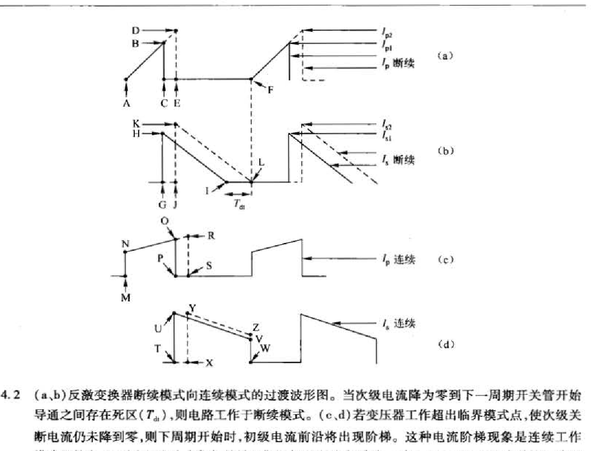
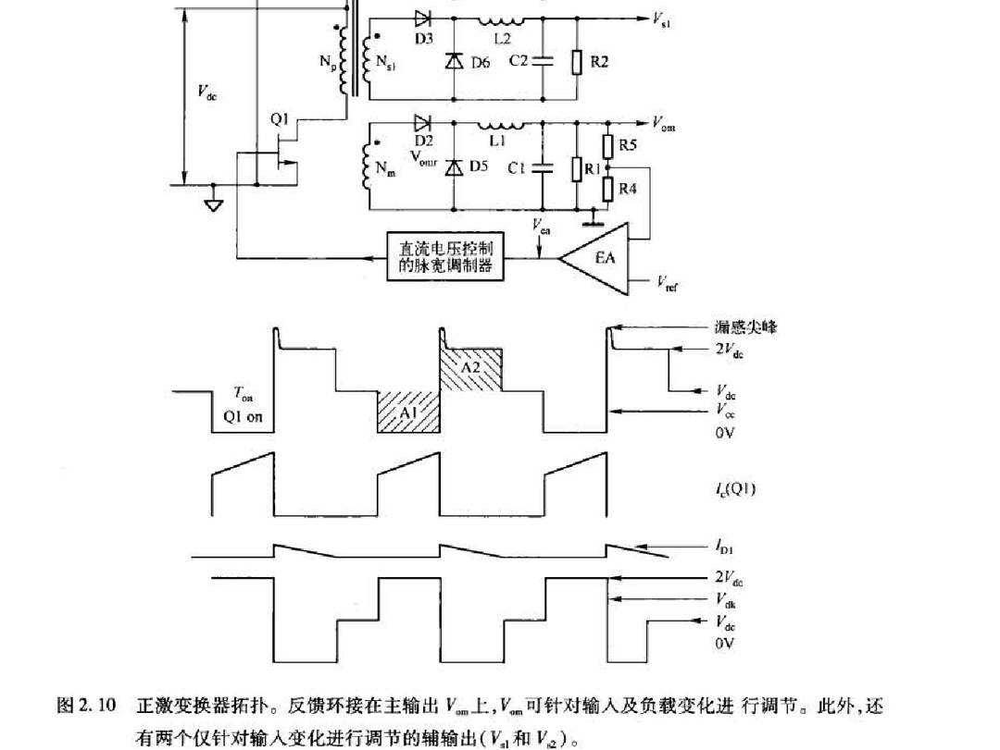
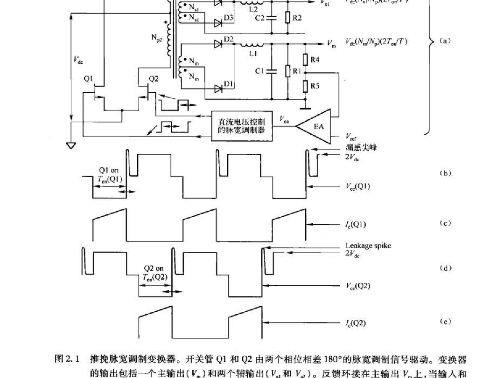
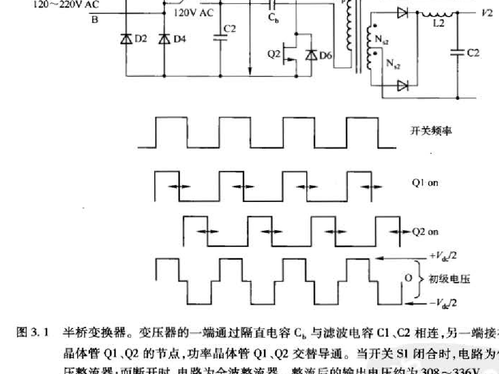
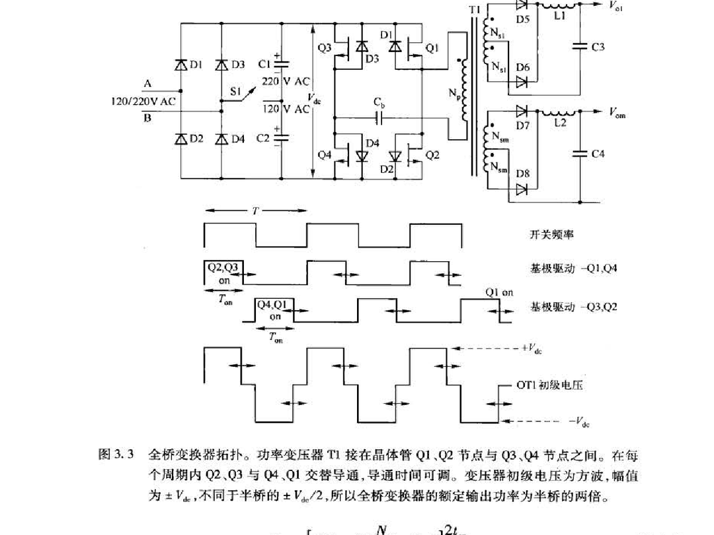

# 第一章 开关电源设计

> 本章从"开关电源的核心思想"出发，讲清 Buck / Boost / Buck-Boost 的**工作原理、数学本质与物理本质**，再展开方案选择、测试问题、开关损耗、LDO，以及 Ćuk 与 PFC。文中公式一律"**由物理过程引出，再逐项解读**"，并与后续章节（MOSFET、元件）**融会贯通**。

## 1.1 开关电源的核心思想

### 1.1.1 为什么用"开关"

线性稳压器（LDO）用"可变电阻"分压，多余电压全部转化为热，效率上限为 V<sub>out</sub>/V<sub>in</sub>。

开关电源用**开关管（全开/全关）+ 储能元件（电感/电容）**：

- 开关管只工作在两种状态：**大电流小压降**（导通）或 **大压降零电流**（关断）
- 这两种状态下"电压 × 电流"都很小，因此**理论效率接近 100%**

### 1.1.2 工作原理

```
Vin ──[开关管]──[储能元件 L/C]──▶ Vout
         │
        PWM（占空比 D）
```

- 开关管以频率 f<sub>sw</sub> 通断，占空比 D = t<sub>on</sub> / T<sub>s</sub>
- 电感/电容把斩波后的方波"平均"成平滑直流
- 负反馈调节 D，使 V<sub>out</sub> 稳定

### 1.1.3 数学本质

输出电压由**占空比**决定：

$$
V_{out} = f(D) \cdot V_{in} \qquad (1.1)
$$

不同拓扑对应不同 f(D)：Buck 为 D、Boost 为 1/(1−D)、Buck-Boost 为 D/(1−D)。

### 1.1.4 物理本质

开关电源**并不耗散多余能量**，而是通过"**改变能量传递的时间比例**"控制输出：

- 电感存储磁能 ½Li²，电容存储电能 ½Cv²（元件详细特性见[第三章 3.2 / 3.3](第三章-电源原理图常识.md)）
- 开关将能量分段地从输入传递到输出，储能元件负责"平滑电压与电流的波动"
- 开关频率越高 → 能量传递越频繁 → 储能元件可以越小

> **融会贯通**：本章讲的"开关管承担 V-I 交叠损耗"会在[第五章 5.8](第五章-MOSFET特性与选型.md) 里用 MOSFET 的 R<sub>DS(on)</sub>、Q<sub>gd</sub>、C<sub>oss</sub> 精确展开；这里先建立"能量传递"的物理图像。

## 1.2 三种基本拓扑：工作原理、数学与物理

### 1.2.1 Buck（降压）

**工作原理**（两个状态）：

- **S 导通、D 截止**：V<sub>in</sub> → L → 负载，电感储能，i<sub>L</sub> 上升
- **S 关断、D 导通**：L 经 D 续流，i<sub>L</sub> 下降，能量释放给负载

**物理过程**：电感在导通时"存能量"、在关断时"放能量"，输出电容把断续的电流"填平"。

**由物理引出公式（伏秒平衡）**：稳态下电感电压一周期积分必须为零（否则电流会一直涨/跌）：

$$
(V_{in} - V_{out})\, D T_s + (-V_{out})\, (1-D) T_s = 0 \qquad (1.2)
$$

**逐项解读**：

- 第一项 `(V_in − V_out)·D·T_s`：**导通期间**电感两端的正伏秒（能量充入）
- 第二项 `(−V_out)·(1−D)·T_s`：**关断期间**电感两端的负伏秒（能量放出）
- 两项相加为 0：**充入 = 放出**，本质是能量守恒

整理得：

$$
V_{out} = D \cdot V_{in} \qquad (1.3)
$$

**电感电流纹波**（导通期间电感电压驱动电流上升）：

$$
\Delta I_L = \frac{(V_{in} - V_{out})\, D T_s}{L} \qquad (1.4)
$$

- **逐项解读**：ΔI ∝ (V<sub>in</sub>−V<sub>out</sub>)·D·T<sub>s</sub> / L——压差越大、占空比越大、频率越低、电感越小，纹波越大

**输出纹波电压**（电容"安秒平衡"：一周期内电容电流积分为零）：

$$
\Delta V_{out} \approx \frac{\Delta I_L}{8 f_{sw} C} \qquad (1.5)
$$

- **逐项解读**：纹波与电感电流纹波成正比，与频率、电容成反比；所以"加大电容/提高频率"能减小纹波

**物理本质**：电感在导通时储能、关断时放能；伏秒平衡的本质是**能量守恒**——每周期充入的能量必须等于放出的能量，否则电感电流会无限增长（或衰减到零）。

### 1.2.1.1 Buck 的 DCM 分析

前面讨论的是 CCM（连续导通模式）。当负载较轻时，电感电流会在关断结束前降到零，进入 **DCM（断续导通模式）**。

**DCM 的三个阶段**：

1. **导通阶段**：S 导通，电感电流从 0 线性上升，储能
2. **放电阶段**：S 关断，电感经 D 续流，电流线性下降
3. **空闲阶段**：电感电流降到零，D 截止，负载由电容供电

**DCM 变换比**：

$$
\frac{V_{out}}{V_{in}} = \frac{2D}{2D + D_{2}} \qquad (1.32)
$$

其中 D<sub>2</sub> 为放电时间占比。

**物理本质**：DCM 下，变换比不仅取决于 D，还取决于 D<sub>2</sub>（与负载有关）。轻载时 D<sub>2</sub> 减小，输出电压升高——这是 DCM 下"负载调整率变差"的原因。

**CCM 与 DCM 的对比**：

| | CCM | DCM |
| --- | --- | --- |
| 电感电流 | 始终 >0 | 每周期到零 |
| 变换比 | 仅与 D 有关 | 与 D、负载有关 |
| 电流应力 | 小 | 大（峰值高） |
| 环路 | 二阶（LC） | 一阶 |
| 效率（轻载） | 低（开关损耗占比高） | 高（可降频） |

**工程意义**：DCM 下没有 RHP 零点（对 Boost/Buck-Boost），环路容易补偿；但峰值电流大、EMI 大。轻载时进入 DCM，可采用"跳频"降低开关损耗。

### 1.2.2 Boost（升压）

**工作原理**：

- **S 导通**：V<sub>in</sub> → L 储能，i<sub>L</sub> 上升；D 反偏，负载由电容供电
- **S 关断**：V<sub>in</sub> + 电感反电动势 → D → 负载，给电容和负载充电

**由物理引出公式**：

$$
V_{in}\, D T_s + (V_{in} - V_{out})\, (1-D) T_s = 0 \qquad (1.6)
$$

**逐项解读**：导通时电感电压 = V<sub>in</sub>（正伏秒）；关断时 = V<sub>in</sub>−V<sub>out</sub>（负伏秒）；两者相等 → 解出：

$$
V_{out} = \frac{V_{in}}{1-D} \qquad (1.7)
$$

**物理本质**：Boost 的"升压"来自电感的**反电动势**——关断瞬间电感电流不能突变，产生一个叠加在 V<sub>in</sub> 上的电压，把能量"顶"到更高的输出。

### 1.2.2.1 Boost 的 DCM 分析

Boost 在轻载时也会进入 DCM。三个阶段：

1. **导通阶段**：电感储能，i<sub>L</sub> 从 0 上升
2. **放电阶段**：电感向输出放能，i<sub>L</sub> 下降
3. **空闲阶段**：i<sub>L</sub> 降到零，输出由电容供电

**DCM 变换比**：

$$
\frac{V_{out}}{V_{in}} = \frac{1 + \sqrt{1 + \frac{4D^{2}}{K}}}{2}, \qquad K = \frac{2L}{R T_{s}} \qquad (1.39)
$$

**逐项解读**：

- DCM 下，升压比不仅取决于 D，还取决于 K（与负载、电感有关）
- 负载越轻（R 越大），K 越小，升压比越大
- 因此 DCM 下轻载时输出电压会"偏高"

**物理本质**：DCM 下，电感在每个周期都把能量"放完"，输出电压由"每次放多少"决定，而"放多少"与负载有关。这与 CCM 下"由占空比决定"不同。

**工程意义**：DCM 下没有 RHP 零点，环路容易补偿；但峰值电流大，适合小功率场合。

### 1.2.3 Buck-Boost（升降压）

**工作原理**（两个状态）：

- **S 导通**：V<sub>in</sub> → L 储能，D 反偏，负载由电容供电
- **S 关断**：L 的反电动势使 D 导通，能量释放到输出，输出为**反极性**

**由物理引出公式**：

$$
d\,V_{in} + (1-d)\,(-V_{out}) = 0 \qquad (1.8)
$$

**逐项解读**：导通时电感从输入储能（正伏秒 d·V<sub>in</sub>）；关断时向输出放能（负伏秒 (1−d)·V<sub>out</sub>）；两者相等 → 解出：

$$
|V_{out}| = \frac{D}{1-D} V_{in} \qquad (1.9)
$$

**三种工作模式**：

| 条件 | 占空比 | 工作模式 |
| --- | --- | --- |
| V<sub>out</sub> < V<sub>in</sub> | D < 0.5 | 降压 |
| V<sub>out</sub> = V<sub>in</sub> | D = 0.5 | 等压 |
| V<sub>out</sub> > V<sub>in</sub> | D > 0.5 | 升压 |

**物理本质**：Buck-Boost 是 Buck 与 Boost 的"组合"——导通时像 Buck 一样从输入储能，关断时像 Boost 一样向输出放能。输出极性由二极管方向决定，因此是反极性。

**DCM 分析**：

在 DCM 下，电感电流在关断后降到零。设放电时间为 D<sub>2</sub>T<sub>s</sub>，由伏秒平衡：

$$
V_{in} D T_s = |V_{out}| D_{2} T_s \qquad (1.11)
$$

得 DCM 变换比：

$$
|V_{out}| = V_{in} \frac{D}{D_{2}} \qquad (1.12)
$$

**物理本质**：DCM 下变换比还取决于 D<sub>2</sub>（与负载有关）。轻载时 D<sub>2</sub> 减小，输出电压升高——这是 DCM 下"负载调整率差"的原因。

**开关应力**：

- 开关管承受电压：V<sub>in</sub> + |V<sub>out</sub>|
- 开关管峰值电流：电感峰值电流
- 二极管承受电压：V<sub>in</sub> + |V<sub>out</sub>|

**传递函数**（CCM，详见[第四章 4.2.6](第四章-系统环路.md)）：

$$
G_{vd}(s) = \frac{V_{in}}{(1-D)^{2}} \cdot \frac{1 - \frac{s}{\omega_{RHP}}}{1 + \frac{s}{Q\omega_{0}} + \left(\frac{s}{\omega_{0}}\right)^{2}} \qquad (1.13)
$$

**物理本质**：Buck-Boost 含**右半平面零点**，因为能量"先存电感、再放输出"，占空比增大瞬间输出反而先降——控制作用方向与预期相反。

**优缺点**：

| 优点 | 缺点 |
| --- | --- |
| 升降压均可 | 输出反极性 |
| 结构简单、成本低 | 输入、输出电流都断续 |
| 一个开关管 | 含 RHP 零点、环路难补偿 |
| 适合宽输入范围 | 开关应力大（V<sub>in</sub>+\|V<sub>out</sub>\|） |

### 1.2.4 三种拓扑对比

| 拓扑 | 变换比 | 输出极性 | 输入电流 | 输出电流 |
| --- | --- | --- | --- | --- |
| Buck | D | 同 | 断续 | 连续 |
| Boost | 1/(1−D) | 同 | 连续 | 断续 |
| Buck-Boost | D/(1−D) | 反 | 断续 | 断续 |

> **融会贯通**：这里的"连续/断续"会决定电感纹波与 EMI；开关管承受的电压/电流应力则是[第五章 5.2.1](第五章-MOSFET特性与选型.md) 选型（V<sub>DS</sub>、I<sub>D</sub>）的依据。

### 1.2.4.1 三种拓扑的电流波形对比

| 拓扑 | 输入电流 | 输出电流 | 原因 |
| --- | --- | --- | --- |
| Buck | 断续（脉动） | 连续（电感） | 电感在输出侧 |
| Boost | 连续（电感） | 断续（脉动） | 电感在输入侧 |
| Buck-Boost | 断续（脉动） | 断续（脉动） | 电感在中间 |

**物理本质**：电感的"位置"决定哪一侧电流连续——电感在输入侧，输入电流连续；电感在输出侧，输出电流连续；电感在中间，两侧都断续。

**工程意义**：电流连续的一侧，EMI 小、纹波小；电流断续的一侧，需要更大的滤波电容。

## 1.3 Buck 电路方案选择

### 1.3.1 场景判断

当输入输出压差较大（V<sub>in</sub> − V<sub>out</sub> ≥ 10 V）、且负载电流超过 3 A 时，优先选择**全桥（同步）驱动 Buck**。

选择高侧驱动方案时，应尽量避免**带电流保护**的高侧驱动——负载跳变时电流保护可能误触发，导致高侧 MOS 关断、出现掉电。

### 1.3.2 同步 vs 非同步：数学与物理

- **非同步 Buck**：低端用**二极管**续流，导通压降 V<sub>f</sub>（约 0.5~1 V），损耗：

$$
P_{D} = V_{f} \cdot I_{out} \qquad (1.10)
$$

- **同步 Buck**：低端用 **MOS** 替代二极管，压降 I·R<sub>ds(on)</sub>，损耗：

$$
P_{MOS} = I_{out}^{2} \cdot R_{ds(on)} \qquad (1.11)
$$

**逐项解读**：二极管损耗与电流**线性**相关（V<sub>f</sub>·I）；MOS 损耗与电流**平方**相关（I²R）。小电流时可能二极管更省，大电流时 MOS 明显更优。

**物理本质**：MOS 导通时相当于一个"很小的电阻"（约 7 mΩ），压降远小于二极管的 V<sub>f</sub>，所以损耗小得多。

**举例**（12 V / 5 A）：二极管 0.7 V × 5 A ≈ **3.5 W**；MOS 25 × 7 mΩ ≈ **175 mW**。

### 1.3.3 同步 Buck 的优点

- 导通损耗低、热损耗小
- 两颗 MOS 分担热量，热效应更低
- 效率更高

### 1.3.4 同步 Buck 的缺点

- 需要两颗低内阻 MOS，**成本更高**
- 外围器件多
- 低端 MOS 需要**回流到芯片地平面**形成回路，容易受到地平面干扰；部分场合需把模拟地与数字地通过 0 Ω 电阻**单点连接**

### 1.3.5 并联 MOS 方案

重载 Buck 中，仅靠两颗 MOS 可能热效应不达标，此时采用**多 MOS 并联**：

- 数学：并联后等效 R<sub>ds(on)</sub> 减半，导通损耗减半
- 物理：电流分摊到多颗管子，热量分散
- 注意：同批次、同封装、对称布局均流；栅极单独串联电阻，避免相互振荡（详见[第六章 6.2.1.2](第六章-电机驱动硬件环路设计.md) 的 Miller 振荡）

### 1.3.6 Buck 的电感与电容选择

**电感选择**：

$$
L = \frac{(V_{in} - V_{out})\, D T_s}{\Delta I_L} \qquad (1.36)
$$

**逐项解读**：由纹波要求 ΔI<sub>L</sub>（通常取输出电流的 20~40%）反推电感量。电感越大，纹波越小，但体积越大、瞬态响应越慢。

- 饱和电流要大于峰值电流（I<sub>out</sub> + ΔI<sub>L</sub>/2）
- DCR 要小，减小导通损耗

**输出电容选择**：

$$
C = \frac{\Delta I_L}{8 f_{sw} \Delta V_{out}} \qquad (1.37)
$$

**逐项解读**：由纹波要求 ΔV<sub>out</sub> 反推电容。电容越大、频率越高，纹波越小。

- 考虑 ESR 贡献：ΔV<sub>ESR</sub> = ΔI<sub>L</sub>·ESR
- 实际取"容性纹波"与"ESR 纹波"的较大者
- 电容的耐压要留裕量

**物理本质**：电感决定**电流纹波**，电容决定**电压纹波**。两者配合，才能把开关纹波"滤平"。

### 1.3.7 Buck 的输入电容

输入电容的作用，是"吸收"开关导通瞬间的脉冲电流，避免输入电压跌落与 EMI：

$$
C_{in} \geq \frac{I_{out} D (1-D)}{f_{sw} \Delta V_{in}} \qquad (1.38)
$$

**逐项解读**：输入电容与输出电流、占空比、频率、允许的输入纹波有关。D=0.5 时最大。

**物理本质**：输入电容是"本地电荷仓库"——开关导通瞬间，电流从电容取，而不是从远处电源取，从而减小输入电压波动与 EMI。

## 1.4 Buck 电路测试常见问题

### 1.4.1 谐振现象

测试中常看到 SW 波形上叠加**正弦振荡**，本质是**寄生参数 LC 回路的衰减谐振**：

- 物理：开关回路的寄生电感 L<sub>loop</sub> 与 MOS 结电容、PCB 寄生电容构成谐振腔
- 数学：谐振频率 f ≈ 1 / (2π√(L<sub>loop</sub>C<sub>par</sub>))
- **Layout 要求**：开关回路尽可能短；地平面保持完整；避免分割地平面导致回流路径过长

### 1.4.2 纹波测试要点

- 使用**对地弹簧（地环）**，缩短示波器探头的地回路
- 减少探头回路寄生参数对输出波形的影响
- 探头尽量靠近输出电容、被测点

### 1.4.4 测试安全与注意事项

开关电源测试涉及高压、大电流，必须注意安全：

1. **高压隔离**：市电输入侧必须用隔离变压器，避免触电
2. **放电**：断电后电容仍存电，测试前要放电
3. **探头接地**：示波器探头地要与被测地一致，避免短路
4. **上电检查**：先检查极性、短路、焊点，再上电
5. **逐步加载**：从轻载逐步加到满载，观察温升与波形

**物理本质**：开关电源的储能元件（电感、电容）在断电后仍可能存有能量，必须确认放电后再操作。

## 1.5 开关损耗与降频策略

### 1.5.1 物理过程

开关管导通/关断不是瞬间完成的，存在**交叠区**（米勒平台期间）：

- 交叠区里，开关管**同时承受大电压和大电流**
- 瞬时功率 P = V·I 很大 → 一个开关周期损失一块能量

### 1.5.2 由物理引出公式

假设 V、I 在交叠区线性变化，平均功率 ≈ ½·V·I，乘以交叠时间、再乘以频率：

$$
P_{sw} \approx \frac{1}{2} V_{in} I_{out} (t_{on} + t_{off}) f_{sw} \qquad (1.12)
$$

### 1.5.3 逐项解读

- **½**：交叠区功率近似三角形，平均取一半
- **V<sub>in</sub>**：开关管承受的电压
- **I<sub>out</sub>**：导通电流
- **t<sub>on</sub>、t<sub>off</sub>**：开关时间（由**栅极电荷、驱动电流**决定，详见[第五章 5.3 / 5.4](第五章-MOSFET特性与选型.md)）
- **f<sub>sw</sub>**：开关频率——频率越高，开关损耗越大

### 1.5.4 为什么高输入电压要降频

由式 (1.12) 可见 P<sub>sw</sub> ∝ V<sub>in</sub>·f<sub>sw</sub>：

- V<sub>in</sub> 升高时，若保持 f<sub>sw</sub> 不变，开关损耗**线性上升**
- 高压大电流下不降频 → 开关管过热甚至烧毁
- **降频**本质是把开关损耗降低至与低压输入相当的水平，保证热设计可靠性

> **融会贯通**：`t<sub>on</sub>+t<sub>off</sub>` 不是常数，它由 MOSFET 的 Q<sub>gd</sub>（米勒电荷）和驱动电流决定——**换管子、改栅极电阻都会改变开关损耗**。这正是[第五章 5.8.3](第五章-MOSFET特性与选型.md) 要展开的内容。

### 1.5.5 开关损耗的定量估算

设某 Buck：V<sub>in</sub> = 12 V，I<sub>out</sub> = 5 A，f<sub>sw</sub> = 500 kHz，t<sub>on</sub>+t<sub>off</sub> = 50 ns。

$$
P_{sw} = \frac{1}{2} \times 12 \times 5 \times 50\,\text{ns} \times 500\,\text{kHz} = 0.75\,\text{W} \qquad (1.33)
$$

**逐项解读**：开关损耗与 V<sub>in</sub>、I<sub>out</sub>、开关时间、频率都成正比。高频化虽然能减小电感电容，但开关损耗会线性增加。

**物理本质**：开关损耗的本质是"交叠区里电压和电流同时存在"，瞬时功率 P=V·I 很大。要减小它，要么缩短交叠时间（快开关），要么让 V、I 不在同一时刻出现（软开关）。

### 1.5.6 软开关（ZVS/ZCS）

**硬开关**：V、I 交叠，损耗大。
**软开关**：通过谐振，让开关管在"电压为零"（ZVS）或"电流为零"（ZCS）时切换，消除交叠损耗。

- **ZVS（零电压开关）**：开通前让 V<sub>DS</sub> 降到零
- **ZCS（零电流开关）**：关断前让 I<sub>D</sub> 降到零

**物理本质**：软开关利用谐振，把"V、I 同时存在"变成"V、I 错开"，从根本上消除交叠损耗。但软开关需要额外的谐振元件，增加成本与复杂度。

### 1.5.7 驱动损耗

驱动损耗是"给栅极电容充放电"的损耗，主要在驱动器里：

$$
P_{gate} = Q_{g} V_{GS} f_{sw} \qquad (1.34)
$$

**逐项解读**：Q<sub>g</sub> 是总栅极电荷，V<sub>GS</sub> 是驱动电压。驱动损耗与频率成正比，高频场合要选低 Q<sub>g</sub> 的 MOS（见[第五章 5.8.4](第五章-MOSFET特性与选型.md)）。

## 1.6 LDO 线性稳压电源

### 1.6.1 工作原理

LDO 由**一个 MOS（通常为 PMOS）**和一个**运算放大器**构成：

- 运放作为**误差放大器**
- 输出电压经电阻分压后送入运放正极，与**基准源**比较
- 误差信号控制 PMOS 栅极，调整 V<sub>ds</sub> 压降，形成闭环稳压


### 1.6.2 数学本质

LDO 是线性稳压器，输入电流约等于输出电流：

$$
\eta \approx \frac{V_{out}}{V_{in}} \qquad (1.13)
$$

$$
P_{loss} = (V_{in} - V_{out}) I_{out} \qquad (1.14)
$$

**逐项解读**：损耗与"压差 × 电流"成正比；压差越大、电流越大，发热越严重，效率越低。

### 1.6.3 物理本质

LDO 用**受控可变电阻（PMOS）** 把多余电压"线性地"耗散成热：

- 压差越大 → 耗散越多 → 效率越低
- 所以只适合**小压差、小电流、低噪声**场合

> **融会贯通**：LDO 的 PMOS 工作在**线性区（可变电阻）**，正是[第五章 5.1.3](第五章-MOSFET特性与选型.md) 讲的"线性区"；而 Buck 的 MOS 工作在**开关区**。**同一个 MOS，工作区不同，用法完全不同**。

### 1.6.4 LDO 与 Buck 的对比

| | LDO | Buck |
| --- | --- | --- |
| 器件工作区 | 线性区 | 开关区 |
| 损耗 | (V<sub>in</sub>−V<sub>out</sub>)·I | I²R<sub>ds(on)</sub> + 开关损耗 |
| 效率 | V<sub>out</sub>/V<sub>in</sub> | 90%+ |
| 纹波 | 极小 | 有开关纹波 |
| 成本 / 复杂度 | 低 | 高 |

### 1.6.5 LDO 的关键参数

| 参数 | 含义 | 影响 |
| --- | --- | --- |
| **压差（Dropout）** | 维持稳压所需的最小输入输出压差 | 压差越小，可用输入范围越大 |
| **PSRR** | 电源抑制比 | 抑制输入纹波的能力 |
| **输出噪声** | 输出端的噪声电压 | 影响模拟、射频电路 |
| **静态电流** | 无负载时的自身电流 | 影响待机功耗 |
| **负载调整率** | 负载变化时的输出变化 | 稳压精度 |
| **线性调整率** | 输入变化时的输出变化 | 稳压精度 |

### 1.6.6 PSRR 与噪声

LDO 的 PSRR 随频率升高而下降，高频段抑制能力弱。原因是误差放大器的带宽有限，高频时无法及时响应输入扰动。

对模拟电路（ADC、射频、音频），要选**高 PSRR、低噪声**的 LDO；对数字负载，普通 LDO 即可。

**物理本质**：LDO 用负反馈抑制输入纹波，反馈带宽决定了 PSRR 的频段。带宽越高，高频抑制越好。

### 1.6.7 LDO 选型与应用

| 应用 | 选型重点 |
| --- | --- |
| 音频、ADC、射频 | 低噪声、高 PSRR |
| 电池供电 | 低压差、低静态电流 |
| 大电流负载 | 散热、封装 |
| 普通数字负载 | 成本、体积 |

### 1.6.8 LDO 与 DC-DC 的组合

实际系统中，常用"**DC-DC + LDO**"的组合：

- DC-DC 先降压（高效率），把电压降到略高于目标值
- LDO 再稳压（低噪声），滤除 DC-DC 的开关纹波

这样兼顾了效率与噪声。

## 1.7 Ćuk 变换器

### 1.7.1 工作原理

Ćuk 变换器用**两个电感 + 一个耦合电容**实现升降压，输出为**负极性**：

```
      L1              C1
Vin ─/\/\/──●────────||────────●──/\/\/── Vout(负)
             │                  │    L2
            SW                 D
             │                  │
            GND                GND
```

- **L<sub>1</sub>**：输入电感
- **C<sub>1</sub>**：耦合电容（能量传输核心）
- **L<sub>2</sub>**：输出电感
- **SW / D**：开关管、二极管

### 1.7.2 数学本质

$$
V_{out} = -\frac{D}{1-D} V_{in} \qquad (1.15)
$$

### 1.7.3 物理本质

能量传递方式：**电感充能 → 耦合电容搬运 → 电感放能**，而不是像 Buck / Boost 那样由电感直接传能。

- **L<sub>1</sub>** 让输入电流连续，**L<sub>2</sub>** 让输出电流连续 → **双低纹波**
- 缺点：耦合电容 C<sub>1</sub> 承担全部功率，体积大；输出反极性；CCM 下有 RHP 零点

### 1.7.4 与其他非隔离拓扑对比

| 拓扑 | 输出极性 | 输入电流 | 输出电流 |
| --- | --- | --- | --- |
| Buck-Boost | 反 | 断续 | 断续 |
| **Ćuk** | **反** | **连续** | **连续** |
| SEPIC | 同 | 断续 | 连续 |
| Zeta | 同 | 连续 | 断续 |

### 1.7.5 典型应用

- PFC（输入电流连续，EMI 低）
- 电池供电、低纹波电源
- 负电压生成
- 隔离电源（隔离 Ćuk）

### 1.7.6 Ćuk 的设计方程

**变换比**：

$$
V_{out} = -\frac{D}{1-D} V_{in} \qquad (1.24)
$$

**耦合电容电压**：

$$
V_{C1} = V_{in} - V_{out} = V_{in} + |V_{out}| \qquad (1.25)
$$

**电感电流**：

$$
I_{L1} = I_{in}, \qquad I_{L2} = I_{out} \qquad (1.26)
$$

**逐项解读**：Ćuk 的两个电感分别承担输入电流与输出电流，因此**输入、输出电流都连续**——这是它相比 Buck-Boost 的最大优势。

**耦合电容的选型**：C<sub>1</sub> 要承受全部功率的传递，因此体积大、纹波电流大。一般选低 ESR 的薄膜电容或电解电容。

### 1.7.7 Ćuk 的优缺点

**优点**：

- **输入、输出电流都连续** → 纹波小、EMI 低
- 可升降压
- 输出反极性
- 耦合电容可兼作隔离（隔离 Ćuk）

**缺点**：

- **耦合电容承受全部功率** → 体积大、成本高
- 输出反极性
- 含 RHP 零点（CCM 下）
- 拓扑较复杂

### 1.7.8 Ćuk 与其他拓扑对比

| 拓扑 | 输出极性 | 输入电流 | 输出电流 | 特点 |
| --- | --- | --- | --- | --- |
| Buck-Boost | 反 | 断续 | 断续 | 简单、纹波大 |
| **Ćuk** | **反** | **连续** | **连续** | **双低纹波、电容大** |
| SEPIC | 同 | 断续 | 连续 | 非反相 |
| Zeta | 同 | 连续 | 断续 | 非反相 |

**物理本质**：Ćuk 用"两个电感 + 一个耦合电容"把 Buck-Boost 的"断续"变成了"连续"——输入侧电感让输入电流连续，输出侧电感让输出电流连续，耦合电容负责把能量"搬"过去。

## 1.8 PFC（功率因数校正）

### 1.8.1 工作原理

PFC 的目标不是"升压"，而是**让输入电流和输入电压同相、成正比**，使负载"看起来像纯电阻"：

- 普通整流桥 + 电容：输入电流是**尖峰脉冲**，PF 只有 0.5~0.6
- PFC 通过控制开关，把输入电流"修"成正弦

### 1.8.2 数学本质

$$
\text{PF} = \frac{P}{V_{rms} \cdot I_{rms}} \qquad (1.16)
$$

### 1.8.3 逐项解读

- **P**：有功功率（真正做功的功率）
- **V<sub>rms</sub>·I<sub>rms</sub>**：视在功率
- PF = 1 表示"视在功率全部是有功"，电压电流同相

### 1.8.4 物理本质

- PF = 1 表示电压和电流同相 → 没有无功功率来回交换 → 电网容量利用率最高
- 普通整流桥的电流尖峰 → 谐波大、PF 低

### 1.8.5 最常用：Boost PFC

```
市电 AC → 整流 → 0~Vpeak 的脉动直流 → Boost 变换器 → 稳定 DC（如 400 V）
```

Boost PFC 干两件事：

1. **升压**：把脉动直流升到稳定直流（输出必须 > 输入峰值）
2. **整形电流**：让输入电流跟随整流后的正弦波形（PFC 的核心）

**为什么 Boost 是主流**：

- 输入电流连续（电感在输入端）→ EMI 低、易整形
- 输出天然高于输入峰值（400 V > 220 V 的峰值 311 V）
- 拓扑简单、效率高

### 1.8.6 PFC 拓扑对比

| 拓扑 | 输入电流 | 输出 | 用途 |
| --- | --- | --- | --- |
| **Boost PFC** | **连续** | > 输入峰值 | **最主流** |
| Buck PFC | 断续 | < 输入峰值 | 低压输出 |
| Buck-Boost PFC | 断续 | 任意 | 通用 |
| SEPIC PFC | 断续 | 非反相 | 中等功率 |
| Ćuk PFC | 连续 | 反极性 | 低功率、LED |

### 1.8.7 Boost PFC 的控制

PFC 控制器要同时完成两件事：

1. **让输入电流跟随整流后的正弦电压**（电流环）
2. **稳定输出电压**（电压环）

**双环控制结构**：

- **电压外环**：采样输出电压，与基准比较，输出电流指令
- **电流内环**：采样输入电流，跟踪正弦指令

**乘法器**：电压环的输出乘以输入电压的正弦波形，作为电流环的指令——这样输入电流就跟随输入电压，实现 PF≈1。

**物理本质**：乘法器是 PFC 的"核心"——它把"电压环的直流指令"与"输入电压的正弦形状"相乘，得到"正弦电流指令"，再让电流环去跟踪。这样既保证了输出稳定，又保证了输入电流的正弦度。

### 1.8.8 典型 PFC 芯片：UC3854

UC3854 是最经典的 Boost PFC 控制器，内部包含：

- 电压误差放大器
- 乘法器
- 电流误差放大器
- PWM 比较器
- 过压/欠压保护

**工作过程**：整流后的正弦电压采样 → 乘法器 → 与电流采样比较 → PWM → 驱动 Boost 开关管。

**关键引脚**：V<sub>ref</sub>（基准）、I<sub>sense</sub>（电流采样）、V<sub>sense</sub>（电压采样）、V<sub>fb</sub>（反馈）、PWM 输出。

### 1.8.9 PFC 设计流程

1. 确定输出功率、输入电压范围
2. 选择 Boost 电感（按纹波与电流）
3. 选择输出电容（按保持时间）
4. 选择开关管与二极管（按电压电流应力）
5. 设计电压环、电流环补偿
6. 校核 PF、THD、效率

**关键指标**：

- **PF（功率因数）**：接近 1（通常 >0.99）
- **THD（总谐波失真）**：越小越好（通常 <5%）
- **效率**：通常 95% 以上

**保持时间**：PFC 输出电容要在输入掉电后维持输出电压一段时间（通常 20 ms），因此电容要足够大。

### 1.8.10 PFC 的物理本质

PFC 的本质是"**让负载看起来像纯电阻**"：

- 普通整流桥的输入电流是尖峰脉冲，包含大量谐波
- PFC 通过控制开关，把输入电流"修"成正弦，与电压同相
- 这样电网的视在功率全部是有功功率，利用率最高

**为什么需要 PFC**：没有 PFC 时，PF 只有 0.5~0.6，电网容量利用率低；同时谐波会干扰其他设备。因此很多标准（如 IEC 61000-3-2）对 PF 与谐波有强制要求。

## 1.9 效率与损耗构成（融会贯通小结）

开关电源的**总损耗**可以拆成几块，正好对应前面和后面章节：

| 损耗 | 来源 | 相关章节 |
| --- | --- | --- |
| **导通损耗** | 开关管 R<sub>ds(on)</sub>、电感 DCR | 第五章 5.8.2、第三章 3.3 |
| **开关损耗** | 开关管 V-I 交叠 | 第五章 5.8.3 |
| **驱动损耗** | 栅极电荷 Q<sub>g</sub> 充放电 | 第五章 5.8.4 |
| **输出电容损耗** | C<sub>oss</sub> 充放电 | 第五章 5.8.5 |
| **死区/体二极管损耗** | 续流 | 第五章 5.8.6、第六章 6.2.2 |
| **电感/电容损耗** | DCR、ESR | 第三章 3.2 / 3.3 |

$$
\eta = \frac{P_{out}}{P_{out} + P_{loss}} \qquad (1.17)
$$

**逐项解读**：提高效率无非两条路——**减小每一项损耗**，或**让损耗尽量落在低阻抗路径上**。而每一项损耗的精确计算，都落在[第五章 5.8](第五章-MOSFET特性与选型.md) 里。

> **融会贯通**：本章回答"拓扑和占空比怎么决定电压"，第五章回答"具体用哪种 MOS、损耗多大、会不会过热"。两者合起来，才是完整的开关电源设计。

### 1.9.1 效率的分解

开关电源的效率可以按损耗来源分解：

$$
\eta = \frac{P_{out}}{P_{out} + P_{loss}} = \frac{1}{1 + P_{loss}/P_{out}} \qquad (1.35)
$$

**逐项解读**：效率由"损耗/输出功率"的比值决定。要提升效率，要么减小损耗，要么增大输出功率。

**损耗的构成**（以 Buck 为例）：

| 损耗 | 公式 | 占比（典型） |
| --- | --- | --- |
| 导通损耗 | I²·R<sub>ds(on)</sub> | 30~50% |
| 开关损耗 | ½·V·I·(t<sub>r</sub>+t<sub>f</sub>)·f | 20~40% |
| 驱动损耗 | Q<sub>g</sub>·V<sub>gs</sub>·f | 5~10% |
| 电感损耗 | I²·DCR + 磁芯损耗 | 5~15% |
| 电容损耗 | I²·ESR | 2~5% |

### 1.9.2 效率优化

**按频率选择优化方向**：

- **低频（<100 kHz）**：导通损耗占主导 → 选低 R<sub>ds(on)</sub> MOS
- **中频（100~500 kHz）**：开关损耗上升 → 选低 Q<sub>g</sub>、小 C<sub>oss</sub>
- **高频（>500 kHz）**：开关损耗主导 → 软开关、GaN/SiC

**按负载选择**：

- **满载**：导通损耗主导 → 低 R<sub>ds(on)</sub>
- **轻载**：开关损耗、驱动损耗主导 → 降频、跳频

### 1.9.3 效率曲线

实际电源的效率曲线是"先升后降"的：

- **轻载**：固定损耗（驱动、控制）占比大，效率低
- **中载**：损耗与输出成比例，效率最高
- **重载**：导通损耗 I²R 快速增长，效率下降

因此，效率的"最佳点"通常在 50%~80% 负载。

## 1.10 反激变换器（Flyback）

### 1.10.1 为什么需要反激

前面讨论的 Buck、Boost、Buck-Boost 都是**非隔离**拓扑：输入与输出共地，没有电气隔离。在实际工程中，很多场合需要**安全隔离**：

- 市电输入（220 V）与低压输出之间必须隔离
- 多路输出需要不同的电压等级
- 需要满足安规（如爬电距离、绝缘耐压）

反激（Flyback）是最常用的**隔离型**拓扑之一，广泛用于小功率（几瓦到几十瓦）场合。

### 1.10.2 反激的工作原理

反激的电路结构，本质上是**Buck-Boost + 变压器**：

```
Vin ──[开关管 S]──[变压器初级 Np]──┬──
                                   │
                              [次级 Ns]──[二极管 D]──[电容 C]──▶ Vout
                                   │
                                  GND
```

- **变压器**：实现隔离与电压变换，同时**储能**（利用励磁电感）
- **S 导通**：初级电流上升，变压器储能；次级二极管反偏，负载由电容供电
- **S 关断**：初级电流被切断，变压器磁场反转，次级二极管导通，能量释放到输出

**关键区别**：反激的变压器实际上是**耦合电感**（不是真正的变压器），能量在"导通时存入、关断时放出"，与 Buck-Boost 一样，因此也有 RHP 零点。

**物理过程**（两个阶段）：

1. **导通阶段**：开关管导通，初级电流 I<sub>p</sub> 线性上升，变压器励磁电感储能；次级二极管反偏，负载由输出电容供电。
2. **关断阶段**：开关管关断，初级电流被切断；变压器磁通不能突变，磁场反转，次级二极管导通，能量传递到输出。

### 1.10.3 反激的数学关系

**输出电压**（CCM）：

$$
V_{out} = V_{in} \cdot \frac{N_{s}}{N_{p}} \cdot \frac{D}{1-D} \qquad (1.18)
$$

**逐项解读**：

- **N<sub>s</sub>/N<sub>p</sub>**：匝比，决定电压变换
- **D/(1−D)**：Buck-Boost 的变换比
- 两者相乘，就是反激的变换比

**DCM 下**：

$$
V_{out} = V_{in} \cdot \frac{N_{s}}{N_{p}} \cdot \frac{D}{D_{2}} \qquad (1.19)
$$

其中 D<sub>2</sub> 为次级放电时间。

**初级峰值电流**（导通期间）：

$$
I_{p,pk} = \frac{V_{in} D T_{s}}{L_{m}} \qquad (1.20)
$$

**逐项解读**：初级峰值电流与 V<sub>in</sub>、D、T<sub>s</sub> 成正比，与励磁电感 L<sub>m</sub> 成反比。

**开关管承受电压**：

$$
V_{DS,max} = V_{in} + V_{clamp} \qquad (1.21)
$$

其中 V<sub>clamp</sub> 为 RCD 钳位电压（由漏感能量决定）。

### 1.10.4 CCM 与 DCM 的区别

| 模式 | 电流 | 变换比 | 特点 |
| --- | --- | --- | --- |
| **CCM** | 始终 >0 | D/(1−D) | 电流应力小、RHP 零点 |
| **DCM** | 每到零 | D/D<sub>2</sub> | 无 RHP 零点、轻载电压升 |

**DCM 的优点**：没有 RHP 零点，环路容易补偿；**缺点**：峰值电流大、电流应力大、轻载时电压偏高。

**选型建议**：小功率常用 DCM（简单、成本低）；中大功率用 CCM（电流应力小）。

### 1.10.5 反激的波形



图中给出反激变换器的典型波形：

- **初级电流 I<sub>p</sub>**：导通期间线性上升，关断瞬间突变到零
- **次级电流 I<sub>s</sub>**：关断期间从峰值线性下降
- **开关管电压 V<sub>DS</sub>**：关断时被 RCD 钳位抬高（V<sub>in</sub> + V<sub>clamp</sub>）
- **输出纹波**：由电容充放电决定

**物理本质**：反激的"能量搬运"是"先存磁性、再放次级"——导通时初级电流上升储能，关断时次级电流下降放能。这与 Buck-Boost 完全一致，区别只是多了变压器隔离与匝比。

### 1.10.6 RCD 钳位电路

反激的变压器存在**漏感** L<sub>leak</sub>。开关管关断瞬间，漏感电流不能突变，会产生高压尖峰：

$$
V_{spike} = L_{leak} \frac{di}{dt} \qquad (1.22)
$$

这个尖峰可能击穿开关管，因此需要**RCD 钳位**：

- **R**：消耗漏感能量
- **C**：吸收尖峰
- **D**：引导漏感电流

**钳位电压**约为：

$$
V_{clamp} = V_{RO} + V_{spike} \qquad (1.23)
$$

其中 V<sub>RO</sub> 为反射电压（次级电压折算到初级）。

**设计要点**：钳位电压要低于开关管耐压，同时钳位损耗要小。R 太大 → 钳位电压高、可能击穿；R 太小 → 钳位损耗大、效率低。

### 1.10.7 反激的优缺点

**优点**：

- **结构简单**：一个开关管、一个二极管、一个变压器，成本低
- **隔离**：满足安规要求
- **多路输出**：次级可以绕多组，输出多路电压
- **适合小功率**：几瓦到几十瓦，广泛用于充电器、适配器

**缺点**：

- **电流应力大**：DCM 下峰值电流大
- **RHP 零点**：CCM 下环路难补偿
- **漏感损耗**：RCD 钳位消耗漏感能量
- **变压器设计复杂**：磁芯、匝比、气隙、饱和等

### 1.10.8 反激的设计流程

1. **确定规格**：输入电压范围、输出功率、输出电压、效率目标
2. **选择工作模式**：DCM（小功率）或 CCM（中大功率）
3. **计算匝比**：由输入输出电压与最大占空比确定
4. **选择磁芯**：按功率选磁芯尺寸
5. **计算初级电感**：由 DCM/CCM 条件确定
6. **计算匝数**：由磁芯 AL 值、电感量确定
7. **设计 RCD 钳位**：按漏感与开关管耐压
8. **校核**：磁饱和、温升、效率

### 1.10.9 反激设计实例

设：输入 85~265 V AC（整流后约 120~375 V DC），输出 12 V / 2 A（24 W），开关频率 65 kHz，DCM 模式。

**第一步：确定匝比**。取最大占空比 D<sub>max</sub> = 0.45（DCM 下），由变换比关系：

$$
N = \frac{N_{p}}{N_{s}} = \frac{V_{in,min}\, D_{max}}{V_{out}(1-D_{max})} = \frac{120 \times 0.45}{12 \times 0.55} \approx 8.2 \qquad (1.27)
$$

取 N = 8。

**第二步：计算初级峰值电流与电感**。DCM 下，初级峰值电流：

$$
I_{pk} = \frac{2 P_{out}}{\eta\, V_{in,min}\, D_{max}} = \frac{2 \times 24}{0.8 \times 120 \times 0.45} \approx 1.11\,\text{A} \qquad (1.28)
$$

初级励磁电感：

$$
L_{m} = \frac{V_{in,min}\, D_{max}\, T_{s}}{I_{pk}} = \frac{120 \times 0.45 \times 15.4\,\mu s}{1.11} \approx 0.75\,\text{mH} \qquad (1.29)
$$

**第三步：选磁芯**。按功率 24 W，选 EE25 或 EI25 磁芯（A<sub>e</sub> ≈ 40 mm²）。

**第四步：计算匝数**。由磁通密度限制：

$$
N_{p} = \frac{L_{m} I_{pk}}{B_{max} A_{e}} \qquad (1.30)
$$

取 B<sub>max</sub> = 0.25 T，A<sub>e</sub> = 40 mm²：

$$
N_{p} = \frac{0.75\,\text{mH} \times 1.11}{0.25 \times 40\,\mu m^{2}} \approx 83 \qquad (1.31)
$$

次级匝数 N<sub>s</sub> = N<sub>p</sub>/N ≈ 10。

**第五步：RCD 钳位设计**。漏感取 L<sub>leak</sub> ≈ 1% L<sub>m</sub> = 7.5 µH，钳位电压取 V<sub>clamp</sub> = 150 V。R 与 C 按"漏感能量被 R 消耗"的能量平衡计算。

**第六步：校核**。

- **磁饱和**：B<sub>max</sub> 必须小于磁芯饱和磁通
- **温升**：按铜损 + 铁损估算
- **效率**：按损耗估算，目标 >80%

## 1.11 其他隔离拓扑

反激适合小功率，但在中高功率场合，正激、推挽、半桥、全桥更为合适。下面按"工作原理 → 数学关系 → 物理本质 → 优缺点 → 设计要点"逐个展开。

### 1.11.1 正激变换器（Forward）

#### 1.11.1.1 工作原理

正激变换器可以看作"Buck + 变压器"：变压器在开关**导通时**把能量传递到次级，关断时不传递能量。

```
Vin ──[S]──[Np]──┬──
                 │
            [Ns]──[D1]──[L]──[C]──▶ Vout
                 │          │
                [D2]        GND
                 │
                GND
```



**两个状态**：

1. **S 导通**：能量经变压器传到次级，D1 导通，电感 L 储能，D2 截止
2. **S 关断**：变压器不传能，D2 续流，电感 L 放能

**物理本质**：正激的变压器是"真正的变压器"——导通时把能量"实时"传到次级，关断时既不传能也不储能。但关断后磁通需要**复位**，否则磁芯会饱和。

#### 1.11.1.2 数学关系

**输出电压**：

$$
V_{out} = V_{in} \cdot \frac{N_{s}}{N_{p}} \cdot D \qquad (1.40)
$$

**逐项解读**：与 Buck 的 `V_out = V_in·D` 类似，只多了匝比 N<sub>s</sub>/N<sub>p</sub>。

**占空比限制**（复位绕组法）：

$$
D < \frac{N_{p}}{N_{p} + N_{r}} \qquad (1.41)
$$

其中 N<sub>r</sub> 为复位绕组匝数。

**物理本质**：正激的占空比不能太大，否则复位时间不够，磁芯会饱和。这是正激与 Buck 的最大区别。

#### 1.11.1.3 复位技术

正激的变压器在关断后必须复位，否则磁通逐周期累积、磁芯饱和。常见复位方式：

**（1）复位绕组**：

在变压器上加第三绕组 N<sub>r</sub>，关断时把磁能回馈到输入。占空比受限为 D < N<sub>p</sub>/(N<sub>p</sub>+N<sub>r</sub>)。

**（2）RCD 钳位**：

用 RCD 吸收磁能，简单但损耗大。

**（3）有源钳位**：

用有源开关 + 电容，实现软开关复位，效率高但复杂。

**物理本质**：复位的目的，是让磁芯在每个周期结束时回到初始磁通，避免累积饱和。

#### 1.11.1.4 优缺点

| 优点 | 缺点 |
| --- | --- |
| 效率高（变压器实时传能） | 需要复位电路 |
| 输出纹波小 | 占空比受限（<0.5） |
| 适合中功率 | 变压器设计复杂 |
| 开关管电压应力 = 2V<sub>in</sub> | 需额外绕组/钳位 |

#### 1.11.1.5 设计要点

1. **占空比**：留足复位时间，D < 0.45
2. **复位绕组**：匝比要匹配，避免复位电压过高
3. **磁芯**：选有气隙的磁芯，防止饱和
4. **输出电感**：按 Buck 的电感设计
5. **开关管耐压**：≥ 2V<sub>in</sub>

### 1.11.2 推挽变换器（Push-Pull）

#### 1.11.2.1 工作原理

推挽变换器用**两个开关管交替导通**，变压器双向励磁：

```
Vin ──┬──[S1]──[Np1]──┬──
      │              │
      │──[S2]──[Np2]──┘
                     │
                [Ns]──[D1/D2]──[L]──[C]──▶ Vout
```



**两个状态**：

1. **S1 导通**：Np1 励磁，能量传到次级，D1 导通
2. **S2 导通**：Np2 励磁（反向），能量传到次级，D2 导通

**物理本质**：推挽的变压器**双向励磁**，磁通在正负之间摆动，利用率高。但两个开关管的导通时间必须对称，否则磁通不平衡。

#### 1.11.2.2 数学关系

**输出电压**：

$$
V_{out} = 2 \cdot V_{in} \cdot \frac{N_{s}}{N_{p}} \cdot D \qquad (1.42)
$$

**开关管电压应力**：

$$
V_{DS,max} = 2 V_{in} \qquad (1.43)
$$

**逐项解读**：推挽的开关管承受 2V<sub>in</sub>，这是它的主要缺点。

#### 1.11.2.3 磁通不平衡

推挽的两个开关管交替导通，理想情况下正负半周对称。但实际中，两个开关管的导通时间、压降不完全一致，会导致**磁通不平衡（偏磁）**，严重时磁芯饱和。

**对策**：

1. 两管参数匹配
2. 加隔直电容（阻断直流偏磁）
3. 电流模式控制（逐周期限流）

**物理本质**：偏磁的根源是"正负半周伏秒不相等"，导致磁通累积偏移。隔直电容或电流模式可以消除直流分量。

#### 1.11.2.4 优缺点

| 优点 | 缺点 |
| --- | --- |
| 变压器双向励磁、利用率高 | 开关管电压应力 2V<sub>in</sub> |
| 适合中功率 | 存在磁通不平衡 |
| 输出纹波小 | 需要两管对称 |

### 1.11.3 半桥变换器（Half-Bridge）

#### 1.11.3.1 工作原理

半桥用**两个开关管串联**，变压器初级接在桥臂中点：

```
Vin ──┬──[S1]──┬──[C1]──┬──
      │        │        │
      │        ├──[Np]──┤
      │        │        │
      └──[S2]──┴──[C2]──┘
```



两个电容 C1、C2 分压，桥臂中点电压在 0 与 V<sub>in</sub> 之间摆动，变压器初级电压为 ±V<sub>in</sub>/2。

#### 1.11.3.2 数学关系

**输出电压**：

$$
V_{out} = \frac{V_{in}}{2} \cdot \frac{N_{s}}{N_{p}} \cdot D \qquad (1.44)
$$

**开关管电压应力**：

$$
V_{DS,max} = V_{in} \qquad (1.45)
$$

**逐项解读**：半桥的开关管只承受 V<sub>in</sub>，是它相比推挽的最大优势。

#### 1.11.3.3 优缺点

| 优点 | 缺点 |
| --- | --- |
| 开关管电压应力低（V<sub>in</sub>） | 需要两个分压电容 |
| 适合中高功率 | 电容要承受大纹波电流 |
| 变压器利用率高 | 存在直流偏磁风险 |

### 1.11.4 全桥变换器（Full-Bridge）

#### 1.11.4.1 工作原理

全桥用**四个开关管**组成桥式，变压器初级接在桥臂之间：

```
Vin ──┬──[S1]──┬──[S3]──┬──
      │        │        │
      │        ├──[Np]──┤
      │        │        │
      └──[S2]──┴──[S4]──┘
```



**两个状态**：

1. **S1、S4 导通**：变压器初级电压 +V<sub>in</sub>
2. **S2、S3 导通**：变压器初级电压 −V<sub>in</sub>

#### 1.11.4.2 数学关系

**输出电压**：

$$
V_{out} = V_{in} \cdot \frac{N_{s}}{N_{p}} \cdot D \qquad (1.46)
$$

**开关管电压应力**：

$$
V_{DS,max} = V_{in} \qquad (1.47)
$$

**逐项解读**：全桥的变压器初级电压为 ±V<sub>in</sub>，是半桥的两倍，因此在同样功率下电流更小。

#### 1.11.4.3 优缺点

| 优点 | 缺点 |
| --- | --- |
| 功率最大（几百瓦~千瓦） | 四个开关管、成本高 |
| 开关管电压应力低（V<sub>in</sub>） | 驱动复杂（需隔离） |
| 变压器利用率高 | 存在直通风险 |

### 1.11.5 隔离拓扑对比与选择

| 拓扑 | 功率范围 | 开关管数 | 电压应力 | 变压器励磁 | 特点 |
| --- | --- | --- | --- | --- | --- |
| 反激 | 几瓦~几十瓦 | 1 | V<sub>in</sub>+V<sub>clamp</sub> | 单向（储能） | 简单、多路输出 |
| 正激 | 几十瓦~几百瓦 | 1 | 2V<sub>in</sub> | 单向（需复位） | 效率高、需复位 |
| 推挽 | 中功率 | 2 | 2V<sub>in</sub> | 双向 | 利用率高、有偏磁 |
| 半桥 | 中高功率 | 2 | V<sub>in</sub> | 双向 | 电压应力低 |
| 全桥 | 大功率 | 4 | V<sub>in</sub> | 双向 | 功率最大 |

**选择原则**：

1. **小功率**（<50 W）→ 反激
2. **中功率**（50~200 W）→ 正激
3. **中高功率**（200~500 W）→ 推挽 / 半桥
4. **大功率**（>500 W）→ 全桥

**物理本质**：功率越大，电流应力越大。桥式拓扑通过"多个管子分担"降低单管应力；推挽通过"双向励磁"提高变压器利用率；正激通过"实时传能"提高效率。选择拓扑，本质上是在"成本、效率、应力、复杂度"之间权衡。

## 1.13 拓扑选择总表

| 拓扑 | 隔离 | 变换比 | 输出极性 | 功率范围 | 特点 |
| --- | --- | --- | --- | --- | --- |
| Buck | 否 | D | 同 | 中~大 | 最常用、效率高 |
| Boost | 否 | 1/(1−D) | 同 | 中 | 升压、输入电流连续 |
| Buck-Boost | 否 | D/(1−D) | 反 | 小~中 | 升降压、反极性 |
| Ćuk | 否 | −D/(1−D) | 反 | 小~中 | 双低纹波、电容大 |
| SEPIC | 否 | D/(1−D) | 同 | 小~中 | 非反相、升降压 |
| Zeta | 否 | D/(1−D) | 同 | 小 | 非反相 |
| 反激 | 是 | Ns/Np·D/(1−D) | 任意 | 小 | 简单、多路输出 |
| 正激 | 是 | Ns/Np·D | 任意 | 中 | 需复位、效率高 |
| 推挽 | 是 | 2·Ns/Np·D | 任意 | 中 | 双向励磁 |
| 半桥 | 是 | Ns/Np·D | 任意 | 中高 | 电压应力低 |
| 全桥 | 是 | 2·Ns/Np·D | 任意 | 大 | 功率最大 |

**选择原则**：

1. **先看是否需要隔离**：需要隔离 → 反激/正激/桥式；不需要 → Buck/Boost 等
2. **再看功率**：小功率 → 反激；中功率 → 正激/推挽/半桥；大功率 → 全桥
3. **再看输入输出关系**：升压/降压/升降压 → 选对应拓扑
4. **最后看成本与复杂度**

## 1.14 常见设计问题与对策

### 1.14.1 效率不达标

| 现象 | 可能原因 | 对策 |
| --- | --- | --- |
| 满载效率低 | 导通损耗大 | 选低 R<sub>ds(on)</sub>、多管并联 |
| 轻载效率低 | 开关损耗、驱动损耗 | 降频、跳频、低 Q<sub>g</sub> |
| 高频效率低 | 开关损耗大 | 软开关、GaN/SiC |

### 1.14.2 纹波大

| 现象 | 原因 | 对策 |
| --- | --- | --- |
| 输出纹波大 | 电感/电容不足 | 增大 L/C |
| 纹波有尖峰 | ESR/ESL | 低 ESR 电容、多电容并联 |
| 纹波随负载变化 | 环路不稳 | 检查相位裕度 |

### 1.14.3 环路不稳定

| 现象 | 原因 | 对策 |
| --- | --- | --- |
| 上电振荡 | 相位裕度不足 | 调整补偿器 |
| 负载跳变振荡 | 带宽/阻尼不足 | 增大相位裕度 |
| 轻载振荡 | DCM 模式变化 | 调整补偿或加假负载 |

### 1.14.4 温升过高

| 现象 | 原因 | 对策 |
| --- | --- | --- |
| MOS 温升高 | 损耗大、散热差 | 换低损耗管、加散热 |
| 电感温升高 | DCR 大、磁芯损耗 | 换低 DCR 电感、大磁芯 |
| 电容温升高 | ESR 大、纹波电流大 | 低 ESR 电容、多并联 |

## 1.15 本章小结

本章从核心思想出发，讲了：

1. **基本拓扑**：Buck、Boost、Buck-Boost 的原理与数学
2. **方案选择**：同步 vs 非同步、并联 MOS、电感电容选择
3. **测试问题**：谐振、纹波测试
4. **开关损耗**：交叠损耗与降频
5. **LDO**：线性稳压的原理与对比
6. **Ćuk 与 PFC**：特殊拓扑与功率因数校正
7. **反激**：隔离拓扑的原理、CCM/DCM、RCD 钳位、设计流程
8. **其他隔离拓扑**：正激、推挽、半桥、全桥

**核心思想**：开关电源的本质是"**用开关管与储能元件，把能量分段地从输入传递到输出，并通过反馈调节占空比来稳定输出**"。所有拓扑，都是这个思想的变体；所有公式，都是能量守恒与伏秒平衡的体现。

> **融会贯通**：本章的拓扑是"骨架"，[第五章](第五章-MOSFET特性与选型.md) 的 MOSFET 是"肌肉"，[第三章](第三章-电源原理图常识.md) 的元件是"细胞"，[第四章](第四章-系统环路.md) 的环路是"神经"。四者合起来，才是一台完整的开关电源。

## 1.16 开关电源设计流程

### 1.16.1 需求分析

1. **输入**：电压范围（如 85~265 V AC）、频率
2. **输出**：电压、电流、功率、精度、纹波要求
3. **环境**：温度、散热条件、尺寸限制
4. **安规**：是否需要隔离、认证要求
5. **成本**：目标成本

### 1.16.2 拓扑选择

按 1.13 的选择原则：

- 是否需要隔离？
- 功率范围？
- 输入输出关系？
- 成本与复杂度？

### 1.16.3 参数计算

1. **开关频率**：由尺寸、效率、EMI 折中
2. **占空比**：由变换比计算
3. **电感/电容**：由纹波要求计算
4. **开关管应力**：电压、电流

### 1.16.4 元件选型

1. **开关管**：V<sub>DS</sub>、I<sub>D</sub>、R<sub>ds(on)</sub>、Q<sub>g</sub>（见第五章）
2. **二极管**：耐压、电流、恢复时间（见第三章）
3. **电感**：感量、饱和电流、DCR（见第三章）
4. **电容**：容量、ESR、耐压（见第三章）

### 1.16.5 环路设计

1. 推导 G<sub>vd</sub>(s)（见第四章）
2. 选择穿越频率
3. 设计补偿器
4. 验证相位裕度
5. 实测验证

### 1.16.6 布局与验证

1. **布局**：功率回路最小、地回流短、栅极分开
2. **验证**：效率、纹波、温升、EMI、瞬态响应
3. **迭代**：根据测试结果调整参数

### 1.16.7 设计流程总结

```
需求 → 拓扑 → 参数 → 元件 → 环路 → 布局 → 验证
  ↑                                          │
  └────────────── 迭代 ←────────────────────┘
```

**核心思想**：开关电源设计是一个**迭代过程**——每一步的结论都会影响其他步骤，最终在"效率、成本、尺寸、可靠性"之间取得平衡。

**物理本质**：设计流程的每一步，都是在回答"能量如何传递、如何损耗、如何稳定"这三个问题。拓扑回答"如何传递"，元件回答"损耗多少"，环路回答"如何稳定"。
