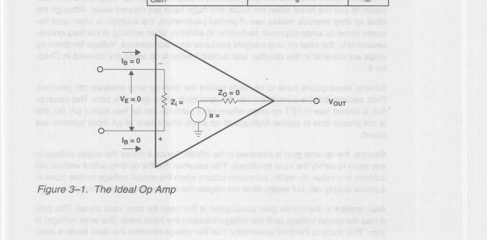
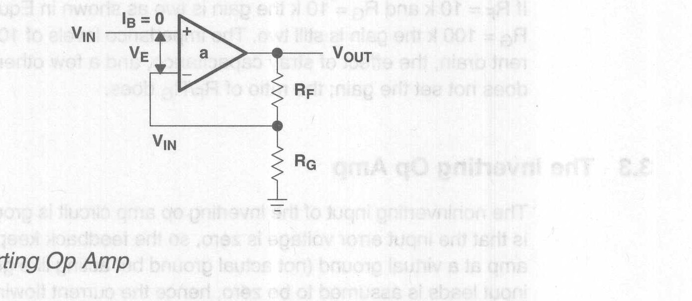
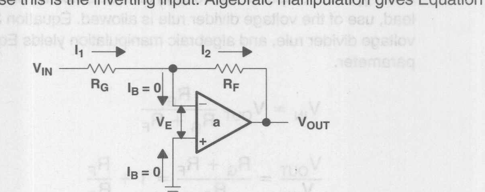
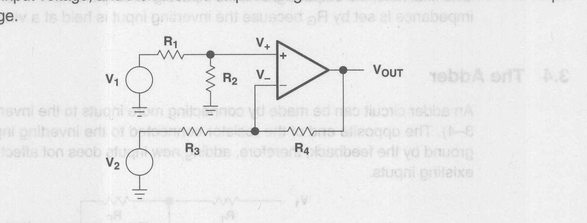

# 第七章 运算放大器

> 本章以 TI《Op Amps For Everyone》为主要参考，从**物理本质**出发，讲清运算放大器的工作原理、理想模型、基本电路、实际参数、单电源设计与稳定性，并给出选型与布局要点。文中公式一律"由物理过程引出、再逐项解读"。

## 7.1 运放的物理本质

### 7.1.1 什么是运算放大器

运算放大器（Operational Amplifier，简称运放）是一个**高增益的差分放大器**。它有两个输入端（同相端 +、反相端 −）和一个输出端：

- **同相端（+）**：输入信号升高，输出升高
- **反相端（−）**：输入信号升高，输出降低
- **输出**：正比于两输入端的**差值**（差模），而不是某一端的绝对值

**为什么叫"运算"放大器**：早期运放用于模拟计算机，通过不同的反馈网络实现加法、减法、积分、微分等"数学运算"。因此运放的核心不是"放大"本身，而是"**用反馈网络实现各种传递函数**"。

### 7.1.2 内部结构

运放的内部通常由三级构成：

1. **差分输入级**：把"两输入之差"转换为电流，同时抑制共模信号
2. **增益级**：提供高电压增益（通常 100 dB 以上）
3. **输出级**：提供低输出阻抗、大电流驱动能力

**物理本质**：运放内部是"**差分 → 放大 → 缓冲**"的链条。它的开环增益极高（理想为无穷大），因此只要加上**负反馈**，就能把"增益"从"器件参数"变成"外部电阻之比"。

### 7.1.3 物理本质：高增益 + 负反馈

运放的核心思想可以用一句话概括：**用极高的开环增益，把误差"压"到几乎为零**。

- 开环时，运放的输出 = A·(V+ − V−)，A 极大
- 加上负反馈后，输出会"自动调整"到使 V+ ≈ V−（误差趋近于零）
- 因此**闭环增益只由外部电阻决定**，与运放本身的参数几乎无关

**这就是"虚短"的物理来源**：不是输入真的短路了，而是高增益 + 负反馈把误差"压"到了接近零。

> **融会贯通**：这与[第四章](第四章-系统环路.md) 的"负反馈把扰动压制到 1/(1+T)"是同一个道理——运放就是一个"T 极大"的反馈系统。

## 7.2 理想运放模型

### 7.2.1 五条理想假设

理想运放假设以下五个参数为"完美值"：

| 参数 | 理想值 | 实际值 | 物理含义 |
| --- | --- | --- | --- |
| **输入电流 IIN** | 0 | pA~µA | 输入阻抗无穷大 |
| **输入失调电压 VOS** | 0 | µV~mV | 两输入完全对称 |
| **输入阻抗 ZIN** | ∞ | MΩ~TΩ | 不从信号源取电流 |
| **输出阻抗 ZOUT** | 0 | Ω 级 | 能驱动任意负载 |
| **开环增益 a** | ∞ | 10⁵~10⁷ | 误差被压到零 |

**图中讲解**：

- **IB = 0**：两输入端的偏置电流为零（理想）
- **VE = 0**：两输入端的误差电压为零（虚短）
- **ZI = ∞**：输入阻抗无穷大
- **ZO = 0**：输出阻抗为零
- **a = ∞**：开环增益无穷大
- 输出 VOUT 由受控源 a·VE 决定

**为什么可以这样假设**：现代运放的实际参数已非常接近理想值；在低频（几 kHz）下，用理想模型分析的结果与实测吻合。

### 7.2.2 虚短与虚断

由理想假设可以推出两条"黄金法则"：

**（1）虚短（Virtual Short）**

$$
V_{+} \approx V_{-} \qquad (7.1)
$$

**物理本质**：开环增益无穷大 + 负反馈 → 输出会调到使两输入之差为零。注意"虚短"只在**负反馈**下成立；开环或正反馈时不成立。

**（2）虚断（Virtual Open）**

$$
I_{+} \approx I_{-} \approx 0 \qquad (7.2)
$$

**物理本质**：输入阻抗无穷大 → 输入引脚几乎不取电流。因此"流入输入端的电流为零"，可以据此列节点方程。

**两条法则的用途**：用"虚短"得到电压关系，用"虚断"得到电流关系，两者联立即可解出任何运放电路的传递函数。

## 7.3 基本电路

### 7.3.1 同相放大器

**图中讲解**：

- 输入 VIN 接**同相端**（+）
- 反相端（−）经 RG 接地、经 RF 接输出，构成负反馈
- **反馈的作用**：把输出的一部分送回反相端，使 V− 跟踪 V+

**推导**（用虚短 + 虚断）：

- 虚短：V− = V+ = VIN
- 虚断：流过 RG 的电流 = 流过 RF 的电流
- 由分压：V− = VOUT·RG/(RG+RF)
- 联立得：

$$
\frac{V_{OUT}}{V_{IN}} = 1 + \frac{R_{F}}{R_{G}} \qquad (7.3)
$$

**逐项解读**：

- 增益 ≥ 1，且**同相**（输出与输入同相）
- RF = 0 或 RG = ∞ 时，增益 = 1 → **电压跟随器（缓冲器）**
- 输入阻抗极高（运放输入阻抗），适合"高阻信号源"

**物理本质**：同相放大器是"**电压串联负反馈**"——反馈电压与输入电压"串联"比较，因此输入阻抗高。

### 7.3.2 反相放大器

**图中讲解**：

- 输入 VIN 经 RG 接**反相端**（−）
- 同相端（+）接地
- RF 从输出接回反相端，构成负反馈

**推导**：

- 虚短：V− = V+ = 0（**虚地**）
- 虚断：流过 RG 的电流 = 流过 RF 的电流
- I₁ = VIN/RG，I₂ = −VOUT/RF
- 联立得：

$$
\frac{V_{OUT}}{V_{IN}} = -\frac{R_{F}}{R_{G}} \qquad (7.4)
$$

**逐项解读**：

- 增益可小于 1（衰减），且**反相**
- 输入阻抗 = RG（较低）
- "虚地"使反相端电位≈0，但**并非真的接地**

**物理本质**：反相放大器是"**电压并联负反馈**"——反馈电流与输入电流"并联"比较，因此输入阻抗低、带宽较宽。

### 7.3.3 加法器

在反相放大器的反相端再接若干输入电阻，就得到**加法器**：

$$
V_{OUT} = -\left(\frac{R_{F}}{R_{1}}V_{1} + \frac{R_{F}}{R_{2}}V_{2} + \cdots\right) \qquad (7.5)
$$

**物理本质**：反相端是"虚地"，各输入支路的电流在虚地点"相加"，再经 RF 转换成电压——这就是"电流求和 + 电流-电压转换"。

### 7.3.4 差分放大器

**图中讲解**：

- V₁ 经 R₁ 接反相端，R₂ 从反相端接地（或接参考）
- V₂ 经 R₃ 接同相端，R₄ 从同相端接输出（反馈）

**推导**（用叠加定理）：

- 当 R₂ = R₄、R₁ = R₃ 时：

$$
V_{OUT} = (V_{1} - V_{2})\frac{R_{4}}{R_{3}} \qquad (7.6)
$$

**逐项解读**：

- 只放大**差模**（V₁ − V₂），抑制**共模**
- 共模抑制能力来自"电阻比的匹配"
- 缺点：输入阻抗不匹配；高精度场合需用"仪表放大器"（三运放）

**物理本质**：差分放大器是"**减法器**"——用电阻网络把"两输入之差"提取出来，再放大。

### 7.3.5 积分器与微分器

把反馈电阻 RF 换成电容 C：

- **积分器**：输入经 R 接反相端，反馈为 C

$$
V_{OUT} = -\frac{1}{RC}\int V_{IN}\,dt \qquad (7.7)
$$

- **微分器**：输入经 C 接反相端，反馈为 R

$$
V_{OUT} = -RC\frac{dV_{IN}}{dt} \qquad (7.8)
$$

**物理本质**：电容的"电压-电流"关系是微分/积分，运放把它"搬"到反馈网络里，就实现了数学运算——这就是"运算放大器"名字的由来。

### 7.3.6 电压跟随器（缓冲器）

同相放大器令 RF = 0、RG = ∞（即输出直接接反相端）：

$$
V_{OUT} = V_{IN} \qquad (7.9)
$$

**物理本质**：增益为 1，但**输入阻抗极高、输出阻抗极低**——用于"阻抗变换/隔离"，把高阻信号源接到低阻负载。

## 7.4 实际运放参数

理想模型只适用于低频、小信号。实际运放有一系列"非理想"参数，直接决定电路性能。

### 7.4.1 开环增益与增益带宽积（GBW）

实际开环增益 A 随频率下降，通常以 **−20 dB/dec** 下降，其"增益 × 带宽"为常数：

$$
\text{GBW} = A \cdot f \qquad (7.10)
$$

**逐项解读**：

- GBW（增益带宽积）是运放的"固有常数"（如 1 MHz、10 MHz）
- 闭环增益越高，可用带宽越窄：f−3dB ≈ GBW / 闭环增益
- **物理本质**：运放内部有"主极点"，增益与带宽成反比——这是"增益换带宽"的权衡

### 7.4.2 压摆率（Slew Rate, SR）

输出最大变化速率：

$$
\text{SR} = \left.\frac{dV_{OUT}}{dt}\right|_{\max} \qquad (7.11)
$$

**逐项解读**：SR 限制了大信号、高频时的输出能力。若要求输出幅度 Vp、频率 f，则需 SR ≥ 2πf·Vp，否则输出会变成"三角波"。

**物理本质**：SR 由内部"补偿电容的充电电流"决定——电流有限，电容充电速度有限。

### 7.4.3 输入失调电压与失调电流

- **VOS（输入失调电压）**：使输出为零所需的"两输入补偿电压"，典型 µV~mV
- **IOS（输入失调电流）**：两输入偏置电流之差

**物理本质**：运放内部差分对"不完全对称"，导致输入有"零点误差"。直流精度要求高时，要选低 VOS 的运放，或外加调零。

### 7.4.4 共模抑制比（CMRR）

差分放大器对共模信号的抑制能力：

$$
\text{CMRR} = 20\log\frac{A_{d}}{A_{cm}} \qquad (7.12)
$$

**逐项解读**：Ad 为差模增益，Acm 为共模增益。CMRR 越高，共模干扰（如 50 Hz 工频）被抑制得越好。

### 7.4.5 电源抑制比（PSRR）

电源电压变化对输出的影响：

$$
\text{PSRR} = 20\log\frac{\Delta V_{OUT}}{\Delta V_{CC}} \qquad (7.13)
$$

**物理本质**：电源纹波会通过内部电路"漏"到输出；PSRR 越高，抗电源干扰能力越强。

### 7.4.6 噪声

运放的噪声分为：

- **电压噪声 en**（nV/√Hz）：等效到输入端的电压噪声
- **电流噪声 in**（pA/√Hz）：等效到输入端的电流噪声
- **1/f 噪声**：低频段随频率降低而增大

**物理本质**：噪声来自"载流子的随机运动"（热噪声、散粒噪声、闪烁噪声）。低噪声设计要选 en、in 小的运放，并注意源阻抗匹配。

### 7.4.7 输出摆幅

实际运放的输出不能达到电源轨（除非是 rail-to-rail 运放）：

- 普通运放：输出比电源轨低 1~2 V
- **Rail-to-Rail（R2R）运放**：输出可接近电源轨

**物理本质**：输出级的晶体管需要一定的"饱和压降"，因此不能完全到轨。

## 7.5 单电源设计

### 7.5.1 单电源 vs 双电源

- **双电源**（如 ±15 V）：输入输出以 0 V 为参考，信号可正可负
- **单电源**（如 +5 V、+3.3 V）：只有一个电源，输入输出以"中点"为参考

**物理本质**：运放只关心"两输入之差"和"输出相对电源的摆幅"，不关心"地"在哪里。单电源下，只要把信号"抬"到中点，运放就能正常工作。

### 7.5.2 偏置（虚拟地）

单电源设计的关键，是给运放建立"**虚拟地**"（通常是 VCC/2）：

- 用两个等值电阻分压，得到 VCC/2
- 用运放缓冲（跟随器）增强驱动能力
- 用去耦电容稳定中点

**物理本质**：虚拟地把"0 V 参考"从真正的地"抬"到 VCC/2，使交流信号可以在"中点上下"摆动。

### 7.5.3 单电源电路示例

以同相放大器为例，单电源下：

- 输入信号先经隔直电容，再经偏置电阻抬到 VCC/2
- 反馈网络也以 VCC/2 为参考
- 输出以 VCC/2 为中心摆动

**设计要点**：偏置电阻要足够大（减小对信号的分流），又要足够小（提供稳定的偏置电流）；去耦电容要靠近运放。

## 7.6 反馈与稳定性

### 7.6.1 反馈方程

运放闭环系统的环路增益与闭环增益：

$$
T(s) = A(s)\beta \qquad (7.14)
$$

$$
A_{closed}(s) = \frac{A(s)}{1 + A(s)\beta} \qquad (7.15)
$$

**逐项解读**：A(s) 为开环增益，β 为反馈系数。当 |Aβ| ≫ 1 时，Aclosed ≈ 1/β——**闭环增益只由反馈网络决定**。

### 7.6.2 相位裕度与稳定性

反馈系统的稳定性由**相位裕度**决定（与[第四章](第四章-系统环路.md) 相同）：

- PM > 45°：稳定
- PM < 45°：超调、振铃
- PM < 0：振荡

**物理本质**：运放内部有一个"主极点"，外加反馈后可能变成"二阶系统"，在频率较高时相位滞后过大——因此需要"补偿"。

### 7.6.3 容性负载

运放驱动**容性负载**（如电缆、ADC 采样电容）时，输出阻抗与负载电容形成"额外极点"，可能导致振荡。

**对策**：

- 输出串小电阻（隔离电容）
- 用"容性负载专用"运放
- 加 RC 吸收网络

### 7.6.4 补偿

内部补偿：运放内部已有补偿电容，保证单位增益稳定。

外部补偿：通过外部 RC 网络调整反馈系数或增加零点，改善稳定性。

## 7.7 电压反馈 vs 电流反馈

### 7.7.1 电压反馈（VFA）

- 反馈信号是**电压**
- 输入级是"差分对"，输入阻抗高
- 增益带宽积（GBW）为常数：增益越高，带宽越窄

**特点**：通用、精度高、噪声低，适合大多数信号处理。

### 7.7.2 电流反馈（CFA）

- 反馈信号是**电流**
- 输入级是"缓冲器 + 电流镜"，反相端输入阻抗低
- 带宽**几乎与增益无关**，适合高增益、高带宽

**特点**：高速、大带宽，适合视频、ADC 驱动；但反馈电阻 RF 固定，不能随意改。

### 7.7.3 对比

| 特性 | 电压反馈（VFA） | 电流反馈（CFA） |
| --- | --- | --- |
| 反馈量 | 电压 | 电流 |
| 反相输入阻抗 | 高 | 低 |
| 带宽 vs 增益 | 反比（GBW 常数） | 近似无关 |
| 稳定性 | 与 RF、RG 都有关 | 主要由 RF 决定 |
| 典型应用 | 通用信号处理 | 高速、视频、ADC 驱动 |

## 7.8 典型应用

### 7.8.1 比较器

比较器是"开环运放"：比较两输入的大小，输出高/低。

**为什么不能直接用运放做比较器**：

- 运放设计为"线性放大"，输出摆率慢、恢复慢
- 比较器设计为"快速翻转"，有内部迟滞
- 运放做比较器可能"卡在中间"（线性区），速度慢

### 7.8.2 有源滤波器

用运放 + RC 网络实现低通、高通、带通、带阻（Sallen-Key、多重反馈等）。

**物理本质**：运放提供"增益与缓冲"，RC 提供"频率选择性"——两者结合，得到"有源滤波器"。

### 7.8.3 电流检测

- **低边检测**：采样电阻在负载与地之间，用差分放大器放大压降
- **高边检测**：采样电阻在电源与负载之间，需要"高共模抑制"的电流检测放大器

**物理本质**：把"电流"转换成"电压"（V = I·R），再用差分放大器放大。

### 7.8.4 仪表放大器

三运放结构：两个缓冲器 + 一个差分放大器，实现"高输入阻抗 + 高共模抑制 + 可调增益"。

**物理本质**：用"缓冲器"隔离输入，用"差分"抑制共模，用"增益电阻"设定放大倍数。

## 7.9 选型与布局

### 7.9.1 选型要点

| 场景 | 关键参数 |
| --- | --- |
| **高精度直流** | 低 VOS、低漂移、高 CMRR |
| **高速** | 高 GBW、高压摆率、低容性负载敏感 |
| **低噪声** | 低 en、低 in |
| **低功耗** | 低静态电流、低电源电压 |
| **单电源** | Rail-to-Rail 输入/输出 |
| **驱动容性负载** | 容性负载能力、输出隔离电阻 |

### 7.9.2 布局要点

1. **电源去耦**：每个电源引脚就近放 0.1 µF + 10 µF 电容
2. **反馈走线**：反馈电阻靠近运放，缩短走线（减小寄生电容）
3. **输入走线**：高阻输入走线要短，远离数字信号（防干扰）
4. **地平面**：完整地平面，避免分割
5. **容性负载**：输出串小电阻或加 RC 吸收

## 7.10 小结

1. **物理本质**：运放是"高增益差分放大器 + 负反馈"——用极高增益把误差压到零，使闭环增益只由外部电阻决定。
2. **理想模型**：五条假设（IIN=0、VOS=0、ZIN=∞、ZOUT=0、a=∞），推出"虚短"与"虚断"。
3. **基本电路**：同相（1+RF/RG）、反相（−RF/RG）、加法、差分、积分/微分、跟随器。
4. **实际参数**：GBW、SR、VOS、CMRR、PSRR、噪声、输出摆幅——决定了"能用在哪"。
5. **单电源**：用"虚拟地"把信号抬到中点。
6. **稳定性**：与第四章的相位裕度一脉相承；容性负载要注意。
7. **VFA vs CFA**：电压反馈通用、电流反馈高速。

> **融会贯通**：本章与[第四章](第四章-系统环路.md) 的"负反馈、相位裕度"、[第零章](第零章-数学基础.md) 的"传递函数、极点"、[第三章](第三章-电源原理图常识.md) 的"电阻/电容"直接对应——运放电路就是"用电阻电容搭建的传递函数"。
