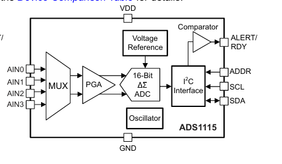

# 第三章 ADC 电路

> 本章介绍 ADC 的选型思路与逐次逼近（SAR）架构。

## 3.1 ADC 选型与逐次逼近架构

### 3.1.1 应用场景

ADC 的应用场景很多，不同需求对 ADC 的要求不同：

- 示波器、逻辑分析仪等高速设备：要求**高采样率、高带宽**；
- 传感器采样、电池检测等：更看重**精度、低噪声、低功耗**。

### 3.1.2 逐次逼近架构

ADC 最常见的方式是**逐次逼近（SAR）**。以 TI 的 ADS1115（16 位 ΔΣ ADC，I²C 接口）为例：

关键模块：

- **MUX（多路选择器）**：支持差分输入与四通道输入；
- **PGA（可编程增益放大器）**：通过编程控制增益，接收低幅值信号；
- **16 位 ΔΣ ADC**：完成模数转换；
- **I²C 接口**：输出数据；
- 内部还有电压基准、振荡器、比较器等。

### 3.1.3 分辨率

ADC 的量化单位（LSB）为：

$$
\text{LSB} = \frac{V_{ref}}{2^N} \qquad (3.1)
$$

其中 Vref 为参考电压，N 为位数。位数越高、参考电压越小，分辨率越高。
