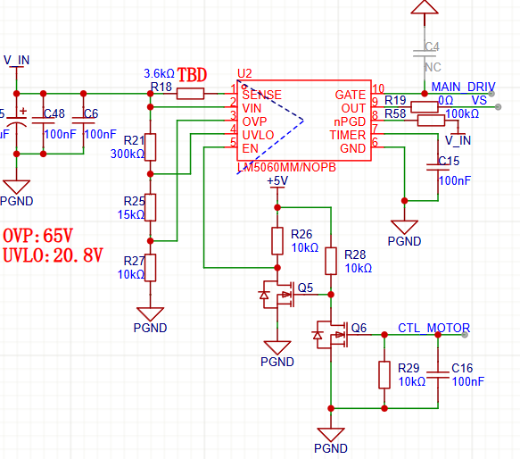

# 第二章 常见保护电路设计

> 本章从"为什么需要保护"出发，讲清**过压保护**与**高侧电压保护**的工作原理、数学本质与物理本质；公式一律"由物理过程引出、再逐项解读"，并与元件、MOSFET 章节**融会贯通**。

## 2.1 为什么需要保护电路

任何器件都有极限：

- **MOS 的 VDS** 超过击穿电压 → 雪崩击穿（见[第五章 5.9](第五章-MOSFET特性与选型.md)）
- **栅氧** 超过耐压 → 击穿
- **电流过大** → 过热烧毁
- **浪涌 / 静电** → 瞬时高压打穿

保护电路的定位：**在异常时"牺牲自己"或"快速切断 / 钳位"，保住后级系统**。它要回答三个问题：

1. **什么时候动作**（阈值）
2. **怎么动作**（切断 / 钳位 / 限流）
3. **动作多快**（响应速度）

## 2.2 过压保护电路

### 2.2.1 电路结构

典型电路由**齐纳二极管 + PNP 三极管 + PMOS** 构成：

### 2.2.2 工作原理

按输入电压分两个状态：

- **低于预设电平**：Q2 基极为高电平 → 三极管关闭 → 后级 PMOS 源极为低电平 → **PMOS 导通**，正常供电
- **超过预设电平**：齐纳二极管（图中 U24 为 BZT52B13，13 V）击穿 → Q2 基极被拉低 → 三极管打开 → PMOS 的 VGS 等于 PNP 的压降 → **PMOS 截止**，切断输出

### 2.2.3 由物理引出公式

**物理过程**：齐纳二极管反向击穿后电压基本恒定（VZ），这个恒定电压通过 PNP 的基射结（VBE）耦合到 PMOS 栅极，形成保护阈值。

$$
V_{OVP} \approx V_{Z} + V_{BE} \qquad (2.1)
$$

**逐项解读**：

- **VZ**：齐纳击穿电压（选型关键）
- **VBE**：PNP 基射压降（约 0.6~0.7 V）
- 两者相加，就是"输入电压升到多少时开始动作"

**计算示例**：以 12 V 输出为例，选 13 V 齐纳、VBE≈0.7 V：

$$
V_{OVP} \approx 13 + 0.7 = 13.7\text{ V}
$$

即输入升到约 13.7 V 时切断。

### 2.2.4 物理本质

- **齐纳二极管**：反向击穿后电压基本恒定（稳压），像一个"电压门限开关"
- **PNP 三极管**：电流放大 + 开关，把齐纳的"微小电流"放大成"能拉低 PMOS 栅极"的驱动
- **PMOS**：受控开关，栅极电压决定通断（详见[第五章 5.10](第五章-MOSFET特性与选型.md)）

**整条链**：过压 → 齐纳击穿 → 基极电位下降 → PNP 导通 → PMOS 栅极被拉高 → PMOS 截止。

### 2.2.5 设计要点

- **齐纳选型**：以 12 V 输出为例，选 13 V 齐纳（略高于额定输出，避免误触发）
- **大功率散热**：输出额定功率超过 40 W 时，采用**多 MOS 并联**降低内阻、缓解热效应（并联原理见[第一章 1.3.5](第一章-开关电源设计.md)）
- **为什么用 PMOS 而不是 NMOS**：
  - PMOS 的衬底 PN 结可承受更高的反偏电压（可达 100 V 级）
  - NMOS 的 VGS 耐压通常只有 20 V 左右
  - PMOS 通过基极（栅极）接高电位即可控制（高边驱动简单，见第五章 5.10.2）

## 2.3 高侧电压保护（功率电子开关）

### 2.3.1 为什么需要

2.2 节的齐纳 + PNP + PMOS 方案一般适用于 36 V 以下。实际场景中还会遇到**浪涌、过压、欠压、过流**等问题，单一 PNP + PMOS 电路不够用；而每个模块都配一套保护电路，又会给 PCB 布局带来困难。

### 2.3.2 工作原理

改用**功率电子开关**（如 LM5060）做高侧功率保护：

- 高侧开关集成**过压（OVP）/ 欠压（UVLO）/ 过流**保护
- **EN 端接 GPIO**，实现使能控制
- MCU 驱动能力不足时，采用**两个 MOS 级联**增强驱动能力
- 可**隔离单片机，防止电流倒灌**

### 2.3.3 数学本质

**OVP / UVLO 阈值**：由电阻分压设定（图中 OVP: 65 V，UVLO: 20.8 V）。设分压比为 k：

$$
V_{threshold} = V_{ref} \cdot \frac{R_{1} + R_{2}}{R_{2}} \qquad (2.2)
$$

**逐项解读**：

- **Vref**：芯片内部基准
- **R1、R2**：分压电阻
- 改变电阻比，就能设定不同的保护阈值

**过流检测**：通过采样电阻 Rsense 检测压降：

$$
V_{sense} = I \cdot R_{sense} \qquad (2.3)
$$

**逐项解读**：Vsense 超过芯片阈值 → 判定过流 → 关断。Rsense 要选**合金电阻**（低阻值、低温度系数，见[第三章 3.4.2](第三章-电源原理图常识.md)）。

### 2.3.4 物理本质

功率电子开关 = **可控的"智能保险丝"**：

- 正常时像"导线"（低 Rds(on)）
- 异常时像"快速开关"（微秒级切断）
- "高侧" = 在电源正极侧控制，切断后负载完全失电

### 2.3.5 保护逻辑

- **过压**：Vin > 阈值 → 关断
- **欠压**：Vin < 阈值 → 关断
- **过流**：I > 阈值 → 关断
- **故障恢复**：延时重试或锁定

## 2.4 保护电路设计要点

1. **阈值**：留足裕量，避免误触发
2. **响应速度**：浪涌要快（µs 级），过压可以慢一些
3. **失效安全**：保护电路本身失效时，系统应进入安全态
4. **功耗**：限流电阻、钳位器件的功耗要算清
5. **温度**：功率器件要算热（见[第五章 5.8.7](第五章-MOSFET特性与选型.md) 结温计算）

## 2.5 常见保护器件对比

| 器件 | 作用 | 物理本质 | 特点 |
| --- | --- | --- | --- |
| **TVS** | 瞬态电压抑制 | 雪崩击穿，快速钳位 | 响应快（ns~µs），适合浪涌 / ESD |
| **齐纳二极管** | 稳压 / 钳位 | 反向击穿后电压稳定 | 价格低，适合慢速过压 |
| **PTC 自恢复保险** | 过流保护 | 温度升高 → 电阻变大 | 可自恢复，适合持续过流 |
| **保险丝** | 过流切断 | 电流过大 → 熔断 | 一次性，可靠 |
| **OCP 电路** | 过流保护 | 采样 + 比较 + 关断 | 可调阈值、可恢复 |

> **融会贯通**：TVS / 齐纳 / 普通二极管都属于"PN 结器件"，它们的差异来自**工艺**（见[第三章 3.5.2](第三章-电源原理图常识.md)）；而 MOSFET 的雪崩能力（EAS）和 SOA 是选 MOS 时校核安全的依据（见[第五章 5.9](第五章-MOSFET特性与选型.md)）。

### 2.5.1 选择逻辑

- **瞬态 / 浪涌** → TVS（要快）
- **持续过压** → 齐纳 / 过压保护电路
- **持续过流 / 短路** → PTC 或保险丝
- **需要可恢复、可调阈值** → OCP 电路

### 2.5.2 物理本质回顾

所有保护器件的共同点：**在异常时改变自己的"阻抗"或"状态"**——

- 钳位类（TVS / 齐纳）：异常时阻抗骤降，把电压"钉住"
- 切断类（保险丝 / PTC）：异常时阻抗骤增，把电流"掐断"
- 控制类（OCP）：检测 + 主动关断

保护的本质，是**用器件自身的"牺牲"或"状态切换"，把异常能量挡在后级之外**。

## 2.6 保护电路设计流程与失效模式

### 2.6.1 设计流程

1. **确定威胁**：过压？过流？浪涌？静电？
2. **确定阈值**：正常范围 + 裕量 → 阈值
3. **确定动作方式**：钳位 / 切断 / 限流
4. **校核能量**：钳位器件的功耗、TVS 的能量、MOS 的 SOA
5. **失效分析**：保护器件失效时，系统是否安全？

### 2.6.2 常见失效模式

| 失效 | 原因 | 后果 |
| --- | --- | --- |
| 保护器件被击穿 | 能量超过钳位器件容量 | 失去保护，后级暴露 |
| 保护误触发 | 阈值太接近正常工作点 | 频繁掉电 |
| 保护响应太慢 | 浪涌前沿太快 | 后级先被打穿 |
| 保护器件漏电 | 高温、老化 | 待机功耗大、误动作 |

**结论**：保护电路不是"加个器件就行"，要**按威胁类型选器件、按能量校核器件、按失效模式留后手**。
