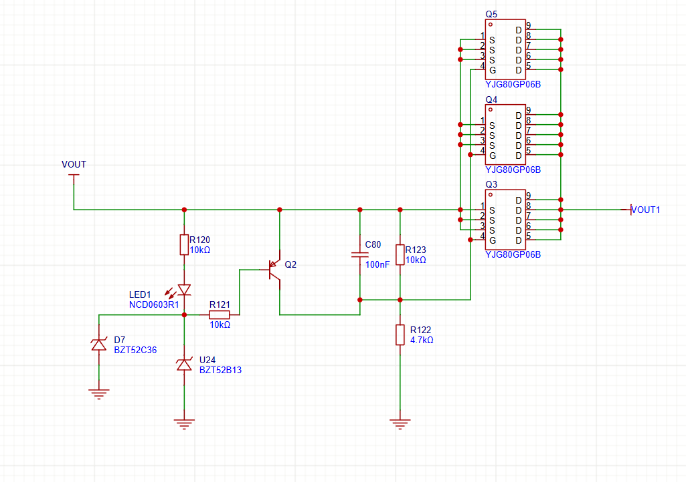

# 第二章 常见保护电路设计

> 本章从"为什么需要保护"出发，讲清**过压保护**与**高侧电压保护**的工作原理、数学本质与物理本质；每个电路都讲清"**为什么这样设计、每个元件的作用、设计的巧思**"，并与元件、MOSFET 章节融会贯通。

## 2.1 为什么需要保护电路

### 2.1.1 器件的极限

任何器件都有极限，超出极限就会损坏：

| 器件/部位 | 极限 | 超出后果 |
| --- | --- | --- |
| **MOS 的 VDS** | 击穿电压 | 雪崩击穿（可恢复）或热击穿（损坏） |
| **栅氧** | 栅源耐压（如 ±20V） | 栅氧击穿，永久损坏 |
| **电流** | 最大电流 | 过热、烧毁 |
| **浪涌/静电** | 瞬时高压 | 打穿 PN 结或栅氧 |

### 2.1.2 保护电路的定位

保护电路在系统中的作用，可以概括为：**在异常时"牺牲自己"或"快速切断/钳位"，保住后级系统**。

它与"稳压"不同：稳压是"正常时工作"，保护是"异常时动作"。因此保护电路的设计目标不是"效率高"，而是"**该动作时一定动作、动作足够快、动作后系统安全**"。

### 2.1.3 保护电路要回答的三个问题

1. **什么时候动作**（阈值）——由什么信号触发？
2. **怎么动作**（切断/钳位/限流）——是断开、短路还是限流？
3. **动作多快**（响应速度）——微秒级还是毫秒级？

这三个问题决定了保护电路的结构与器件选择。

## 2.2 过压保护电路

### 2.2.1 电路结构

典型电路由**齐纳二极管 + PNP 三极管 + PMOS** 构成：

| 元件 | 作用 | 设计目的 |
| --- | --- | --- |
| **齐纳二极管 U24** | 检测过压 | 反向击穿后电压恒定，作为"电压门限" |
| **PNP 三极管 Q2** | 放大 + 开关 | 把齐纳的微小电流放大成驱动能力 |
| **PMOS** | 主开关 | 正常时导通，过压时切断 |
| **分压/限流电阻** | 设定阈值、限流 | 保护齐纳与三极管 |

### 2.2.2 工作原理（两个状态）

保护电路按输入电压分两个状态，本质上是一个"**电压门限开关**"：

**状态 1：输入电压低于预设电平**

- 齐纳二极管未击穿，Q2 基极为高电平
- PNP 三极管**关闭**
- 后级 PMOS 的源极（经电阻）为低电平，VGS 满足导通条件
- **PMOS 导通**，正常供电

**状态 2：输入电压超过预设电平**

- 齐纳二极管（图中 U24 为 BZT52B13，13 V）**击穿**
- Q2 基极被拉低，PNP 三极管**打开**
- PMOS 的 VGS 等于 PNP 的压降（接近 0），不足以导通
- **PMOS 截止**，切断输出

**整条链**：过压 → 齐纳击穿 → 基极电位下降 → PNP 导通 → PMOS 栅极被拉高 → PMOS 截止。

### 2.2.3 数学本质：保护阈值

**物理过程**：齐纳二极管反向击穿后电压基本恒定（VZ），这个恒定电压通过 PNP 的基射结（VBE）耦合到 PMOS 栅极，形成保护阈值。

$$
V_{OVP} \approx V_{Z} + V_{BE} \qquad (2.1)
$$

**逐项解读**：

- **VZ**：齐纳击穿电压（选型关键）
- **VBE**：PNP 基射压降（约 0.6~0.7 V）
- 两者相加，就是"输入电压升到多少时开始动作"

**计算示例**：以 12 V 输出为例，选 13 V 齐纳、VBE≈0.7 V：

$$
V_{OVP} \approx 13 + 0.7 = 13.7\text{ V} \qquad (2.2)
$$

即输入升到约 13.7 V 时切断。

### 2.2.4 物理本质：为什么这样设计

**（1）为什么用齐纳二极管做"门限"？**

齐纳二极管在反向击穿后，电压几乎不随电流变化——它是一个"**电压门限开关**"。当输入电压低于 VZ 时，它不导通；超过 VZ 时，它击穿导通，把电压"钉"在 VZ 附近。这正是"过压检测"需要的特性。

**（2）为什么需要 PNP 三极管？**

齐纳击穿后的电流很小（毫安级），不足以直接驱动 PMOS 栅极。PNP 三极管起"**电流放大**"作用：把齐纳的微小电流放大成能拉低 PMOS 栅极的驱动电流。

**（3）为什么 PMOS 栅极被拉高就截止？**

PMOS 是"**低电平导通、高电平截止**"的器件（源极接高电位，栅极拉低才导通）。当过压时，PNP 导通，把 PMOS 栅极拉高到接近源极电位，VGS≈0，PMOS 截止。

**（4）为什么用 PMOS 而不是 NMOS？**

- PMOS 的衬底 PN 结可承受更高的反偏电压（可达 100 V 级）
- NMOS 的 VGS 耐压通常只有 20 V 左右
- PMOS 高边驱动简单（栅极拉低即导通），不需要自举

**（5）设计巧思：整条链是"电压→电流→电压"的转换**

过压（电压）→ 齐纳击穿（电流）→ 三极管放大（更大电流）→ PMOS 栅极（电压）→ 切断。这条链把"过压检测"与"开关动作"解耦，让每个器件只做它擅长的事。

### 2.2.5 设计要点

- **齐纳选型**：以 12 V 输出为例，选 13 V 齐纳（略高于额定输出，避免误触发）
- **大功率散热**：输出额定功率超过 40 W 时，采用**多 MOS 并联**降低内阻、缓解热效应（并联原理见[第一章 1.3.5](第一章-开关电源设计.md)）
- **响应速度**：齐纳 + 三极管的响应是微秒级，适合慢速过压；浪涌要用 TVS

## 2.3 高侧电压保护（功率电子开关）

### 2.3.1 为什么需要

2.2 节的齐纳 + PNP + PMOS 方案一般适用于 36 V 以下。实际场景中还会遇到**浪涌、过压、欠压、过流**等问题，单一 PNP + PMOS 电路不够用；而每个模块都配一套保护电路，又会给 PCB 布局带来困难。

### 2.3.2 工作原理

改用**功率电子开关**（如 LM5060）做高侧功率保护：

| 功能 | 实现方式 |
| --- | --- |
| **过压（OVP）** | 电阻分压检测，超过阈值关断 |
| **欠压（UVLO）** | 电阻分压检测，低于阈值关断 |
| **过流** | 采样电阻检测压降 |
| **使能控制** | EN 端接 GPIO |
| **驱动增强** | MCU 驱动不足时，两个 MOS 级联 |

### 2.3.3 数学本质

**OVP / UVLO 阈值**：由电阻分压设定（图中 OVP: 65 V，UVLO: 20.8 V）。设分压比为 k：

$$
V_{threshold} = V_{ref} \cdot \frac{R_{1} + R_{2}}{R_{2}} \qquad (2.3)
$$

**逐项解读**：

- **Vref**：芯片内部基准
- **R1、R2**：分压电阻
- 改变电阻比，就能设定不同的保护阈值

**过流检测**：通过采样电阻 Rsense 检测压降：

$$
V_{sense} = I \cdot R_{sense} \qquad (2.4)
$$

**逐项解读**：Vsense 超过芯片阈值 → 判定过流 → 关断。Rsense 要选**合金电阻**（低阻值、低温度系数，见[第三章 3.4.2](第三章-电源原理图常识.md)）。

### 2.3.4 物理本质：为什么这样设计

**（1）为什么用"功率电子开关"而不是分立方案？**

分立方案（齐纳 + 三极管 + PMOS）只能做"单一过压保护"，且阈值固定。功率电子开关把 OVP、UVLO、OCS、使能集成在一个芯片里，**阈值可调、保护更全面、布局更紧凑**。

**（2）为什么"高侧"？**

"高侧"指在电源正极侧控制。切断后，负载完全失电（包括地线），比"低侧"更安全。

**（3）为什么需要两个 MOS 级联？**

MCU 的 GPIO 驱动能力有限（毫安级），不足以快速驱动大功率 MOS 的栅极。两个 MOS 级联可以"逐级放大"驱动能力。

**（4）设计巧思：芯片化**

把"检测 + 比较 + 驱动 + 保护"集成到一颗芯片，外部只需配置电阻分压。这样既简化了设计，又保证了保护的可靠性。

### 2.3.5 保护逻辑

- **过压**：Vin > 阈值 → 关断
- **欠压**：Vin < 阈值 → 关断
- **过流**：I > 阈值 → 关断
- **故障恢复**：延时重试或锁定

## 2.4 常见保护器件对比

### 2.4.1 器件对比

| 器件 | 作用 | 物理本质 | 特点 |
| --- | --- | --- | --- |
| **TVS** | 瞬态电压抑制 | 雪崩击穿，快速钳位 | 响应快（ns~µs），适合浪涌/ESD |
| **齐纳二极管** | 稳压/钳位 | 反向击穿后电压稳定 | 价格低，适合慢速过压 |
| **PTC 自恢复保险** | 过流保护 | 温度升高 → 电阻变大 | 可自恢复，适合持续过流 |
| **保险丝** | 过流切断 | 电流过大 → 熔断 | 一次性，可靠 |
| **OCP 电路** | 过流保护 | 采样 + 比较 + 关断 | 可调阈值、可恢复 |

> **融会贯通**：TVS / 齐纳 / 普通二极管都属于"PN 结器件"，它们的差异来自**工艺**（见[第三章 3.5.2](第三章-电源原理图常识.md)）；而 MOSFET 的雪崩能力（EAS）和 SOA 是选 MOS 时校核安全的依据（见[第五章 5.9](第五章-MOSFET特性与选型.md)）。

### 2.4.2 选择逻辑

- **瞬态/浪涌** → TVS（要快）
- **持续过压** → 齐纳/过压保护电路
- **持续过流/短路** → PTC 或保险丝
- **需要可恢复、可调阈值** → OCP 电路

### 2.4.3 物理本质：为什么保护器件分"三类"

所有保护器件的共同点：**在异常时改变自己的"阻抗"或"状态"**——

- **钳位类**（TVS/齐纳）：异常时阻抗骤降，把电压"钉住"。物理本质是"击穿后电压恒定"。
- **切断类**（保险丝/PTC）：异常时阻抗骤增，把电流"掐断"。物理本质是"熔断或温升导致电阻变大"。
- **控制类**（OCP）：检测 + 主动关断。物理本质是"用电路主动控制开关"。

**为什么这样分类**：因为不同的威胁需要不同的"响应方式"——瞬态浪涌需要"快速钳位"，持续过流需要"切断"，可恢复场合需要"自恢复"。保护的本质，是**用器件自身的"牺牲"或"状态切换"，把异常能量挡在后级之外**。

## 2.5 保护电路设计流程与失效模式

### 2.5.1 设计流程

1. **确定威胁**：过压？过流？浪涌？静电？
2. **确定阈值**：正常范围 + 裕量 → 阈值
3. **确定动作方式**：钳位/切断/限流
4. **校核能量**：钳位器件的功耗、TVS 的能量、MOS 的 SOA
5. **失效分析**：保护器件失效时，系统是否安全？

### 2.5.2 常见失效模式

| 失效 | 原因 | 后果 |
| --- | --- | --- |
| 保护器件被击穿 | 能量超过钳位器件容量 | 失去保护，后级暴露 |
| 保护误触发 | 阈值太接近正常工作点 | 频繁掉电 |
| 保护响应太慢 | 浪涌前沿太快 | 后级先被打穿 |
| 保护器件漏电 | 高温、老化 | 待机功耗大、误动作 |

**结论**：保护电路不是"加个器件就行"，要**按威胁类型选器件、按能量校核器件、按失效模式留后手**。
