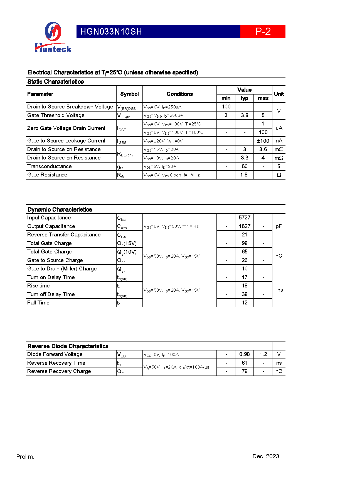
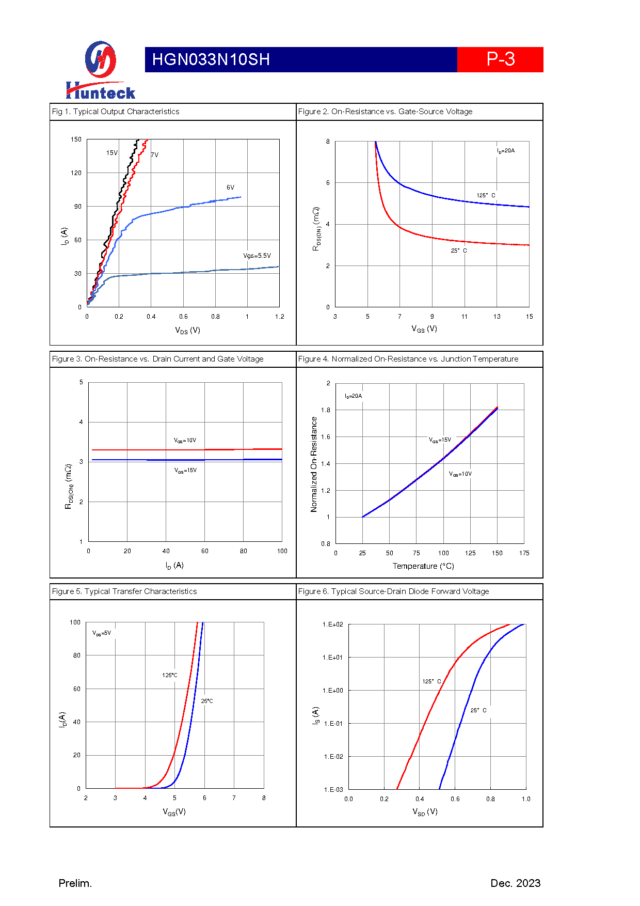

# 第五章 MOSFET 特性与选型

> 本章从**物理本质**出发，讲清 MOSFET 的工作状态、关键参数，以及**不同工况 / 用途下该看重哪些参数**；并用一颗 100 V N-MOS（HGN033N10SH）的规格书做实例分析。

## 5.1 物理本质：MOSFET 是怎么工作的

### 5.1.1 结构

MOSFET 是"金属-氧化物-半导体"结构：

- **G（栅极）**：控制端
- **D（漏极）**、**S（源极）**：主电流两端
- **B（衬底/体）**：常与源极短接
- 栅极与沟道之间是**绝缘的氧化层（SiO₂）**

### 5.1.2 工作原理

- 栅极加电压 → 电场**穿过氧化层**（栅极不流过直流电流）→ 在半导体表面"吸"出**反型层（沟道）**
- NMOS：VGS > VTH → 吸引电子 → 形成 N 型沟道 → 源漏导通
- **|VGS| 越大 → 反型层载流子越多 → 沟道电阻越小**

**物理本质**：**用电场控制电荷（载流子），用电荷控制电阻和电流**。栅极是"阀门"，VGS 决定开多大。

### 5.1.3 三个工作区

| 区域 | 条件（NMOS） | 特点 | 像什么 |
| --- | --- | --- | --- |
| **截止区** | VGS < VTH | 沟道未形成，几乎不导通 | 断开的开关 |
| **线性区（三极管区）** | VDS < VGS − VTH | 沟道连续，电流随 VDS 线性变化 | 可变电阻 |
| **饱和区** | VDS > VGS − VTH | 沟道在漏端夹断，电流基本恒定 | 电流源 |

**物理本质**：线性区是"电阻"（用于开关导通），饱和区是"恒流源"（用于放大）。

## 5.2 关键特性参数

### 5.2.1 电压参数

| 参数 | 含义 | 注意 |
| --- | --- | --- |
| **VDS** | 漏源耐压 | 超过会雪崩击穿 |
| **VGS** | 栅源耐压（常见 ±20 V） | 超过会击穿栅氧 |
| **VGS(th)** | 阈值电压 | 决定"何时开始导通" |

### 5.2.2 电流参数

- **ID**：连续漏极电流
- **IDM**：脉冲漏极电流（短时）

### 5.2.3 导通参数

- **RDS(on)**：导通电阻（决定导通损耗）
- **gfs**：跨导（VGS 变化引起 ID 变化的能力）

### 5.2.4 电容参数

| 参数 | 组成 | 含义 |
| --- | --- | --- |
| **Ciss** | Cgs + Cgd | 输入电容，决定**开关时间** |
| **Coss** | Cds + Cgd | 输出电容，影响**开关损耗 / ZVS** |
| **Crss** | Cgd | 反向传输（**米勒电容**），影响**振荡 / 直通** |

### 5.2.5 电荷参数

| 参数 | 含义 |
| --- | --- |
| **Qg** | 总栅极电荷（驱动损耗 ∝ Qg） |
| **Qgs** | 栅源电荷（VGS 升到平台所需） |
| **Qgd** | 栅漏（**米勒**）电荷（VDS 变化所需） |

### 5.2.6 时间参数

td(on)、tr（开通延迟、上升时间）；td(off)、tf（关断延迟、下降时间）。

### 5.2.7 热参数

- **RθJC**：结到壳热阻
- **RθJA**：结到环境热阻
- **Tj**：结温（通常最大 150 ℃）

### 5.2.8 体二极管参数

- **VSD**：体二极管正向压降
- **trr / Qrr**：反向恢复时间 / 电荷

### 5.2.9 雪崩参数

- **EAS**：单脉冲雪崩能量（感性负载关断时，电感能量无处释放，靠雪崩吸收）

## 5.3 Qgd（米勒电荷）与 Miller 效应

**Qgd 是栅漏之间的电荷**，对应"VDS 变化时需要给 Cgd 充/放的电荷"。

**开关过程中**：

1. VGS 升到阈值附近，沟道开始导通
2. 此时 **VDS 快速变化**，Cgd 需要大量电荷
3. 栅极电流几乎全部流向 Cgd → **VGS 被"钉"在平台电压（米勒平台）**
4. 平台持续时间由 **Qgd** 决定：Qgd 越大，平台越长，开关越慢

**影响**：

- **Qgd 大 → 米勒平台长 → 开关慢 → 开关损耗大**
- **Qgd 大 → 米勒耦合强 → 更容易 Miller 振荡 / 对管直通**

## 5.4 Cgs 与开关时间

**Ciss（≈ Cgs + Cgd）决定 VGS 的上升速度**：

$$
\frac{dV_{GS}}{dt} = \frac{I_{g}}{C_{iss}} \qquad (5.1)
$$

- 栅极驱动电流 Ig 一定时，**Ciss 越大 → VGS 上升越慢 → 开关时间越长**
- 所以 **Ciss 决定"开关有多快"**，Qg 决定"驱动要花多少电荷"

## 5.5 不同工况下看重哪些参数

| 工况 | 首先看重的参数 | 原因 |
| --- | --- | --- |
| **低频、大电流**（如电源主开关） | **RDS(on)**、ID | 导通损耗占主导 |
| **高频开关**（如 SMPS） | **Qg、Coss、Crss** | 开关损耗、驱动损耗占主导 |
| **高压** | **VDS、SOA** | 耐压与安全工作区 |
| **感性负载 / 电机** | **EAS、SOA** | 关断时电感能量靠雪崩吸收 |
| **同步整流** | **体二极管 VSD、trr、Qrr** | 死区续流损耗 |
| **桥式 / 半桥** | **Qgd、Crss** | 米勒振荡、直通风险 |
| **电池 / 低功耗** | **VGS(th)、RDS(on)@低 VGS** | 低驱动电压下仍要导通好 |

## 5.6 规格书分析：HGN033N10SH（100 V N-MOS）

> 以下是 Huntcek 的 HGN033N10SH 规格书关键页（DFN5x6 封装，100 V N-Ch Power MOSFET）。

**P1 关键信息**：

- **VDS = 100 V，VGS = ±20 V**
- **RDS(on) = 3 mΩ @ VGS=15 V，3.3 mΩ @ VGS=10 V**
- **ID = 148 A（硅限）/ 60 A（封装限）**
- **IDM = 550 A**
- **EAS = 180 mJ**（单脉冲雪崩能量）
- **PD = 144 W（TC=25℃）**
- **RθJC = 0.87 ℃/W，RθJA = 55 ℃/W**
- 应用：同步整流、硬开关、电动工具、UPS、**电机控制**

**P2 关键参数**：

| 参数 | 值 | 解读 |
| --- | --- | --- |
| **VGS(th)** | 3~5 V（typ 3.8 V） | 阈值较高，需足够栅压 |
| **RDS(on)** | 3 mΩ（@15V）/ 3.3 mΩ（@10V） | 导通电阻很小 |
| **Ciss** | 5727 pF | 输入电容大 → 开关较慢 |
| **Coss** | 1627 pF | 输出电容 |
| **Crss** | 21 pF | **米勒电容小**，抗振荡能力较好 |
| **Qg(15V)** | 98 nC | 总栅极电荷 |
| **Qgd** | **10 nC** | 米勒电荷小 → 平台短 |
| **Qgs** | 26 nC | 栅源电荷 |
| **tr / tf** | 18 ns / 12 ns | 开关较快 |
| **trr / Qrr** | 61 ns / 79 nC | 体二极管反向恢复 |

**P3 三张关键曲线**：

- **Fig 1 输出特性**：ID-VDS 曲线 → 体现"线性区 / 饱和区"
- **Fig 5 转移特性**：ID-VGS 曲线 → 体现"阈值、跨导"
- **Fig 4 归一化 RDS(on)**：**温度升高，RDS(on) 明显增大**（本图 125℃ 时约 1.8 倍）→ 算损耗要按高温取值

**P4 四张关键曲线**：

- **Fig 7 栅极电荷**：能直接看到**米勒平台**（VGS 在 5V 附近有一段平台）——平台长度由 Qgd 决定
- **Fig 8 电容-电压曲线**：Ciss、Coss、Crss 随 VDS 变化
- **Fig 9 SOA 曲线**：安全工作区
- **Fig 10 电流-壳温曲线**：硅限 / 封装限两条线
- **Fig 11 瞬态热阻抗**：脉冲工况下怎么算结温

## 5.7 按用途选型

| 用途 | 选型要点 |
| --- | --- |
| **同步整流（SMPS）** | 低 RDS(on)、低 VSD、小 Qrr；本例正适合 |
| **硬开关 / 高频** | 小 Qg、小 Qgd、小 Crss，减少开关损耗与振荡 |
| **电机驱动（半桥 / 全桥）** | 低 RDS(on)、足够 EAS/SOA、小 Qgd（防直通） |
| **电源主开关（低频大电流）** | 低 RDS(on)、大 ID |
| **电池 / 便携（低驱动电压）** | 低 VGS(th)、低 VGS 下 RDS(on) 仍小 |

## 5.8 SOA 曲线怎么读

SOA（Safe Operating Area，安全工作区）是 **ID-VDS 平面上的允许工作区域**，由几条边界围成：

1. **RDS(on) 限制线**（左边界）：VDS 很小时，电流受导通电阻限制
2. **电流限制线**（上边界）：最大脉冲电流 IDM
3. **功率限制线**（斜线）：VDS × ID ≤ 允许功率
4. **热限制线**（右下）：长时间 / 不同脉宽对应的热极限（10µs、100µs、1ms、10ms、DC）

**怎么用**：

- 在 SOA 图上标出**实际工作的 (VDS, ID) 点**，必须落在对应脉宽的线以下
- 脉宽越短，允许的功率越大（热来不及积累）
- **启动、短路、感性关断**等瞬态工况，要用 SOA 校验

## 5.9 MOS 损耗计算

### 5.9.1 导通损耗

$$
P_{cond} = I_{rms}^{2} \cdot R_{DS(on)} \qquad (5.2)
$$

- RDS(on) **要按实际结温取值**（温度升高，RDS(on) 增大）
- 例：本例 125℃ 时 RDS(on) 约 1.8 倍

### 5.9.2 开关损耗

$$
P_{sw} \approx \frac{1}{2} V_{DS} I_{D} (t_{r} + t_{f}) f_{sw} \qquad (5.3)
$$

### 5.9.3 驱动损耗

$$
P_{gate} = Q_{g} \cdot V_{GS} \cdot f_{sw} \qquad (5.4)
$$

### 5.9.4 输出电容损耗（硬开关）

$$
P_{oss} = \frac{1}{2} C_{oss} V_{DS}^{2} f_{sw} \qquad (5.5)
$$

### 5.9.5 总损耗

$$
P_{total} = P_{cond} + P_{sw} + P_{gate} + P_{oss} \qquad (5.6)
$$

再结合热阻算结温：

$$
T_{j} = T_{C} + P_{total} \cdot R_{\theta JC} \qquad (5.7)
$$

## 5.10 雪崩参数

**雪崩（Avalanche）**：MOS 关断时，若负载是电感，电感电流不能突变，会产生高压尖峰。当 VDS 超过击穿电压时，MOS 进入**雪崩击穿**，把电感能量吸收掉。

- **EAS**：单脉冲雪崩能量（本例 180 mJ）
- **UIS 测试**：Unclamped Inductive Switching，无钳位感性开关测试，用来验证雪崩能力
- 选型时：**感性负载（电机、继电器）必须校核 EAS**，并确保实际关断能量 < EAS

## 5.11 PMOS 与 NMOS 的区别与用途

### 5.11.1 物理区别

| | **NMOS** | **PMOS** |
| --- | --- | --- |
| 沟道载流子 | **电子** | **空穴** |
| 导通条件 | VGS > VTH（正压） | VGS < VTH（负压） |
| 衬底 | P 型 | N 型 |
| 同尺寸 RDS(on) | **更低**（电子迁移率高） | 更高 |
| 成本 | 低 | 高 |

### 5.11.2 用途区别

| | 典型用途 |
| --- | --- |
| **NMOS** | 低边开关、同步整流、电机驱动下管、大部分功率场合（**效率高、成本低**） |
| **PMOS** | 高边开关（栅极接低即可导通，驱动简单）、电源防反接、LDO 的 pass 管 |

**核心**：**NMOS 性能好、便宜，是主力；PMOS 胜在"高边驱动简单"**（源极接高电位，栅极拉低就导通）。

## 5.12 选型流程总结

1. **定电压**：VDS ≥ 1.5~2 × 实际最高电压（含尖峰）
2. **定电流**：ID ≥ 1.5~2 × 峰值电流，且高温降额
3. **定导通**：按损耗预算选 RDS(on)（按高温取值）
4. **定开关**：按频率选 Qg、Coss、Crss
5. **定可靠性**：校核 SOA、EAS、热阻
6. **定类型**：低边 / 同步整流用 NMOS；高边简单驱动用 PMOS
