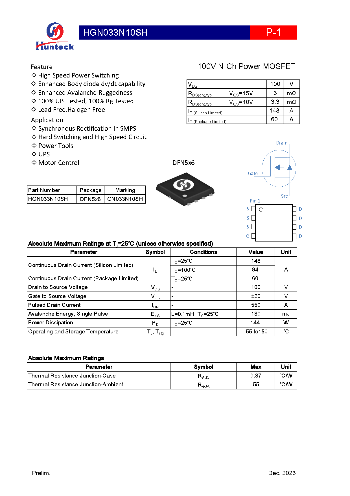
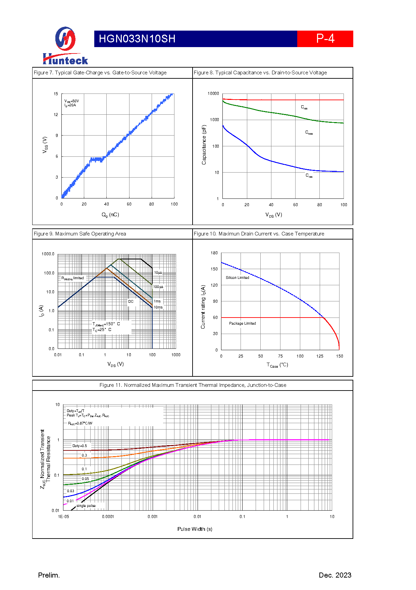

# 第五章 MOSFET 特性与选型

> 本章从**物理本质**出发，逐项讲清功率 MOSFET 的规格书参数、工作状态、以及**不同工况 / 用途下该看重哪些参数**；并用一颗 100 V N-MOS（HGN033N10SH）的规格书做**逐页实例分析**，最后给出损耗计算、SOA 读法、雪崩校核与 PMOS/NMOS 的区别。
>
> 参考：NXP《The Power MOSFET Application Handbook — Design Engineer's Guide》。

## 5.1 物理本质：MOSFET 的结构与工作区

### 5.1.1 结构

功率 MOSFET 是"金属-氧化物-半导体"结构：

- **G（栅极）**：多晶硅/金属，控制端
- **D（漏极）**、**S（源极）**：主电流两端
- **B（衬底/体）**：常与源极短接
- 栅极与沟道之间是**绝缘的氧化层（SiO₂）**——栅极几乎不流直流电流

### 5.1.2 工作原理

- 栅极加电压 → 电场**穿过氧化层** → 在半导体表面"吸"出**反型层（沟道）**
- NMOS：VGS > VTH → 吸引电子 → 形成 N 型沟道 → 源漏导通
- **|VGS| 越大 → 反型层载流子越多 → 沟道电阻越小**
- 栅极电压撤去 → 反型层消失 → 沟道截止

**物理本质**：**用电场控制电荷（载流子），用电荷控制电阻和电流**。栅极是"阀门"，VGS 决定开多大。

### 5.1.3 三个工作区

| 区域 | 条件（NMOS） | 特点 | 像什么 |
| --- | --- | --- | --- |
| **截止区** | VGS < VTH | 沟道未形成，几乎不导通 | 断开的开关 |
| **线性区（三极管区）** | VDS < VGS − VTH | 沟道连续，电流随 VDS 线性变化 | 可变电阻 |
| **饱和区** | VDS > VGS − VTH | 沟道在漏端夹断，电流基本恒定 | 电流源 |

**物理本质**：线性区是"电阻"（开关导通用），饱和区是"恒流源"（放大用）。功率开关正常时工作在**截止区**与**线性区**之间切换，饱和区只在切换瞬间短暂经过。

## 5.2 规格书参数详解

规格书一般分四块：**极限值（Limiting values）→ 热特性（Thermal）→ 电气特性（Static / Dynamic）→ 特性曲线**。下面逐项讲。

### 5.2.1 极限值（Limiting values）

| 参数 | 含义 | 注意 |
| --- | --- | --- |
| **VDS** | 漏源最大耐压 | 在 25℃ 以上成立；**低于 25℃ 时会下降**（雪崩击穿电压有正温度系数） |
| **VGS** | 栅源最大耐压（常见 ±20 V） | 超过会击穿栅氧；栅氧寿命随温度/电压下降而降低 |
| **VDGR** | 漏栅最大耐压 | 一般等于 VDS |
| **ID** | 连续漏极电流 | 取决于**封装结构**或**最大 Tj**，两者取小；高温要降额 |
| **IDM** | 脉冲漏极电流 | 一般指 10 µs 以内的脉冲 |
| **Ptot** | 最大连续功耗 | 在壳温 25℃ 下、使 Tj 达到最大值的功率；反映**热性能** |
| **Tj** | 结温范围 | 通常 -55~150/175℃ |
| **EAS** | 单次雪崩能量 | 感性负载关断时吸收的能量 |

**降额曲线**：极限值表和降额曲线一起看。例如"连续漏极电流 vs 壳温"曲线，25℃ 时 61.8 A，75℃ 时降到 50 A，175℃ 时降到 0。

**降额的物理本质**：电流/功率的极限，本质是"结温不能超过最大值"。结温 = 壳温 + 功耗 × 热阻，所以壳温越高，允许的功耗/电流越小。

### 5.2.2 静态特性

| 参数 | 含义 | 温度特性 | 工程意义 |
| --- | --- | --- | --- |
| **V(BR)DSS** | 漏源击穿电压 | **正温度系数**（温度↑ 击穿电压↑） | 低温时耐压降低，要留裕量 |
| **VGS(th)** | 阈值电压 | **负温度系数**（温度↑ 阈值↓） | 高温时更容易误开通 |
| **IDSS** | 漏极漏电流（关断时） | **随温度急剧增大**（25℃ 0.02µA → 175℃ 500µA） | 高温关断损耗、电池待机功耗 |
| **IGSS** | 栅极漏电流 | 与温度基本无关（绝缘层） | 计算保持导通所需电流 |
| **RDS(on)** | 导通电阻 | **正温度系数**（温度↑ R↑） | 算损耗必须按高温取值 |
| **gfs** | 跨导 | — | VGS 变化引起 ID 变化的能力 |

**归一化 RDS(on) 曲线**（Fig 4）：横轴 Tj，纵轴"相对 25℃ 的倍数"。常见 125℃ 时约 1.8 倍——**算损耗时若用 25℃ 的 RDS(on)，会严重低估**。

**阈值电压的定义**：规格书的 VGS(th) 是在"VDS = VGS、漏极电流为某个小值（如 250µA）"下测的，用于量产测试；它和"器件物理意义上的开启点"略有差异。

### 5.2.3 动态特性

| 参数 | 含义 | 关键点 |
| --- | --- | --- |
| **Qg** | 总栅极电荷 | 驱动损耗 ∝ Qg |
| **Qgs** | 栅源电荷 | VGS 升到平台所需电荷 |
| **Qgd** | 栅漏（米勒）电荷 | VDS 变化所需电荷，**决定平台长度** |
| **Ciss** | 输入电容 = Cgs + Cgd | 决定开关时间 |
| **Coss** | 输出电容 = Cds + Cgd | 影响开关损耗 / ZVS |
| **Crss** | 反向传输电容 = Cgd | 米勒电容，影响振荡 / 直通 |
| **td(on)/tr** | 开通延迟 / 上升时间 | 与驱动条件强相关 |
| **td(off)/tf** | 关断延迟 / 下降时间 | 同上 |

**注意**：电容随 VDS 变化（Fig 8），所以**看栅极电荷比看电容更准**——电荷是电容对电压的积分，能直接反映"要多少电荷"。

### 5.2.4 体二极管

| 参数 | 含义 | 工程意义 |
| --- | --- | --- |
| **VSD** | 体二极管正向压降 | 死区续流损耗 |
| **trr / Qrr** | 反向恢复时间 / 电荷 | 死区续流、EMI、尖峰 |

体二极管在"第三象限"（同步整流、死区续流）时工作，是 MOSFET 的"隐藏"二极管。

### 5.2.5 热特性

| 参数 | 含义 |
| --- | --- |
| **RθJC** | 结到壳热阻（稳态） |
| **RθJA** | 结到环境热阻（稳态） |
| **ZθJC** | 瞬态热阻抗（随脉冲宽度、占空比变化） |

**物理本质**：热阻像"电阻"，热容像"电容"，芯片到壳是一个 **RC 热网络**。短脉冲时"热容"起主导（Zth 小），长脉冲/直流时"热阻"起主导（Zth → Rth）。

### 5.2.6 雪崩特性

- **EAS**：单次雪崩能量（感性负载关断时吸收）
- **UIS 测试**：Unclamped Inductive Switching（无钳位感性开关），验证雪崩能力

## 5.3 Qgd（米勒电荷）与 Miller 效应

### 5.3.1 栅极电荷曲线的三段

看规格书的 **栅极电荷曲线（Fig 7）**，VGS-Qg 关系分三段：

1. **Qgs 段**：VGS 从 0 升到平台电压，给 Cgs 充电
2. **Qgd 段（米勒平台）**：VGS 基本不变，VDS 快速变化，**栅极电流全部给 Cgd 充放电**
3. **平台之后**：VDS 已接近导通，继续给 Cgs 充电到最终驱动电压

### 5.3.2 米勒平台怎么产生

- 当 VGS 升到"能让负载电流流过"的电压时，VDS 开始快速下降
- VDS 下降 → Cgd 两端电压变化 → 需要大量电荷
- **栅极电流被 Cgd "吃掉"** → VGS 停住不动 → 平台

### 5.3.3 Qgd 怎么影响

- **Qgd 大 → 平台越长 → VDS 变化越慢 → 开关越慢 → 开关损耗越大**
- 同时，Qgd 大也意味着 Cgd（Crss）大 → **米勒耦合强 → 更容易振荡、对管更易误导通**
- 高压应用 Qgd 更大（平台随 VDS 增高而变长）

## 5.4 Cgs / Ciss 与开关时间

栅极回路的电流（驱动电流 Ig）给 Ciss 充电：

$$
\frac{dV_{GS}}{dt} = \frac{I_{g}}{C_{iss}} \qquad (5.1)
$$

- **Ciss 大 → VGS 上升慢 → 开关时间长**
- 开关时间大致与 `Ciss · ΔVGS / Ig` 成正比
- 所以 **Ciss 决定"开关有多快"，Qg 决定"驱动要花多少电荷/多少驱动损耗"**

## 5.5 不同工况下看重哪些参数

| 工况 | 首先看重的参数 | 原因 |
| --- | --- | --- |
| **低频、大电流**（电源主开关） | **RDS(on)**、ID | 导通损耗占主导 |
| **高频开关**（SMPS） | **Qg、Coss、Crss** | 开关损耗、驱动损耗占主导 |
| **高压** | **VDS、SOA** | 耐压与安全工作区 |
| **感性负载 / 电机** | **EAS、SOA** | 关断时电感能量靠雪崩吸收 |
| **同步整流** | **体二极管 VSD、trr、Qrr** | 死区续流损耗 |
| **桥式 / 半桥** | **Qgd、Crss** | 米勒振荡、直通风险 |
| **电池 / 低功耗** | **VGS(th)、低 VGS 下 RDS(on)** | 低驱动电压下仍要导通好 |
| **线性模式**（如电子负载） | **SOA、ZTC 点** | 线性区热失控风险 |

## 5.6 规格书分析：HGN033N10SH（100 V N-MOS）

> Huntcek HGN033N10SH，DFN5x6 封装。下面逐页精读。

### 5.6.1 P1：特性、封装、极限值

**产品定位**：

- 100 V N-Ch Power MOSFET
- 高速功率开关、增强体二极管 dv/dt、增强雪崩耐量
- 100% UIS 测试、100% Rg 测试
- 应用：同步整流、硬开关、电动工具、UPS、电机控制

**极限值精读**：

| 参数 | 值 | 解读 |
| --- | --- | --- |
| VDS | 100 V | 实际工作电压要留 1.5~2 倍裕量 |
| VGS | ±20 V | 超过会击穿栅氧 |
| ID（硅限） | 148 A | 芯片本身能承受的电流（理论值） |
| ID（封装限） | 60 A | **封装/键合线**能承受的电流（实际受此限制） |
| IDM | 550 A | 脉冲电流 |
| EAS | 180 mJ | 单脉冲雪崩能量 |
| PD（25℃） | 144 W | 反映热性能 |
| RθJC | 0.87 ℃/W | 结到壳热阻 |
| RθJA | 55 ℃/W | 结到环境热阻（无散热器时） |

**重点**：**硅限 148 A 和封装限 60 A 差了 2 倍多**——真实可用电流受**封装**限制。选型时看"封装限"，不是"硅限"。

### 5.6.2 P2：静态 / 动态 / 体二极管特性

**静态特性精读**：

| 参数 | 值 | 解读 |
| --- | --- | --- |
| VGS(th) | 3~5 V（typ 3.8） | **阈值较高**，驱动电压要够（10~15V 才能充分导通） |
| RDS(on) | 3 mΩ@15V / 3.3 mΩ@10V（max 4 mΩ） | 导通电阻很小，但**10V 驱动下比 15V 略大** |
| gfs | 60 S | 跨导大，导通能力强 |
| RG | 1.8 Ω | 内部栅极电阻，影响开关速度 |

**动态特性精读**：

| 参数 | 值 | 解读 |
| --- | --- | --- |
| Ciss | 5727 pF | **输入电容大 → 开关较慢** |
| Coss | 1627 pF | 输出电容中等 |
| Crss | 21 pF | **米勒电容很小** → 抗振荡能力强 |
| Qg(15V) | 98 nC | 总栅极电荷 |
| Qg(10V) | 65 nC | 10V 驱动时电荷更少 |
| Qgs | 26 nC | 栅源电荷 |
| Qgd | **10 nC** | **米勒电荷很小 → 平台短、开关快** |
| tr / tf | 18 ns / 12 ns | 开关较快 |

**体二极管**：

| 参数 | 值 | 解读 |
| --- | --- | --- |
| VSD | 0.98 V（typ） | 死区续流压降，比普通二极管高 |
| trr | 61 ns | 反向恢复时间 |
| Qrr | 79 nC | 反向恢复电荷，影响死区损耗与 EMI |

**综合判断**：这是一颗**低 RDS(on)、高电流、米勒电容小**的管子，适合**同步整流、硬开关、电机驱动**；但 **Ciss 大（5727pF）**，开关速度受驱动能力限制，需要较强的驱动器。

### 5.6.3 P3：输出特性、转移特性、RDS(on) 曲线

- **Fig 1 输出特性（ID-VDS）**：VGS 越大，曲线越陡 → 直观体现"线性区/饱和区"
- **Fig 2/3 RDS(on)-VGS/ID**：VGS 低于 ~7V 时 RDS(on) 急剧上升 → **驱动电压不能太低**
- **Fig 4 归一化 RDS(on)-Tj**：**温度越高 RDS(on) 越大**（125℃ 约 1.8 倍）→ 算损耗必须按高温值
- **Fig 5 转移特性（ID-VGS）**：体现阈值与跨导；温度升高，曲线左移（阈值下降）
- **Fig 6 体二极管正向特性（IS-VSD）**：死区续流时的压降与温度关系

### 5.6.4 P4：栅极电荷、电容、SOA、热阻

- **Fig 7 栅极电荷曲线**：能清楚看到 **米勒平台**（VGS 在 5V 附近有一段平），平台对应的电荷就是 Qgd
- **Fig 8 电容-电压曲线**：Ciss 基本不随 VDS 变；Coss、Crss 随 VDS 变化
- **Fig 9 SOA 曲线**：详见 5.7
- **Fig 10 电流-壳温**：硅限、封装限两条线，封装限 60A 一直平到 ~125℃ 才下降
- **Fig 11 瞬态热阻抗**：不同占空比、不同脉宽下的 Zth，用于短脉冲结温计算

### 5.6.5 用这颗管子做一个算例

设应用：Vin=48V，ID=30A，开关频率 100kHz，VGS=10V，TC=80℃。

**① 导通损耗**：先按高温取 RDS(on)。若 Tj≈150℃，RDS(on)(10V) 从 3.3mΩ 升到约 1.8 倍 ≈ 5.9mΩ。

$$
P_{cond} = 30^{2} \times 5.9\text{ m}\Omega \approx 5.3\text{ W} \qquad (5.2)
$$

**② 开关损耗**（近似）：

$$
P_{sw} \approx \frac{1}{2} \times 48 \times 30 \times (18 + 12)\text{ ns} \times 100\text{ kHz} \approx 2.16\text{ W} \qquad (5.3)
$$

**③ 驱动损耗**：

$$
P_{gate} = Q_{g} \cdot V_{GS} \cdot f_{sw} = 65\text{ nC} \times 10\text{ V} \times 100\text{ kHz} \approx 0.065\text{ W} \qquad (5.4)
$$

**④ 总损耗**≈ 7.5 W，按 RθJC=0.87℃/W 算结温：约 80 + 7.5×0.87 ≈ **86.5℃**，在安全范围内。

（实际还要算 Coss、体二极管、死区损耗，见 5.9。）

## 5.7 SOA 曲线怎么读（深入）

SOA（Safe Operating Area）是 **ID-VDS 平面上的允许工作区域**，由 5 条边界围成：

| 区域 | 边界 | 公式/含义 |
| --- | --- | --- |
| **(1) RDS(on) 限制** | 左边界 | `I_D = V_DS / R_DS(on)`，管子完全导通时 |
| **(2) 最大脉冲电流** | 上边界 | `I_D = I_DM`，受封装/键合线限制 |
| **(3) 最大功率线** | 斜线 | `V_DS × I_D = P`，受瞬态热阻抗限制 |
| **(4) 最大电压** | 右边界 | `V_DS = V_BR` |
| **(5) 线性模式降额** | 右下斜线 | **偏离理想**：低电流、高压时进入**正反馈/热失控** |

### 5.7.1 为什么区域 (5) 会"凹进去"

MOSFET 同时有两股趋势随温度变化：

- **阈值电压下降**（温度↑ → VGS(th)↓）→ 更容易导通 → 电流↑
- **电阻上升**（温度↑ → RDS(on)↑）→ 电流↓

- **大电流时电阻占主导** → 负反馈 → 稳定
- **小电流时阈值下降占主导** → 正反馈 → **局部热点 → 热失控**

这个临界点叫 **ZTC 点（零温度系数点）**。所以 SOA 在"低电流、高压"区域会**收缩**，选型/校验时必须注意。

### 5.7.2 SOA 的温度降额

SOA 默认 **Tc=25℃、单脉冲**。如果壳温更高，要按"允许温升"比例降额：

$$
\text{降额系数} = \frac{T_{j(max)} - T_{c}}{T_{j(max)} - 25} \qquad (5.5)
$$

例：Tj(max)=150℃，Tc=100℃ → 降额系数 = (150−100)/(150−25) = 0.4，即允许功率只有 25℃ 时的 40%。

## 5.8 MOS 损耗计算（含算例）

### 5.8.1 导通损耗

$$
P_{cond} = I_{rms}^{2} \cdot R_{DS(on)}(T_{j}) \qquad (5.6)
$$

**必须按实际结温取 RDS(on)**（温度升高，R 增大）。

### 5.8.2 开关损耗

$$
P_{sw} \approx \frac{1}{2} V_{DS} I_{D} (t_{r} + t_{f}) f_{sw} \qquad (5.7)
$$

### 5.8.3 驱动损耗

$$
P_{gate} = Q_{g} \cdot V_{GS} \cdot f_{sw} \qquad (5.8)
$$

### 5.8.4 输出电容损耗（硬开关）

$$
P_{oss} = \frac{1}{2} C_{oss} V_{DS}^{2} f_{sw} \qquad (5.9)
$$

### 5.8.5 死区体二极管损耗

$$
P_{body} = V_{SD} \cdot I_{D} \cdot t_{dead} \cdot f_{sw} \qquad (5.10)
$$

### 5.8.6 结温校验

$$
T_{j} = T_{C} + P_{total} \cdot R_{\theta JC} \qquad (5.11)
$$

（短脉冲用瞬态热阻抗 ZθJC，长脉冲/直流用 RθJC。）

## 5.9 雪崩参数（深入）

### 5.9.1 什么是雪崩

感性负载（电机、继电器）关断瞬间，电感电流不能突变，会产生高压尖峰。当 VDS 超过击穿电压，MOS 进入**雪崩击穿**，把电感能量吸收掉。

**UIS 测试（Unclamped Inductive Switching）**：用无钳位电感验证——开通充电、关断后电流经电感续流，VDS 被钳在击穿电压，直到电流归零。

### 5.9.2 关键公式

击穿电压（典型取额定值的 1.3 倍）：

$$
V_{BR} \approx 1.3 \times V_{DS(rated)} \qquad (5.12)
$$

电流衰减率：

$$
\frac{dI}{dt} = -\frac{V_{BR}}{L} \qquad (5.13)
$$

雪崩时间：

$$
t_{AL} = \frac{L \cdot I_{AS}}{V_{BR}} \qquad (5.14)
$$

单次雪崩能量（三角波）：

$$
E_{AS} = \frac{1}{2} V_{BR} I_{AS} t_{AL} = \frac{1}{2} L I_{AS}^{2} \qquad (5.15)
$$

峰值雪崩功率：

$$
P_{AS} = V_{BR} \cdot I_{AS} \qquad (5.16)
$$

温升：

$$
\Delta T_{j} = P_{AS} \cdot Z_{th}(t_{AL}/2) \qquad (5.17)
$$

### 5.9.3 单次 vs 重复雪崩

| | 单次雪崩 | 重复雪崩 |
| --- | --- | --- |
| 场景 | 故障（过压） | 设计上允许反复发生 |
| 限制 | Tj ≤ Tj(max) | 还要满足**平均结温**限制 |
| 校核 | EAS + 温升 | 重复雪崩 SOAR 曲线 + 平均温升 |

**选型要点**：感性负载（电机、继电器）必须校核 **EAS**，并确保实际关断能量 < EAS。

## 5.10 PMOS 与 NMOS

### 5.10.1 物理区别

| | **NMOS** | **PMOS** |
| --- | --- | --- |
| 沟道载流子 | **电子** | **空穴** |
| 衬底 | P 型 | N 型 |
| 导通条件 | VGS > VTH（正压） | VGS < VTH（负压） |
| 同尺寸 RDS(on) | **更低**（电子迁移率高） | 更高（约 2~3 倍） |
| 成本 | 低 | 高 |
| 开关速度 | 快 | 慢（空穴迁移率低） |

### 5.10.2 用途区别

| | 典型用途 | 原因 |
| --- | --- | --- |
| **NMOS** | 低边开关、同步整流、电机驱动下管、大部分功率场合 | 性能好、便宜、效率高 |
| **PMOS** | 高边开关（栅极拉低即导通）、电源防反接、LDO 的 pass 管 | **高边驱动简单**，不用自举 |

**核心**：**NMOS 性能好、便宜，是主力；PMOS 胜在"高边驱动简单"**（源极接高电位，栅极拉低就导通）。

## 5.11 按用途选型

| 用途 | 选型要点 |
| --- | --- |
| **同步整流（SMPS）** | 低 RDS(on)、低 VSD、小 Qrr |
| **硬开关 / 高频** | 小 Qg、小 Qgd、小 Crss |
| **电机驱动（半桥 / 全桥）** | 低 RDS(on)、足够 EAS/SOA、小 Qgd（防直通） |
| **电源主开关（低频大电流）** | 低 RDS(on)、大 ID（看**封装限**） |
| **电池 / 便携（低驱动电压）** | 低 VGS(th)、低 VGS 下 RDS(on) 仍小 |

## 5.12 选型流程总结

1. **定电压**：VDS ≥ 1.5~2 × 实际最高电压（含尖峰）
2. **定电流**：ID（**看封装限**）≥ 1.5~2 × 峰值电流，且高温降额
3. **定导通**：按损耗预算选 RDS(on)（按高温取值）
4. **定开关**：按频率选 Qg、Coss、Crss
5. **定可靠性**：校核 SOA、EAS、热阻
6. **定类型**：低边 / 同步整流用 NMOS；高边简单驱动用 PMOS
