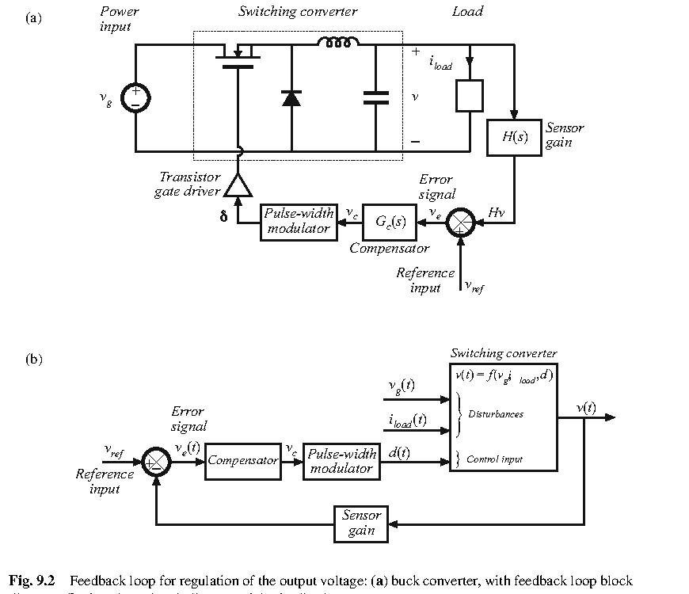
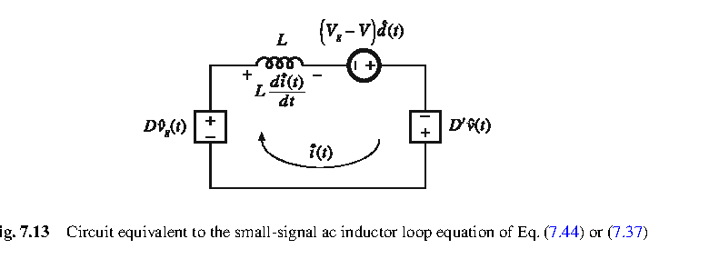
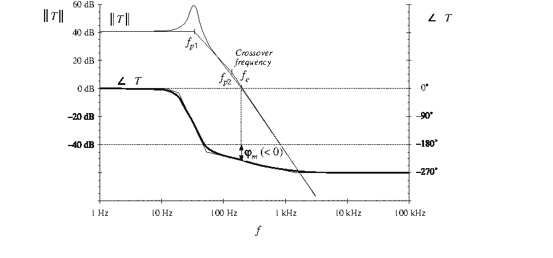
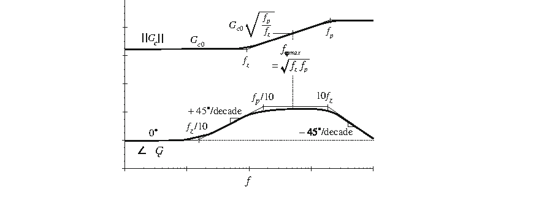

# 第四章 系统环路

> 本章从"环路"的角度讲如何设计开关电源：把电源当作**闭环控制系统**，从建模、稳定性、补偿到验证，一步步讲清"**为什么、会怎么样、如何改**"。
>
> 参考：Erickson & Maksimović《Fundamentals of Power Electronics》(3rd Ed.) 第 7~9 章。

## 4.1 为什么从"环路"角度看开关电源

### 4.1.1 开环不够用

只按 `V_out = D·V_in` 设计（第一章），只能保证"名义上"的输出。实际中：

- 输入电压会变、负载会跳、器件有误差
- 开环下这些扰动**全部直接反映到输出**，没有"纠错"能力

### 4.1.2 闭环：通过负反馈修正输出偏差

把输出采样回来，与基准比较，误差经补偿器 → 调占空比 → 将输出调节回目标值。这就是**反馈环路**。

**图中读什么**：

- **(a) 图**：虚线框内为 Buck 主回路（开关管、二极管、电感 L、电容 C），右侧为负载与采样分压 H(s)。
- **信号流**：采样电压 Hv 与基准 vref 比较得到误差信号 ve，经补偿器 Gc(s) 得到控制量 vc，再由 PWM 调制器转换为占空比 d，驱动开关管。
- **(b) 图**：功能框图把功率级抽象为受控源；前向通路为"补偿器 → PWM → 功率级"，反馈通路为"传感器 H(s)"。
- **要点**：前向与反馈在此闭合成环，环路的稳定性与动态特性均由这条闭合路径决定。

环路三要素：

| 环节 | 符号 | 作用 |
| --- | --- | --- |
| 功率级 | Gvd(s) | 占空比 D → 输出电压 |
| 补偿器 | Gc(s) | 误差放大器 + 补偿网络 |
| 反馈 | H(s) | 输出电压分压采样 |

**物理本质**：闭环是"**通过误差反馈修正输出偏差**"——误差越大，补偿器输出越大，把占空比往反方向调，直到误差趋近于零。

## 4.2 环路建模：从开关波形到小信号模型

### 4.2.1 为什么要建模

开关电源是**非线性、时变**的（开关在通/断之间跳）。要分析环路，必须把它变成"线性、时不变"的模型——方法是**平均 + 小信号线性化**。

### 4.2.2 平均模型

- 在一个开关周期内，对电感电压、电容电流**求平均**（第一章的伏秒/安秒平衡就是它的特例）
- 平均后，开关的"通/断"被抹平成连续的"占空比 D"
- 得到**平均模型**：用受控源代替开关

### 4.2.3 小信号线性化

- 在稳态工作点附近，给变量加"小扰动"：`d = D + d̂`、`v = V + v̂`
- 忽略二阶小量（`d̂·v̂` 项），得到**线性小信号模型**
- 图 7.13 就是小信号模型的电感回路等效电路：受控源 + 理想变压器

**图中读什么**：

- **L**：电感，其端电压 L·dî/dt 等于回路中三个受控源电压之和。
- **D·v̂g**：输入电压扰动 v̂g 经占空比 D 折算后的受控源。
- **D′·v̂**：输出电压扰动 v̂ 经 D′（=1−D）折算后的受控源。
- **(Vg−V)·d̂**：占空比扰动 d̂ 引入的受控源，是"控制输入"对回路的激励。
- **要点**：三个受控源分别对应"输入扰动、输出扰动、占空比扰动"；占空比扰动经 (Vg−V)·d̂ 改变电感电流，进而改变输出电压——这正是 Gvd(s) 的物理来源。

### 4.2.4 功率级传递函数 Gvd(s)

对小信号模型求解，得到"占空比扰动 → 输出扰动"的传递函数。以 Buck 为例：

$$
G_{vd}(s) = \frac{V_{in}}{1 + \frac{s}{Q\omega_0} + \left(\frac{s}{\omega_0}\right)^{2}} \qquad (4.1)
$$

**逐项解读**：

- **Vin**：直流增益
- **ω0 = 1/√(LC)**：LC 双极点频率（储能元件的"惯性"）
- **Q = R√(C/L)**：品质因数，决定谐振峰高低
- **分母二次项**：LC 谐振，会在 ω0 处产生 −180° 相位跌落

**物理本质**：LC 双极点来自"**电感电流和电容电压不能突变**"——储能元件有惯性，输出对占空比的响应会"先慢后振"。

> **融会贯通**：这里的 L、C 正是[第三章 3.2/3.3](第三章-电源原理图常识.md) 讲的储能元件；Boost/Buck-Boost 还多一个**右半平面零点（RHP zero）**，见 4.3.4。

## 4.3 稳定性分析：为什么环路会振荡

### 4.3.1 环路增益 T(s)

环路增益 = 前向增益 × 反馈增益：

$$
T(s) = G_{c}(s) \cdot G_{vd}(s) \cdot H(s) \qquad (4.2)
$$

闭环传递函数里到处是 `1/(1+T)`：**T 大 → 扰动被压制、输出跟随基准；T 小 → 扰动放大**。

### 4.3.2 相位裕度（Phase Margin）

在穿越频率 ωc（|T|=1，0 dB）处，相位离 −180° 的余量：

$$
\text{PM} = 180° + \angle T(j\omega_{c}) \qquad (4.3)
$$

**图中读什么**：

- **上半图（幅频）**：|T| 在低频保持高增益，在 fp1、fp2 附近出现谐振峰后下降；|T| 穿过 0 dB 的频率即**穿越频率 fc**。
- **下半图（相频）**：∠T 从 0° 开始，依次经过 −90°、−180°；在 fc 处的相位与 −180° 之差即**相位裕度 PM**（图中 φm）。
- **读图顺序**：先由 0 dB 交点确定 fc，再读 ∠T(fc)，最后计算 PM。
- **判据**：PM > 0 → 稳定；PM 过小 → 超调/振荡；PM < 0 → 不稳定（本图为负相位裕度，属不稳定示例）。

**物理本质**：相位裕度 = "**离'正反馈振荡'还有多少余量**"。PM 越大越稳，但太大又慢。

### 4.3.3 相位裕度 ↔ 阻尼比 ↔ 动态响应

二阶系统里，PM 和阻尼比 ζ 近似对应：

$$
\zeta \approx \frac{\text{PM}}{100} \qquad (4.4)
$$

（PM 用"度"代入的工程近似）

- PM 45°~60° → ζ 0.45~0.6 → 有一定超调、响应较快
- PM 太小 → ζ 小 → 超调大、振铃
- PM 太大 → 过阻尼 → 响应慢

**物理本质**：相位裕度不足 = 系统"欠阻尼"，扰动后要经过数次振荡后才稳定。

### 4.3.4 右半平面零点（RHP zero）

Boost/Buck-Boost/Flyback 在 CCM 下，Gvd(s) 里有一个**右半平面零点**：

- 它**不改变幅频**（|T| 不变），却**额外贡献 −90° 相位**
- 结果：相位掉得更快 → **限制穿越频率**（带宽上不去）
- 物理原因：能量"先存到电感、再放到输出"，占空比增大瞬间输出反而先降——"**变化方向与预期相反**"

**影响**：RHP 零点频率越低，环路越难做快。其频率（Boost/Buck-Boost CCM）约为：

$$
\omega_{RHP} = \frac{R(1-D)^{2}}{L} \qquad (4.8)
$$

- D 越大 → ωRHP 越低 → 环路越难做快
- 所以 Boost 在"大占空比（升压比大）"时特别难补偿

## 4.4 补偿器设计：怎么让环路稳定

### 4.4.1 补偿器类型

| 类型 | 零极点 | 作用 | 适用 |
| --- | --- | --- | --- |
| **PD（超前）** | 1 零点 + 1 高频极点 | 提相位（补 LC 滞后） | 电压模式 |
| **PI（滞后）** | 1 积分 + 1 零点 | 提低频增益、消稳态误差 | 电流模式 |
| **PID（组合）** | 1 积分 + 2 极点 + 2 零点 | 兼顾低频增益与相位 | 高要求 |

### 4.4.2 零极点配置：PD 补偿器

PD 补偿器传递函数：

$$
G_{c}(s) = G_{c0}\frac{1 + \frac{s}{\omega_{z}}}{1 + \frac{s}{\omega_{p}}} \qquad (4.5)
$$

**图中读什么**：

- **上半图（幅频）**：低频增益为 Gc0；在零点 fz 之后以一定斜率上升，在极点 fp 之后趋于平坦。
- **下半图（相频）**：相位在 fz 与 fp 之间抬升，最大相位提升出现在几何平均频率 fφmax = √(fzfp) 处。
- **设计要点**：令 fφmax 对准穿越频率 fc，即可在 fc 处获得最大的相位裕度提升。
- 图中标注的 +45°/decade、−45°/decade 是渐近线斜率，用于快速估算而非精确计算。

**怎么设计**：

1. 零点放在 LC 双极点附近，**补回 −180° 相位**
2. 最大相位提升频率是零极点的几何平均：

$$
f_{\varphi max} = \sqrt{f_{z} f_{p}} \qquad (4.6)
$$

3. 要让 fφmax 落在穿越频率 fc 上
4. 按需要的相位提升 θ 选零极点比：

$$
\frac{f_{p}}{f_{z}} = \frac{1 + \sin\theta}{1 - \sin\theta} \qquad (4.7)
$$

**物理本质**：补偿器 = "**给环路加零极点，重塑增益和相位**"——零点"提相位"，极点"压高频"。

### 4.4.3 PI / PID 补偿器

**PI（滞后）**：

$$
G_{c}(s) = G_{c0}\left(1 + \frac{\omega_{z}}{s}\right) \qquad (4.9)
$$

- 低频时增益 ∝ 1/s（积分）→ **消除稳态误差**
- 零点 ωz 补偿低频段相位
- 电流模式控制常用

**PID（组合）**：

$$
G_{c}(s) = G_{c0}\frac{(1 + s/\omega_{z1})(1 + s/\omega_{z2})}{s(1 + s/\omega_{p1})(1 + s/\omega_{p2})} \qquad (4.10)
$$

- 积分 → 提高低频增益；两个零点 → 补相位；两个极点 → 压高频
- 兼顾"稳态精度"和"动态响应"

**怎么选**：电流模式常用 PI；电压模式常用 PD / PID；要求高就用 PID。

## 4.5 环路测量与验证

### 4.5.1 电压注入法

在反馈回路串一个小电阻，注入小交流扰动，测 `T = v_out/v_inj` 的幅频/相频。

### 4.5.2 电流注入法

在反馈节点注入电流扰动，测环路增益（适合高阻抗节点）。

### 4.5.3 为什么必须实测

- 模型忽略了寄生参数、ESR、延迟
- 实测 Bode 图能验证相位裕度、发现模型没预测到的谐振

## 4.6 环路设计流程

### 4.6.1 确定功率级传递函数 Gvd(s)

补偿器的设计以被控对象为前提。缺少 Gvd(s)，就无法确定 LC 双极点的位置、RHP 零点的影响以及 ESR 零点的作用，补偿器的零极点也就无从配置。工程上应先用平均模型与小信号模型推导 Gvd(s)，再以仿真或实测 Bode 图校核。若跳过这一步直接试凑参数，往往难以收敛，甚至出现自激振荡。

### 4.6.2 选择穿越频率 fc

穿越频率决定环路带宽，进而决定动态响应速度。fc 取得过高，相位裕度不足，系统对开关噪声与扰动敏感，容易产生振荡；fc 取得过低，负载跳变时输出电压跌落大、恢复慢；若 fc 接近或超过 RHP 零点，环路将无法稳定。工程上通常取 fc < fsw/10，并相对 RHP 零点留出裕量（fc < fRHP/3~5）。若带宽无法满足要求，应从降低开关频率或调整拓扑入手。

### 4.6.3 设计补偿器

LC 双极点在穿越频率附近引入接近 −180° 的相位滞后，必须由补偿器的零点予以补偿；同时，低频段需要足够的增益以抑制稳态误差。补偿器设计不当的直接后果是相位裕度不足或低频增益不够，表现为超调、振铃或稳态误差偏大。设计时零点对准 LC 双极点、极点置于高频段以压制开关噪声，并利用积分环节提高低频增益；零极点位置按式 (4.6) 与 (4.7) 计算。

### 4.6.4 验证相位裕度

相位裕度是判断稳定性的直接依据。PM 过小（小于约 30°）时，负载跳变会引起明显振荡；PM 为负则系统不稳定。验证时应由补偿器参数重新绘制 Bode 图，确认穿越频率处的相位裕度满足要求；若不满足，需调整零极点位置，或降低 fc。

### 4.6.5 实测验证

理论模型忽略了寄生参数、传输延迟与布局效应，因此必须由实测确认。实测可采用电压注入法测量环路增益，并与设计值比较；若偏差较大，应将模型中的 ESR、延迟与寄生参数补入，重新进行 4.6.1 及后续步骤。
